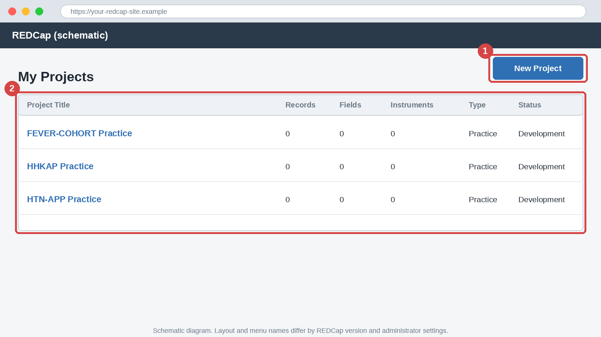
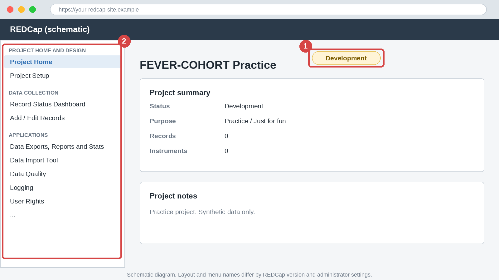
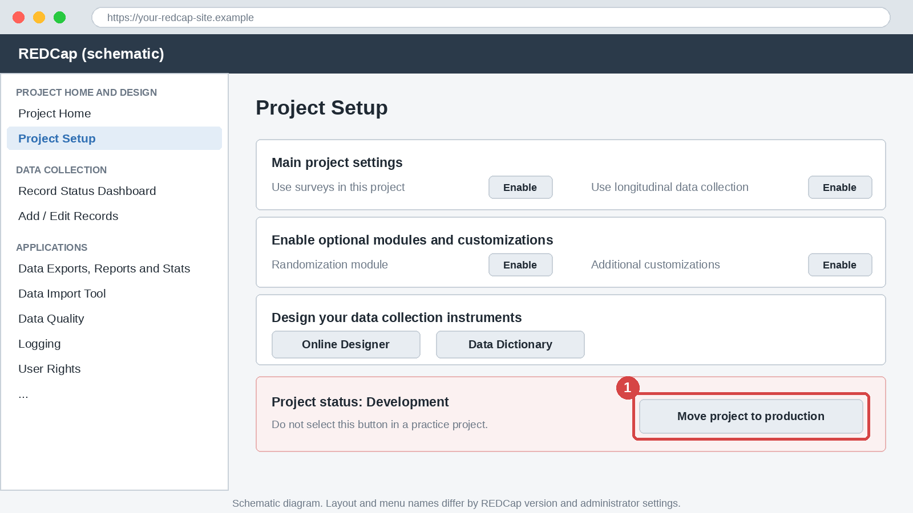

# Module 1: EDC Concepts, the REDCap Ecosystem and the Data Management Lifecycle

## Part A: English

### 1. Title block

| Item | Detail |
|------|--------|
| Module | 1 of 20 |
| Level | Beginner |
| Estimated time | 45 to 60 minutes |
| Assumed REDCap version | 14 or later. Menu names differ by version and by administrator settings. |
| Prerequisites | None. A REDCap login helps for Track A but is not required. |
| Case studies used | A (FEVER-COHORT), B (HHKAP), C (HTN-APP) |

> ⚠️ **Pitfall:** Never enter real patient data, real identifiers or real participants into a practice project. Use synthetic data only.

### 2. Learning objectives

By the end of this module you will be able to:

1. Compare spreadsheets with electronic data capture (EDC) systems for data quality, audit trail and access control.
2. Describe what REDCap is, who uses it and which project purposes and statuses exist.
3. Map the data lifecycle from protocol to archiving and assign each stage to a role.
4. Locate My Projects, Project Home, Project Setup and the left menu in a REDCap project.
5. Cite REDCap correctly in a protocol or manuscript.

### 3. Why this matters

**Data quality:** an EDC system checks values when they are typed, so errors are caught while the participant record is still fresh. A spreadsheet accepts anything.

**Analysis:** structured, coded data go to the statistician without weeks of cleaning.

**Compliance:** access control, audit trail and documented change control are expected in clinical research. A shared spreadsheet offers little of this.

**Career:** research coordinators, data managers and postdocs are often expected to build and run a REDCap project. Knowing the lifecycle shows that you can manage data for the whole study, not only enter it.

### 4. Core concepts

**Spreadsheets versus EDC**

| Feature | Spreadsheet | EDC (REDCap) |
|---------|-------------|--------------|
| Input control | Any value in any cell | Field types, validation, required fields |
| Audit trail | None or manual | Automatic log of who changed what and when |
| Access control | File-level sharing | User rights per role, per form, per site |
| Multiple users | Version conflicts | Simultaneous entry in one database |
| Data structure | Free layout | Defined variables and a data dictionary |
| Surveys | Not available | Built-in survey tools |
| Export | Copy and paste | Export to CSV, SPSS, SAS, R and Stata |

**What REDCap is.** REDCap (Research Electronic Data Capture) is a secure, web-based application for building and managing online forms and surveys. It was developed at Vanderbilt University and is shared through a consortium of institutional partners. Your institution hosts its own instance, so features and policies vary. REDCap is metadata-driven: the project design is stored as a data dictionary, which describes every variable.

**Project purposes.** When you create a project, you state its purpose: Practice or Just for fun, Operational Support, Research, Quality Improvement, or Other. Research projects usually ask for further details such as ethics approval. Verify in your REDCap instance which options and extra questions appear.

**Project statuses.** A project moves through statuses.

| Status | Meaning |
|--------|---------|
| Development | Design and testing. Changes are free and test records can be deleted. |
| Production | Live data collection. Design changes go through controlled change requests. |
| Analysis/Cleanup | Data collection is closed. Cleaning, locking and export continue. |
| Archived | Project kept for record and hidden from the active list. |

Status labels and exact behaviour differ by version. Verify in your REDCap instance.

**Roles in a research data team**

| Role | Main tasks |
|------|-----------|
| Principal investigator | Owns the protocol and approves the data management plan |
| Data manager | Writes the data dictionary, builds the project, runs data quality checks |
| Data entry staff | Enter and verify records |
| Statistician | Defines the analysis, checks the exported dataset |
| REDCap administrator | Maintains the instance, grants special features, approves production moves where required |
| Site coordinator | Manages participants and local data entry at one site |

**The data lifecycle**

1. Protocol and data management plan
2. CRF and data dictionary design
3. Build in Development status
4. Testing and user acceptance
5. Move to Production
6. Data collection and monitoring
7. Data cleaning, locking and export
8. Analysis and reporting
9. Archiving and retention

Each stage has an output. For example, stage 2 produces a data dictionary, and stage 4 produces a signed-off test log.

**Worked example.** In FEVER-COHORT, a coordinator types body temperature as "38,9" in one row, "high" in another and "385" in a third. All three are accepted by a spreadsheet. In REDCap the field `temp_c` is defined as a number between 34 and 42. The first entry is rejected for its comma format, the second is not a number, and the third is flagged as out of range. The error is fixed within seconds, not at analysis.

**The three running case studies**

| Case study | Design | Core variables |
|------------|--------|----------------|
| A: FEVER-COHORT | Prospective cohort of adults with acute febrile illness. Visits at Baseline, Day 3, Day 5, Day 7 and Day 28 | `record_id`, `enrol_date`, `dob`, `sex`, `onset_date`, `temp_c`, `wbc`, `hct`, `plt`, `hosp_admit`, `outcome_d28` |
| B: HHKAP | Knowledge, attitudes and practice survey on hand hygiene among healthcare workers | `consent`, `hcw_role`, `years_exp`, `kap_k1` to `kap_k5`, `kap_a1` to `kap_a5`, `kap_p1` to `kap_p5` |
| C: HTN-APP | Two-arm parallel randomised trial (1:1) of a smartphone self-management app versus usual care in adults with hypertension, stratified by site and baseline blood pressure category | `record_id`, `age`, `sbp_base`, `dbp_base`, `site`, `rand_group`, `sbp_wk12`, `dbp_wk12`, plus a repeating adverse event instrument |

All data in this course are synthetic.

**How to cite REDCap.** Cite both papers when you report a study that used REDCap:

- Harris PA, et al. J Biomed Inform 2009;42(2):377-381.
- Harris PA, et al. J Biomed Inform 2019;95:103208.

Also add any acknowledgement wording your institution requires. Verify with your REDCap administrator or institutional page.

### 5. Step-by-step walkthrough

This tour uses a practice project. Menu names may differ in your version.

1. Log in to your institution's REDCap site. You land on **My Projects**, the list of projects you can access.

   > 📷 **Figure 1:** My Projects page (schematic). Find (1) the New Project button and (2) the project list.

   

2. Select **New Project**. Enter the title "FEVER-COHORT Practice". Choose the purpose **Practice / Just for fun**.
3. For the starting template, choose **Empty project (create fields from scratch)**. Select **Create Project**.
4. You arrive at **Project Home**. Note the project title, the status label (Development) and the summary of project information.

   > 📷 **Figure 2:** Project Home page (schematic). Find (1) the status label and (2) the left menu.

   

5. Open **Project Setup**. Read the three blocks: main project settings, optional modules and settings, and the section on designing data collection instruments. At the bottom is the status box with the button to move the project to Production. Do not select it.

   > 📷 **Figure 3:** Project Setup page (schematic). Find (1) the Move project to production button. Do not select it in a practice project.

   

6. Read the left menu. Typical groups are Project Home and Design, Data Collection, Applications, and project administration items. Find **Record Status Dashboard**, **Add / Edit Records**, **Data Dictionary** and **Codebook**. Verify in your REDCap instance where each item sits.
7. Open **Online Designer** from Project Setup and note that the project is empty. You will add fields in Module 3.

> 💡 **Tip:** Keep one practice project per case study. Name it clearly so it is never confused with a live study.

### 6. If this is not enabled

> 🔒 **Admin-dependent:** Creating new projects may be restricted to users with that right, and some instances require administrator approval for Research projects.

**What to request from the administrator:** permission to create projects, or a practice project created for you, and a short note on the instance's rules for Production moves.

**Conceptual walkthrough without access:** use Track B in each exercise. Print or sketch the three screens (My Projects, Project Home, Project Setup) from the descriptions above and label the parts yourself.

### 7. Exercises

**Exercise 1 (guided): Interface tour and status check**

**Track A (live REDCap practice project):**

1. Create the practice project from the walkthrough.
2. Locate and note down: project status, the button for adding records, the Record Status Dashboard, and the Codebook.
3. Self-check: you can state the status without looking, and you can reach each of the four items in two clicks.

**Track B (no access):** A colleague describes Project Setup: "I see three numbered blocks, a status box at the bottom with a Production button, and a left menu with Data Collection and Applications." Write what each part does and what status the project is in.

Answer key

**Track A:** Status is Development. Record Status Dashboard and Add / Edit Records are under Data Collection. Codebook is under the design area. Exact positions: Verify in your REDCap instance.

**Track B:** The three blocks are main settings, optional modules, and instrument design. The status box controls the move to Production. The left menu groups tools by function. The project is in Development, because the Production button is still offered.

**Exercise 2 (independent): Spreadsheet audit**

A synthetic FEVER-COHORT spreadsheet is shown.

| id | enrol_date | dob | sex | temp | wbc | plt |
|----|------------|-----|-----|------|-----|-----|
| 1 | 03/04/2026 | 12-Jan-1988 | F | 38.5 | 4.2 | 120 |
| 2 | 2026-04-03 | 1990 | male | 38,9 | 3.1 | 98 |
| 3 | 4 March 26 | 05/06/1975 | M | high | 5.5 | 250 |
| 2 | 2026-04-05 | 1991 | Male | 39.2 | 3.0 | 92k |

**Track A (live REDCap practice project):**

1. Upload the file `data/M01_fever_cohort_baseline.csv` as the data dictionary of your practice project. Menu location: Verify in your REDCap instance.
2. Add one record. Enter `temp_c` as 45 and `dob` as 1990.
3. Record what each field reports.
4. Self-check: the dictionary loads without errors and both entries are challenged.

**Track B (no access):** List at least five problems in the table. For each, name the EDC feature that would prevent it. Then open `data/M01_fever_cohort_baseline.csv` in a spreadsheet and read the `Text Validation Type OR Show Slider Number`, `Text Validation Min` and `Text Validation Max` columns for `temp_c`.

Answer key

**Track B problems and preventing features:**

1. Mixed date formats and an ambiguous 03/04/2026: date validation with one format.
2. Partial date of birth (1990): date validation requiring a full date.
3. Inconsistent sex coding (F, M, male, Male): radio field with coded choices.
4. Decimal comma and text in temperature (38,9 and high): number validation with range 34 to 42.
5. Unit inconsistency in platelets (92k): numeric validation and units in the field label.
6. Duplicate id 2 for different rows: auto-numbered unique record identifier.

For `temp_c` the dictionary shows validation type `number`, minimum 34, maximum 42.

**Track A:** The 45 is flagged as out of range. Whether it is blocked or only warned: Verify in your REDCap instance. The year-only `dob` is rejected because the field expects a full date.

**Exercise 3 (challenge): Lifecycle and roles for HHKAP**

**Track A (live REDCap practice project):**

1. Create a second practice project named "HHKAP Practice".
2. Upload `data/M01_hhkap_consent_demo.csv`.
3. Write a table with the nine lifecycle stages. For each stage, give the role responsible, the output and the project status at that stage.
4. Check your statuses against the real project. It is still in Development.

**Track B (no access):** Write the same table using only the protocol summary: a single-round online survey of 200 healthcare workers.

Answer key

| Stage | Role | Output | Status |
|-------|------|--------|--------|
| 1 Protocol and plan | PI, data manager | Data management plan | Not yet created |
| 2 Design | Data manager | Data dictionary | Not yet created |
| 3 Build | Data manager | Working survey | Development |
| 4 Testing | Data manager, coordinator | Signed-off test log | Development |
| 5 Move to Production | PI, administrator if required | Live project | Production |
| 6 Collection | Coordinator, respondents | Responses | Production |
| 7 Cleaning and export | Data manager | Clean dataset | Analysis/Cleanup |
| 8 Analysis | Statistician | Results tables | Analysis/Cleanup |
| 9 Archiving | PI, data manager | Archived data and documents | Archived |

Role assignment may vary by team. The statuses before stage 3 are "not yet created" because no project exists. Variations are acceptable if each stage has a role and an output.

### 8. Quiz

**Question 1 (multiple choice).** Which feature stops a temperature of 385 from being saved without a warning?

- A. Audit trail
- B. Field validation with a range
- C. Project status
- D. Data dictionary download

Answer

B. A range on a number field checks the value at entry.

**Question 2 (multiple choice).** In which status are design changes free and test records easy to delete?

- A. Production
- B. Archived
- C. Development
- D. Analysis/Cleanup

Answer

C. Development is for building and testing.

**Question 3 (short answer).** Give two risks of storing study data in a shared spreadsheet.

Answer

Any two: no input control, no audit trail, version conflicts, weak access control. The first two affect data integrity and compliance.

**Question 4 (multiple choice).** What should be completed immediately before moving to Production?

- A. Data export
- B. Archiving
- C. User acceptance testing
- D. Statistical analysis

Answer

C. Testing confirms the design works before live data are entered.

**Question 5 (short answer).** Which role usually writes the data dictionary and builds the project?

Answer

The data manager. Local practice may assign this to a coordinator.

**Question 6 (multiple choice).** Which citations should a manuscript include for REDCap?

- A. Only the 2009 paper
- B. Only the 2019 paper
- C. Both the 2009 and 2019 papers
- D. None, because it is a free tool

Answer

C. Harris et al. 2009 and Harris et al. 2019 are both requested.

**Question 7 (short answer).** In Case Study C, which variable records the allocated arm?

Answer

`rand_group`.

### 9. Common pitfalls

> ⚠️ **Pitfall:** Treating REDCap as a spreadsheet with a login. Design variables, codes and validation first.

> ⚠️ **Pitfall:** Entering real participant data into a practice project. Use synthetic data only.

> ⚠️ **Pitfall:** Building directly in a live project. Always build and test in Development, then move to Production.

> ⚠️ **Pitfall:** Skipping the data management plan. Without it, roles and rules are unclear when problems arise.

> ⚠️ **Pitfall:** Forgetting that features vary by instance. Check with your administrator before planning around a feature.

### 10. Career tips

> 🎯 **Career tip:** State "designed and managed a REDCap project from protocol to archiving" on your CV, with the study type and sample size.

> 🎯 **Career tip:** In grant and protocol data sections, name the lifecycle stages and the roles responsible. Reviewers look for a clear data plan.

> 🎯 **Career tip:** Add both REDCap citations to every manuscript that used the tool. Editors and collaborators check for it.

### 11. Downloadable files

| File | Contents | How to use |
|------|----------|------------|
| [M01_fever_cohort_baseline.csv](data/M01_fever_cohort_baseline.csv) | Partial FEVER-COHORT baseline instrument with 10 fields and validation | Upload as a data dictionary in Exercise 2, or read in a spreadsheet |
| [M01_hhkap_consent_demo.csv](data/M01_hhkap_consent_demo.csv) | Partial HHKAP survey with consent, role, experience and two knowledge items | Upload in Exercise 3, or read in a spreadsheet |

Open CSV files in a text editor or import them as UTF-8 text so that values are not auto-formatted.

### 12. Key takeaways

- EDC systems check data at entry, keep an audit trail and control access. Spreadsheets do none of these reliably.
- REDCap is metadata-driven: the data dictionary defines the project.
- A project moves from Development to Production to Analysis/Cleanup and finally Archived.
- The data lifecycle has nine stages, and each stage has a role and an output.
- Cite both REDCap papers and follow your institution's requirements.

### 13. Next module

Next: [Module 2, Planning before building](../02_planning_before_building/Module_02_planning_before_building.md).

Topics: protocol to data collection schedule to CRF to variable list, naming and coding conventions, and a draft data dictionary.

### 14. Version table

| Version | Date |
|---------|------|
| 1.0 | 2026-10-04 |

---

## Part B: Burmese

### 1. ခေါင်းစဉ်အချက်အလက် (Title block)

| အချက် | အသေးစိတ် |
|-------|----------|
| မော်ဂျူး | ၂၀ ခုအနက် 1 ခု |
| အဆင့် | အခြေခံ (Beginner) |
| ခန့်မှန်းကြာချိန် | 45 မှ 60 မိနစ် |
| ယူဆထားသော REDCap ဗားရှင်း | 14 နှင့်အထက်။ မီနူးအမည်များသည် ဗားရှင်းနှင့် စီမံခန့်ခွဲသူ (Administrator) ၏ ဆက်တင်များပေါ် မူတည်ပြီး ကွဲပြားနိုင်ပါတယ်။ |
| ကြိုတင်လိုအပ်ချက် | မရှိပါ။ REDCap အကောင့်ရှိရင် Track A အတွက် အထောက်အကူဖြစ်ပေမယ့် မဖြစ်မနေ မလိုပါ။ |
| အသုံးပြုသော ဖြစ်ရပ်လေ့လာမှုများ | A (FEVER-COHORT)၊ B (HHKAP)၊ C (HTN-APP) |

> ⚠️ **Pitfall:** လက်တွေ့လူနာဒေတာ၊ တကယ့်ကိုယ်ရေးကိုယ်တာ အချက်အလက်နဲ့ တကယ့်ပါဝင်သူတွေရဲ့ အချက်အလက်တွေကို လေ့ကျင့်ရေး ပရောဂျက်ထဲ ဘယ်တော့မှ မထည့်ပါနဲ့။ ဖန်တီးထားတဲ့ (synthetic) ဒေတာကိုပဲ သုံးပါ။

### 2. သင်ယူရမည့် ရည်မှန်းချက်များ (Learning objectives)

ဒီမော်ဂျူးအဆုံးမှာ သင်ဟာ အောက်ပါအရာတွေကို လုပ်နိုင်ပါလိမ့်မယ်။

1. စာရင်းဇယားဆော့ဖ်ဝဲ (Spreadsheet) နဲ့ အီလက်ထရောနစ်ဒေတာစုဆောင်းခြင်းစနစ် (Electronic Data Capture, EDC) တို့ကို ဒေတာအရည်အသွေး၊ စာရင်းစစ်လမ်းကြောင်း (Audit trail) နဲ့ ဝင်ရောက်ခွင့်ထိန်းချုပ်မှု (Access control) အပိုင်းတွေမှာ နှိုင်းယှဉ်နိုင်ပါမယ်။
2. REDCap ဆိုတာ ဘာလဲ၊ ဘယ်သူတွေ သုံးလဲ၊ ပရောဂျက်ရည်ရွယ်ချက်တွေနဲ့ အခြေအနေ (status) တွေ ဘာတွေရှိလဲဆိုတာ ဖော်ပြနိုင်ပါမယ်။
3. သုတေသနစာတမ်းအစီအစဉ် (Protocol) ကနေ သိမ်းဆည်းခြင်း (Archiving) အထိ ဒေတာလုပ်ငန်းစဉ်ကို ပုံဖော်ပြီး အဆင့်တစ်ခုချင်းကို တာဝန်ရှိသူနဲ့ တွဲပေးနိုင်ပါမယ်။
4. REDCap ပရောဂျက်တစ်ခုထဲမှာ My Projects၊ Project Home၊ Project Setup နဲ့ ဘယ်ဘက်မီနူး (left menu) တို့ကို ရှာတွေ့နိုင်ပါမယ်။
5. သုတေသနစာတမ်းအစီအစဉ် (Protocol) သို့မဟုတ် ဆောင်းပါးတစ်ခုမှာ REDCap ကို မှန်ကန်စွာ ကိုးကားနိုင်ပါမယ်။

### 3. ဘာကြောင့် အရေးကြီးသလဲ (Why this matters)

**ဒေတာအရည်အသွေး (Data quality):** EDC စနစ်က တန်ဖိုးကို ရိုက်ထည့်ချိန်မှာတင် စစ်ဆေးပေးတဲ့အတွက် ပါဝင်သူရဲ့ အချက်အလက် မှတ်ဉာဏ်ထဲမှာ ရှိနေဆဲအချိန်မှာပဲ အမှားကို ဖမ်းမိပါတယ်။ Spreadsheet ကတော့ ဘာမဆို လက်ခံပါတယ်။

**ခွဲခြမ်းစိတ်ဖြာမှု (Analysis):** ကုဒ်သတ်မှတ်ပြီး ဖွဲ့စည်းပုံရှိတဲ့ ဒေတာကို ကိန်းဂဏန်းစာရင်းအင်းပညာရှင် (Statistician) ဆီ ရက်သတ္တပတ်ချီ သန့်ရှင်းရေးမလုပ်ဘဲ တိုက်ရိုက်ပို့နိုင်ပါတယ်။

**စည်းမျဉ်းလိုက်နာမှု (Compliance):** ဝင်ရောက်ခွင့်ထိန်းချုပ်မှု၊ စာရင်းစစ်လမ်းကြောင်းနဲ့ မှတ်တမ်းတင်ထားတဲ့ ပြောင်းလဲမှုထိန်းချုပ်ရေး (Change control) တို့ကို လက်တွေ့သုတေသနမှာ မျှော်လင့်ကြပါတယ်။ မျှဝေသုံးထားတဲ့ Spreadsheet မှာ ဒါတွေ အနည်းငယ်ပဲ ရှိပါတယ်။

**အလုပ်အကိုင် (Career):** သုတေသနညှိနှိုင်းရေးမှူး (Research coordinator)၊ ဒေတာမန်နေဂျာ (Data manager) နဲ့ postdoc တွေဟာ REDCap ပရောဂျက်တစ်ခုကို တည်ဆောက်ပြီး လည်ပတ်နိုင်ရမယ်လို့ မကြာခဏ မျှော်လင့်ခံရပါတယ်။ ဒေတာစီမံခန့်ခွဲမှု လုပ်ငန်းစဉ်ကို နားလည်ထားရင် သင်ဟာ ဒေတာထည့်တာတင်မကဘဲ လေ့လာမှုတစ်ခုလုံးရဲ့ ဒေတာကို စီမံနိုင်တယ်ဆိုတာ ပြသနိုင်ပါတယ်။

### 4. အဓိကအယူအဆများ (Core concepts)

**Spreadsheet နဲ့ EDC နှိုင်းယှဉ်ချက်**

| လက္ခဏာ | Spreadsheet | EDC (REDCap) |
|--------|-------------|--------------|
| ထည့်သွင်းမှု ထိန်းချုပ်ခြင်း | ဆဲလ်တိုင်းမှာ ဘာတန်ဖိုးမဆို | Field types၊ validation၊ required fields |
| စာရင်းစစ်လမ်းကြောင်း | မရှိ သို့မဟုတ် လက်နဲ့မှတ်ရ | ဘယ်သူ၊ ဘာကို၊ ဘယ်အချိန် ပြောင်းလဲလဲဆိုတာ အလိုအလျောက် မှတ်တမ်းတင် |
| ဝင်ရောက်ခွင့်ထိန်းချုပ်မှု | ဖိုင်အဆင့် မျှဝေမှု | အခန်းကဏ္ဍ၊ ဖောင်၊ ဆိုက်အလိုက် User rights |
| အသုံးပြုသူ အများအပြား | ဗားရှင်းတိုက်ဆိုင်မှု ပြဿနာများ | ဒေတာဘေ့စ်တစ်ခုတည်းမှာ တစ်ပြိုင်နက် ထည့်သွင်းနိုင် |
| ဒေတာဖွဲ့စည်းပုံ | လွတ်လပ်သော အပြင်အဆင် | သတ်မှတ်ထားသော variable များနဲ့ data dictionary |
| စစ်တမ်း (Surveys) | မရှိ | ပါဝင်ပြီးသား survey tools |
| ထုတ်ယူခြင်း (Export) | Copy နဲ့ paste | CSV၊ SPSS၊ SAS၊ R နဲ့ Stata သို့ export |

**REDCap ဆိုတာ ဘာလဲ။** REDCap (Research Electronic Data Capture) ဟာ အွန်လိုင်းဖောင်တွေနဲ့ စစ်တမ်းတွေကို တည်ဆောက်ပြီး စီမံခန့်ခွဲဖို့ လုံခြုံတဲ့ ဝက်ဘ်အခြေပြု အက်ပ်လီကေးရှင်း ဖြစ်ပါတယ်။ Vanderbilt University မှာ တီထွင်ခဲ့ပြီး အဖွဲ့အစည်းဆိုင်ရာ မိတ်ဖက်တွေပါဝင်တဲ့ consortium တစ်ခုကနေ မျှဝေပါတယ်။ သင့်အဖွဲ့အစည်းက ကိုယ်ပိုင် instance ကို လက်ခံထားတဲ့အတွက် လုပ်ဆောင်ချက်တွေနဲ့ မူဝါဒတွေ ကွဲပြားနိုင်ပါတယ်။ REDCap ဟာ metadata-driven ဖြစ်ပါတယ်။ ဆိုလိုတာက ပရောဂျက်ဒီဇိုင်းကို variable တစ်ခုချင်းစီကို ဖော်ပြတဲ့ ဒေတာအဘိဓာန် (Data Dictionary) အဖြစ် သိမ်းထားတာ ဖြစ်ပါတယ်။

**ပရောဂျက်ရည်ရွယ်ချက်များ (Project purposes)။** ပရောဂျက်တစ်ခု ဖန်တီးတဲ့အခါ ရည်ရွယ်ချက်ကို ဖော်ပြရပါတယ်။ Practice / Just for fun၊ Operational Support၊ Research၊ Quality Improvement သို့မဟုတ် Other တို့ ဖြစ်ပါတယ်။ Research ပရောဂျက်တွေမှာ ကျင့်ဝတ်ခွင့်ပြုချက်လို အပိုအချက်အလက်တွေ မေးလေ့ရှိပါတယ်။ ဘယ်ရွေးချယ်စရာတွေနဲ့ အပိုမေးခွန်းတွေ ပေါ်လဲဆိုတာ Verify in your REDCap instance။

**ပရောဂျက် အခြေအနေများ (Project statuses)။** ပရောဂျက်ဟာ အခြေအနေအဆင့်ဆင့်ကို ဖြတ်သန်းပါတယ်။

| Status | အဓိပ္ပာယ် |
|--------|----------|
| Development | ဒီဇိုင်းနဲ့ စမ်းသပ်မှု။ ပြောင်းလဲမှုတွေ လွတ်လပ်ပြီး စမ်းသပ်မှတ်တမ်းတွေကို ဖျက်နိုင်ပါတယ်။ |
| Production | တိုက်ရိုက်ဒေတာစုဆောင်းမှု။ ဒီဇိုင်းပြောင်းလဲမှုတွေကို ထိန်းချုပ်ထားတဲ့ တောင်းဆိုမှုနဲ့ လုပ်ရပါတယ်။ |
| Analysis/Cleanup | ဒေတာစုဆောင်းမှု ပိတ်ပါပြီ။ သန့်ရှင်းရေး၊ လော့ခ်ချခြင်းနဲ့ export ဆက်လုပ်နိုင်ပါတယ်။ |
| Archived | မှတ်တမ်းအဖြစ် သိမ်းထားပြီး လက်ရှိစာရင်းမှာ ဖျောက်ထားတဲ့ ပရောဂျက်။ |

Status အမည်တွေနဲ့ အတိအကျ အပြုအမူက ဗားရှင်းအလိုက် ကွဲပါတယ်။ Verify in your REDCap instance။

**သုတေသနဒေတာအဖွဲ့ထဲက အခန်းကဏ္ဍများ (Roles)**

| အခန်းကဏ္ဍ | အဓိကတာဝန်များ |
|-----------|---------------|
| အဓိကသုတေသီ (Principal investigator) | Protocol ကို ပိုင်ဆိုင်ပြီး ဒေတာစီမံခန့်ခွဲမှုအစီအစဉ်ကို အတည်ပြုသူ |
| ဒေတာမန်နေဂျာ (Data manager) | Data dictionary ရေး၊ ပရောဂျက်တည်ဆောက်၊ ဒေတာအရည်အသွေးစစ်ဆေးမှုတွေ လုပ်ဆောင် |
| ဒေတာထည့်သွင်းသူ (Data entry staff) | မှတ်တမ်းတွေကို ထည့်သွင်းပြီး တိုက်ဆိုင်စစ်ဆေး |
| ကိန်းဂဏန်းစာရင်းအင်းပညာရှင် (Statistician) | ခွဲခြမ်းစိတ်ဖြာမှုကို သတ်မှတ်ပြီး export လုပ်ထားတဲ့ ဒေတာကို စစ်ဆေး |
| REDCap စီမံခန့်ခွဲသူ (Administrator) | Instance ကို ထိန်းသိမ်း၊ အထူးလုပ်ဆောင်ချက်တွေ ခွင့်ပြု၊ လိုအပ်ရင် Production ပြောင်းခြင်းကို အတည်ပြု |
| ဆိုက်ညှိနှိုင်းရေးမှူး (Site coordinator) | ဆိုက်တစ်ခုမှာ ပါဝင်သူတွေနဲ့ ဒေသတွင်း ဒေတာထည့်သွင်းမှုကို စီမံ |

**ဒေတာလုပ်ငန်းစဉ်ကာလ (The data lifecycle)**

1. သုတေသနစာတမ်းအစီအစဉ် (Protocol) နဲ့ ဒေတာစီမံခန့်ခွဲမှုအစီအစဉ် (Data management plan)
2. CRF နဲ့ data dictionary ဒီဇိုင်း
3. Development status မှာ တည်ဆောက်ခြင်း
4. စမ်းသပ်ခြင်းနဲ့ အသုံးပြုသူ လက်ခံစမ်းသပ်ခြင်း (User acceptance testing)
5. Production သို့ ပြောင်းခြင်း
6. ဒေတာစုဆောင်းခြင်းနဲ့ စောင့်ကြည့်ခြင်း
7. ဒေတာသန့်ရှင်းရေး၊ လော့ခ်ချခြင်းနဲ့ export
8. ခွဲခြမ်းစိတ်ဖြာခြင်းနဲ့ အစီရင်ခံခြင်း
9. သိမ်းဆည်းခြင်းနဲ့ ထိန်းသိမ်းခြင်း (Archiving and retention)

အဆင့်တစ်ခုစီမှာ ရလဒ်တစ်ခု ရှိပါတယ်။ ဥပမာ အဆင့် 2 က data dictionary ထွက်လာပြီး အဆင့် 4 က လက်မှတ်ထိုးအတည်ပြုထားတဲ့ စမ်းသပ်မှတ်တမ်း ထွက်လာပါတယ်။

**လက်တွေ့ ဥပမာ။** FEVER-COHORT မှာ ညှိနှိုင်းရေးမှူးတစ်ဦးက ကိုယ်ပူချိန်ကို တစ်တန်းမှာ "38,9"၊ နောက်တစ်တန်းမှာ "high" နဲ့ တတိယတစ်တန်းမှာ "385" လို့ ရိုက်ထည့်မိပါတယ်။ Spreadsheet က သုံးခုလုံးကို လက်ခံပါတယ်။ REDCap မှာတော့ `temp_c` field ကို 34 နဲ့ 42 ကြား ကိန်းဂဏန်းလို့ သတ်မှတ်ထားပါတယ်။ ပထမတစ်ခုကို ကော်မာပုံစံကြောင့် ပယ်ပါတယ်၊ ဒုတိယတစ်ခုက ကိန်းဂဏန်း မဟုတ်ပါဘူး၊ တတိယတစ်ခုကို အပိုင်းအခြားပြင်ပလို့ အလံပြပါတယ်။ အမှားကို စက္ကန့်ပိုင်းအတွင်း ပြင်နိုင်ပြီး ခွဲခြမ်းစိတ်ဖြာချိန်ထိ မစောင့်ရပါဘူး။

**ဆက်တိုက်သုံးမည့် ဖြစ်ရပ်လေ့လာမှု သုံးခု (The three running case studies)**

| ဖြစ်ရပ်လေ့လာမှု | ဒီဇိုင်း | အဓိက variables |
|-----------------|----------|-----------------|
| A: FEVER-COHORT | ဖျားနာမှုပြင်းထန်တဲ့ လူကြီးတွေကို ရှေ့ဆက်လေ့လာတဲ့ cohort။ လာရောက်မှုတွေက Baseline၊ Day 3၊ Day 5၊ Day 7 နဲ့ Day 28 | `record_id`, `enrol_date`, `dob`, `sex`, `onset_date`, `temp_c`, `wbc`, `hct`, `plt`, `hosp_admit`, `outcome_d28` |
| B: HHKAP | ကျန်းမာရေးဝန်ထမ်းတွေရဲ့ လက်သန့်ရှင်းမှုနဲ့ ပတ်သက်တဲ့ အသိပညာ၊ သဘောထားနဲ့ လက်တွေ့ကျင့်သုံးမှု စစ်တမ်း | `consent`, `hcw_role`, `years_exp`, `kap_k1` မှ `kap_k5`, `kap_a1` မှ `kap_a5`, `kap_p1` မှ `kap_p5` |
| C: HTN-APP | သွေးတိုးရောဂါရှိတဲ့ လူကြီးတွေမှာ စမတ်ဖုန်းအက်ပ်နဲ့ ကိုယ်တိုင်စီမံခြင်း နဲ့ ပုံမှန်စောင့်ရှောက်မှုကို နှိုင်းယှဉ်တဲ့ အုပ်စုနှစ်ခုပါ parallel randomised trial (1:1)။ ဆိုက်နဲ့ အခြေခံသွေးပေါင်းအမျိုးအစားအလိုက် stratified | `record_id`, `age`, `sbp_base`, `dbp_base`, `site`, `rand_group`, `sbp_wk12`, `dbp_wk12` နဲ့ ထပ်ခါထပ်ခါ ဖြည့်တဲ့ adverse event instrument |

ဒီသင်တန်းထဲက ဒေတာအားလုံးဟာ ဖန်တီးထားတဲ့ (synthetic) ဒေတာ ဖြစ်ပါတယ်။

**REDCap ကို ဘယ်လို ကိုးကားမလဲ။** REDCap သုံးထားတဲ့ လေ့လာမှုကို အစီရင်ခံတဲ့အခါ စာတမ်းနှစ်ခုလုံးကို ကိုးကားပါ။

- Harris PA, et al. J Biomed Inform 2009;42(2):377-381.
- Harris PA, et al. J Biomed Inform 2019;95:103208.

သင့်အဖွဲ့အစည်းက လိုအပ်တဲ့ ဂုဏ်ပြုစာသားရှိရင် ထပ်ထည့်ပါ။ သင့် REDCap စီမံခန့်ခွဲသူ သို့မဟုတ် အဖွဲ့အစည်းစာမျက်နှာမှာ Verify လုပ်ပါ။

### 5. အဆင့်ဆင့် လမ်းညွှန် (Step-by-step walkthrough)

ဒီခရီးစဉ်မှာ လေ့ကျင့်ရေးပရောဂျက် တစ်ခုကို သုံးပါတယ်။ မီနူးအမည်တွေက သင့်ဗားရှင်းမှာ ကွဲနိုင်ပါတယ်။

1. သင့်အဖွဲ့အစည်းရဲ့ REDCap ဆိုက်ကို login ဝင်ပါ။ သင် ဝင်ခွင့်ရှိတဲ့ ပရောဂျက်စာရင်းဖြစ်တဲ့ **My Projects** ကို ရောက်ပါလိမ့်မယ်။

   > 📷 **ပုံ 1:** My Projects စာမျက်နှာ (ပုံကြမ်း)။ (1) New Project ခလုတ်နဲ့ (2) ပရောဂျက်စာရင်းကို ရှာပါ။

   

2. **New Project** ကို ရွေးပါ။ ခေါင်းစဉ်ကို "FEVER-COHORT Practice" လို့ ထည့်ပါ။ ရည်ရွယ်ချက်ကို **Practice / Just for fun** ရွေးပါ။
3. စတင်မည့် template အတွက် **Empty project (create fields from scratch)** ကို ရွေးပါ။ ပြီးရင် **Create Project** ကို ရွေးပါ။
4. **Project Home** ကို ရောက်ပါမယ်။ ပရောဂျက်ခေါင်းစဉ်၊ status အမှတ်အသား (Development) နဲ့ ပရောဂျက်အချက်အလက် အကျဉ်းချုပ်ကို သတိပြုပါ။

   > 📷 **ပုံ 2:** Project Home စာမျက်နှာ (ပုံကြမ်း)။ (1) Status အမှတ်အသားနဲ့ (2) ဘယ်ဘက်မီနူးကို ရှာပါ။

   

5. **Project Setup** ကို ဖွင့်ပါ။ အဓိက ပရောဂျက်ဆက်တင်များ၊ ရွေးချယ်နိုင်တဲ့ module တွေနဲ့ ဆက်တင်များ၊ ဒေတာစုဆောင်းရေး instrument တွေ ဒီဇိုင်းလုပ်တဲ့ အပိုင်းဆိုပြီး အပိုင်းသုံးခုကို ဖတ်ပါ။ အောက်ဆုံးမှာ ပရောဂျက်ကို Production သို့ ပြောင်းတဲ့ ခလုတ်ပါတဲ့ status ဘောက်စ် ရှိပါတယ်။ အဲဒါကို မရွေးပါနဲ့။

   > 📷 **ပုံ 3:** Project Setup စာမျက်နှာ (ပုံကြမ်း)။ (1) Move project to production ခလုတ်ကို ရှာပါ။ လေ့ကျင့်ရေးပရောဂျက်မှာ မရွေးပါနဲ့။

   

6. ဘယ်ဘက်မီနူးကို ဖတ်ပါ။ ပုံမှန်အားဖြင့် Project Home and Design၊ Data Collection၊ Applications နဲ့ ပရောဂျက်စီမံခန့်ခွဲရေး ပစ္စည်းတွေ ပါပါတယ်။ **Record Status Dashboard**၊ **Add / Edit Records**၊ **Data Dictionary** နဲ့ **Codebook** ကို ရှာပါ။ ပစ္စည်းတစ်ခုချင်း ဘယ်မှာရှိလဲဆိုတာ Verify in your REDCap instance။
7. Project Setup ကနေ **Online Designer** ကို ဖွင့်ပြီး ပရောဂျက်က အလွတ်ဖြစ်နေတာကို သတိပြုပါ။ Fields တွေကို Module 3 မှာ ထည့်ပါမယ်။

> 💡 **Tip:** ဖြစ်ရပ်လေ့လာမှုတစ်ခုစီအတွက် လေ့ကျင့်ရေးပရောဂျက်တစ်ခုစီ ထားပါ။ တကယ့်လေ့လာမှုနဲ့ မရောသွားအောင် နာမည်ကို ရှင်းရှင်းပေးပါ။

### 6. မဖွင့်ထားရင် (If this is not enabled)

> 🔒 **Admin-dependent:** ပရောဂျက်အသစ် ဖန်တီးခွင့်ကို အဲဒီ right ရှိတဲ့ အသုံးပြုသူတွေကိုပဲ ကန့်သတ်ထားနိုင်ပြီး instance အချို့မှာ Research ပရောဂျက်တွေအတွက် စီမံခန့်ခွဲသူရဲ့ ခွင့်ပြုချက် လိုပါတယ်။

**စီမံခန့်ခွဲသူထံ တောင်းဆိုရမည့်အရာ:** ပရောဂျက်ဖန်တီးခွင့်၊ သို့မဟုတ် သင့်အတွက် ဖန်တီးပေးထားတဲ့ လေ့ကျင့်ရေးပရောဂျက်၊ ပြီးတော့ Production သို့ ပြောင်းခြင်းနဲ့ ပတ်သက်တဲ့ instance ရဲ့ စည်းမျဉ်းတွေကို မှတ်စုတိုတစ်ခု။

**ဝင်ခွင့်မရှိရင် အယူအဆအရ လမ်းညွှန်:** လေ့ကျင့်ခန်းတိုင်းမှာ Track B ကို သုံးပါ။ အပေါ်က ဖော်ပြချက်တွေအရ စာမျက်နှာ သုံးခု (My Projects၊ Project Home၊ Project Setup) ကို ပုံနှိပ်ထုတ် သို့မဟုတ် ပုံကြမ်းဆွဲပြီး အစိတ်အပိုင်းတွေကို ကိုယ်တိုင် အမည်တပ်ပါ။

### 7. လေ့ကျင့်ခန်းများ (Exercises)

**လေ့ကျင့်ခန်း 1 (လမ်းညွှန်ပါ): မျက်နှာပြင်လှည့်လည်ကြည့်ရှုခြင်းနဲ့ status စစ်ဆေးခြင်း**

**Track A (REDCap လေ့ကျင့်ရေးပရောဂျက်):**

1. လမ်းညွှန်ထဲက လေ့ကျင့်ရေးပရောဂျက်ကို ဖန်တီးပါ။
2. ပရောဂျက် status၊ မှတ်တမ်းထည့်တဲ့ ခလုတ်၊ Record Status Dashboard နဲ့ Codebook တို့ကို ရှာပြီး မှတ်ထားပါ။
3. ကိုယ်တိုင်စစ်ရန်: status ကို မကြည့်ဘဲ ပြောနိုင်ရမယ်၊ အချက်လေးချက်လုံးကို နှိပ်ခြင်း နှစ်ကြိမ်အတွင်း ရောက်နိုင်ရမယ်။

**Track B (ဝင်ခွင့်မရှိသူ):** လုပ်ဖော်ကိုင်ဖက်တစ်ယောက်က Project Setup ကို ဒီလိုဖော်ပြပါတယ်: "အမှတ်စဉ်ပါတဲ့ ဘောက်စ်သုံးခု၊ အောက်ဆုံးမှာ Production ခလုတ်ပါတဲ့ status ဘောက်စ်၊ ဘယ်ဘက်မှာ Data Collection နဲ့ Applications ပါတဲ့ မီနူးကို မြင်ရတယ်။" အစိတ်အပိုင်းတစ်ခုချင်း ဘာလုပ်လဲဆိုတာနဲ့ ပရောဂျက်က ဘယ် status မှာရှိလဲဆိုတာ ရေးပါ။

Answer key

**Track A:** Status က Development ဖြစ်ပါတယ်။ Record Status Dashboard နဲ့ Add / Edit Records က Data Collection အောက်မှာ ရှိပါတယ်။ Codebook က ဒီဇိုင်းအပိုင်းမှာ ရှိပါတယ်။ အတိအကျ နေရာတွေ: Verify in your REDCap instance။

**Track B:** ဘောက်စ်သုံးခုက အဓိကဆက်တင်များ၊ ရွေးချယ်နိုင်တဲ့ module များနဲ့ instrument ဒီဇိုင်းတို့ ဖြစ်ပါတယ်။ Status ဘောက်စ်က Production သို့ ပြောင်းတာကို ထိန်းချုပ်ပါတယ်။ ဘယ်ဘက်မီနူးက ကိရိယာတွေကို လုပ်ဆောင်ချက်အလိုက် စုထားပါတယ်။ Production ခလုတ်ကို ဆက်ပြနေတာကြောင့် ပရောဂျက်က Development မှာ ရှိပါတယ်။

**လေ့ကျင့်ခန်း 2 (ကိုယ်တိုင်လုပ်ပါ): Spreadsheet စစ်ဆေးခြင်း**

ဖန်တီးထားတဲ့ FEVER-COHORT spreadsheet တစ်ခုကို ပြထားပါတယ်။

| id | enrol_date | dob | sex | temp | wbc | plt |
|----|------------|-----|-----|------|-----|-----|
| 1 | 03/04/2026 | 12-Jan-1988 | F | 38.5 | 4.2 | 120 |
| 2 | 2026-04-03 | 1990 | male | 38,9 | 3.1 | 98 |
| 3 | 4 March 26 | 05/06/1975 | M | high | 5.5 | 250 |
| 2 | 2026-04-05 | 1991 | Male | 39.2 | 3.0 | 92k |

**Track A (REDCap လေ့ကျင့်ရေးပရောဂျက်):**

1. `data/M01_fever_cohort_baseline.csv` ဖိုင်ကို သင့်လေ့ကျင့်ရေးပရောဂျက်ရဲ့ data dictionary အဖြစ် upload လုပ်ပါ။ မီနူးနေရာ: Verify in your REDCap instance။
2. မှတ်တမ်းတစ်ခု ထည့်ပါ။ `temp_c` ကို 45 နဲ့ `dob` ကို 1990 လို့ ထည့်ပါ။
3. Field တစ်ခုချင်းက ဘာကို သတင်းပို့လဲဆိုတာ မှတ်ပါ။
4. ကိုယ်တိုင်စစ်ရန်: Dictionary က အမှားမပါဘဲ load ဖြစ်ရမယ်၊ ထည့်သွင်းမှုနှစ်ခုလုံးကို စိန်ခေါ်ရမယ်။

**Track B (ဝင်ခွင့်မရှိသူ):** ဇယားထဲက ပြဿနာ အနည်းဆုံး ငါးခုကို စာရင်းပြုစုပါ။ တစ်ခုချင်းအတွက် ကာကွယ်ပေးမယ့် EDC လုပ်ဆောင်ချက်ကို အမည်ပေးပါ။ ပြီးရင် `data/M01_fever_cohort_baseline.csv` ကို spreadsheet မှာဖွင့်ပြီး `temp_c` အတွက် `Text Validation Type OR Show Slider Number`၊ `Text Validation Min` နဲ့ `Text Validation Max` ကော်လံတွေကို ဖတ်ပါ။

Answer key

**Track B ပြဿနာများနဲ့ ကာကွယ်မည့် လုပ်ဆောင်ချက်များ:**

1. ရက်စွဲပုံစံ ရောနေခြင်းနဲ့ 03/04/2026 ရဲ့ မရေရာမှု: ပုံစံတစ်ခုတည်းနဲ့ date validation။
2. မွေးသက္ကရာဇ် တစ်စိတ်တစ်ပိုင်းသာ ပါခြင်း (1990): ရက်စွဲအပြည့်အစုံ လိုအပ်တဲ့ date validation။
3. လိင် ကုဒ်ချိန်ညှိမှု မညီခြင်း (F, M, male, Male): ကုဒ်သတ်မှတ်ထားတဲ့ ရွေးချယ်စရာပါ radio field။
4. ကိုယ်ပူချိန်မှာ ဒသမကော်မာနဲ့ စာသား (38,9 နဲ့ high): 34 မှ 42 အပိုင်းအခြားပါ number validation။
5. သွေးပြားတန်ဖိုးမှာ ယူနစ် မညီခြင်း (92k): ကိန်းဂဏန်း validation နဲ့ field label ထဲမှာ ယူနစ်ထည့်ခြင်း။
6. မတူတဲ့ တန်းတွေအတွက် id 2 ထပ်နေခြင်း: အလိုအလျောက်နံပါတ်ပေးတဲ့ ထူးခြားသော record identifier။

`temp_c` အတွက် dictionary မှာ validation type က `number`၊ အနည်းဆုံး 34၊ အများဆုံး 42 ဖြစ်ပါတယ်။

**Track A:** 45 ကို အပိုင်းအခြားပြင်ပလို့ အလံပြပါတယ်။ ပိတ်ဆို့လား သတိပေးရုံလား: Verify in your REDCap instance။ နှစ်ပဲပါတဲ့ `dob` ကို ပယ်ပါတယ်၊ ဘာကြောင့်လဲဆိုတော့ field က ရက်စွဲအပြည့်အစုံကို မျှော်လင့်ထားလို့ ဖြစ်ပါတယ်။

**လေ့ကျင့်ခန်း 3 (စိန်ခေါ်မှု): HHKAP အတွက် လုပ်ငန်းစဉ်နဲ့ အခန်းကဏ္ဍများ**

**Track A (REDCap လေ့ကျင့်ရေးပရောဂျက်):**

1. "HHKAP Practice" အမည်နဲ့ ဒုတိယ လေ့ကျင့်ရေးပရောဂျက်တစ်ခု ဖန်တီးပါ။
2. `data/M01_hhkap_consent_demo.csv` ကို upload လုပ်ပါ။
3. ဒေတာလုပ်ငန်းစဉ် အဆင့် ကိုးဆင့်နဲ့ ဇယားတစ်ခု ရေးပါ။ အဆင့်တစ်ခုစီအတွက် တာဝန်ရှိသူ၊ ရလဒ်နဲ့ အဲဒီအဆင့်ရှိ ပရောဂျက် status ကို ပေးပါ။
4. သင့် status တွေကို တကယ့်ပရောဂျက်နဲ့ တိုက်စစ်ပါ။ အခု Development မှာ ရှိနေပါသေးတယ်။

**Track B (ဝင်ခွင့်မရှိသူ):** Protocol အကျဉ်းချုပ်ကိုပဲ သုံးပြီး ဇယားတူတစ်ခု ရေးပါ။ အကျဉ်းချုပ်က ကျန်းမာရေးဝန်ထမ်း 200 ဦးကို အွန်လိုင်းစစ်တမ်း တစ်ကြိမ်တည်း ကောက်ခံတာ ဖြစ်ပါတယ်။

Answer key

| အဆင့် | အခန်းကဏ္ဍ | ရလဒ် | Status |
|-------|-----------|------|--------|
| 1 Protocol နဲ့ အစီအစဉ် | PI၊ ဒေတာမန်နေဂျာ | ဒေတာစီမံခန့်ခွဲမှုအစီအစဉ် | မဖန်တီးရသေး |
| 2 ဒီဇိုင်း | ဒေတာမန်နေဂျာ | Data dictionary | မဖန်တီးရသေး |
| 3 တည်ဆောက်ခြင်း | ဒေတာမန်နေဂျာ | အလုပ်လုပ်တဲ့ စစ်တမ်း | Development |
| 4 စမ်းသပ်ခြင်း | ဒေတာမန်နေဂျာ၊ ညှိနှိုင်းရေးမှူး | လက်မှတ်ထိုးအတည်ပြုထားတဲ့ စမ်းသပ်မှတ်တမ်း | Development |
| 5 Production သို့ ပြောင်းခြင်း | PI၊ လိုအပ်ရင် စီမံခန့်ခွဲသူ | တိုက်ရိုက်ပရောဂျက် | Production |
| 6 စုဆောင်းခြင်း | ညှိနှိုင်းရေးမှူး၊ ဖြေဆိုသူများ | အဖြေများ | Production |
| 7 သန့်ရှင်းရေးနဲ့ export | ဒေတာမန်နေဂျာ | သန့်ရှင်းသော ဒေတာအစု | Analysis/Cleanup |
| 8 ခွဲခြမ်းစိတ်ဖြာခြင်း | Statistician | ရလဒ်ဇယားများ | Analysis/Cleanup |
| 9 သိမ်းဆည်းခြင်း | PI၊ ဒေတာမန်နေဂျာ | သိမ်းထားသော ဒေတာနဲ့ စာရွက်စာတမ်းများ | Archived |

အခန်းကဏ္ဍ ခွဲဝေမှုက အဖွဲ့အလိုက် ကွဲနိုင်ပါတယ်။ အဆင့်တိုင်းမှာ တာဝန်ရှိသူနဲ့ ရလဒ် ရှိနေရင် ကွဲလွဲမှုတွေကို လက်ခံနိုင်ပါတယ်။ အဆင့် 3 မတိုင်ခင် status ကို "မဖန်တီးရသေး" လို့ ပေးတာက ပရောဂျက် မရှိသေးလို့ ဖြစ်ပါတယ်။

### 8. မေးခွန်းလွှာ (Quiz)

**မေးခွန်း 1 (ရွေးချယ်ခြင်း)။** ကိုယ်ပူချိန် 385 ကို သတိပေးချက်မရှိဘဲ သိမ်းဆည်းခြင်းကို ဘယ်လုပ်ဆောင်ချက်က တားပေးသလဲ။

- A. Audit trail
- B. အပိုင်းအခြားပါ field validation
- C. Project status
- D. Data dictionary download

Answer

B။ Number field ပေါ်က အပိုင်းအခြားက ထည့်သွင်းချိန်မှာ တန်ဖိုးကို စစ်ပါတယ်။

**မေးခွန်း 2 (ရွေးချယ်ခြင်း)။** ဘယ် status မှာ ဒီဇိုင်းပြောင်းလဲမှုတွေ လွတ်လပ်ပြီး စမ်းသပ်မှတ်တမ်းတွေကို လွယ်လွယ်ကူကူ ဖျက်နိုင်သလဲ။

- A. Production
- B. Archived
- C. Development
- D. Analysis/Cleanup

Answer

C။ Development က တည်ဆောက်ပြီး စမ်းသပ်ဖို့ ဖြစ်ပါတယ်။

**မေးခွန်း 3 (အဖြေတို)။** မျှဝေသုံးထားတဲ့ spreadsheet ထဲမှာ လေ့လာမှုဒေတာ သိမ်းခြင်းရဲ့ အန္တရာယ် နှစ်ခုကို ပေးပါ။

Answer

နှစ်ခုခု: ထည့်သွင်းမှု ထိန်းချုပ်ခြင်း မရှိခြင်း၊ audit trail မရှိခြင်း၊ ဗားရှင်းပဋိပက္ခများ၊ ဝင်ရောက်ခွင့်ထိန်းချုပ်မှု အားနည်းခြင်း။ ပထမနှစ်ခုက ဒေတာမှန်ကန်မှုနဲ့ စည်းမျဉ်းလိုက်နာမှုကို ထိခိုက်ပါတယ်။

**မေးခွန်း 4 (ရွေးချယ်ခြင်း)။** Production သို့ မပြောင်းခင် ချက်ချင်း ဘာကို ပြီးအောင်လုပ်ရမလဲ။

- A. Data export
- B. Archiving
- C. User acceptance testing
- D. Statistical analysis

Answer

C။ တိုက်ရိုက်ဒေတာ မထည့်ခင် ဒီဇိုင်း အလုပ်လုပ်ကြောင်း စမ်းသပ်မှုက အတည်ပြုပေးပါတယ်။

**မေးခွန်း 5 (အဖြေတို)။** Data dictionary ကို ရေးပြီး ပရောဂျက်ကို ပုံမှန် ဘယ်အခန်းကဏ္ဍက တည်ဆောက်လဲ။

Answer

ဒေတာမန်နေဂျာ ဖြစ်ပါတယ်။ ဒေသတွင်းအလေ့အထအရ ညှိနှိုင်းရေးမှူးကို ခွဲဝေပေးနိုင်ပါတယ်။

**မေးခွန်း 6 (ရွေးချယ်ခြင်း)။** REDCap အတွက် ဆောင်းပါးတစ်ပုဒ်မှာ ဘယ်ကိုးကားချက်တွေ ပါသင့်လဲ။

- A. 2009 စာတမ်းတစ်ခုတည်း
- B. 2019 စာတမ်းတစ်ခုတည်း
- C. 2009 နဲ့ 2019 စာတမ်း နှစ်ခုလုံး
- D. အခမဲ့ကိရိယာမို့ ဘာမှမလို

Answer

C။ Harris et al. 2009 နဲ့ Harris et al. 2019 နှစ်ခုလုံးကို တောင်းဆိုထားပါတယ်။

**မေးခွန်း 7 (အဖြေတို)။** ဖြစ်ရပ်လေ့လာမှု C မှာ ခွဲဝေပေးထားတဲ့ အုပ်စုကို ဘယ် variable က မှတ်တမ်းတင်သလဲ။

Answer

`rand_group`။

### 9. အဖြစ်များသော အမှားများ (Common pitfalls)

> ⚠️ **Pitfall:** REDCap ကို login ပါတဲ့ spreadsheet လို သဘောထားခြင်း။ Variables၊ ကုဒ်တွေနဲ့ validation ကို အရင်ဒီဇိုင်းလုပ်ပါ။

> ⚠️ **Pitfall:** လေ့ကျင့်ရေးပရောဂျက်ထဲ တကယ့်ပါဝင်သူဒေတာ ထည့်ခြင်း။ ဖန်တီးထားတဲ့ (synthetic) ဒေတာကိုပဲ သုံးပါ။

> ⚠️ **Pitfall:** တိုက်ရိုက်ပရောဂျက်ထဲမှာ တိုက်ရိုက်တည်ဆောက်ခြင်း။ Development မှာ အမြဲတည်ဆောက်စမ်းသပ်ပြီးမှ Production သို့ ပြောင်းပါ။

> ⚠️ **Pitfall:** ဒေတာစီမံခန့်ခွဲမှုအစီအစဉ် ကျော်သွားခြင်း။ အဲဒါမရှိရင် ပြဿနာတက်တဲ့အခါ အခန်းကဏ္ဍတွေနဲ့ စည်းမျဉ်းတွေ မရှင်းလင်းပါဘူး။

> ⚠️ **Pitfall:** Instance အလိုက် လုပ်ဆောင်ချက်တွေ ကွဲတယ်ဆိုတာ မေ့သွားခြင်း။ လုပ်ဆောင်ချက်တစ်ခုပေါ်မှာ အစီအစဉ်မချမီ စီမံခန့်ခွဲသူနဲ့ အတည်ပြုပါ။

### 10. အလုပ်အကိုင် အကြံပြုချက်များ (Career tips)

> 🎯 **Career tip:** သင့် CV မှာ "protocol ကနေ archiving အထိ REDCap ပရောဂျက်တစ်ခု ဒီဇိုင်းလုပ်စီမံခဲ့သည်" လို့ လေ့လာမှုအမျိုးအစားနဲ့ နမူနာအရေအတွက်နဲ့အတူ ရေးပါ။

> 🎯 **Career tip:** ထောက်ပံ့ငွေလျှောက်လွှာနဲ့ protocol ရဲ့ ဒေတာအပိုင်းတွေမှာ လုပ်ငန်းစဉ်အဆင့်တွေနဲ့ တာဝန်ရှိသူ အခန်းကဏ္ဍတွေကို အမည်တပ်ပါ။ သုံးသပ်သူတွေက ရှင်းလင်းတဲ့ ဒေတာအစီအစဉ်ကို ရှာကြပါတယ်။

> 🎯 **Career tip:** REDCap သုံးထားတဲ့ ဆောင်းပါးတိုင်းမှာ REDCap ကိုးကားချက် နှစ်ခုလုံး ထည့်ပါ။ တည်းဖြတ်သူတွေနဲ့ ပူးပေါင်းဆောင်ရွက်သူတွေက စစ်ဆေးကြပါတယ်။

### 11. ဒေါင်းလုဒ်လုပ်နိုင်သော ဖိုင်များ (Downloadable files)

| ဖိုင် | ပါဝင်မှု | အသုံးပြုနည်း |
|-------|---------|-------------|
| [M01_fever_cohort_baseline.csv](data/M01_fever_cohort_baseline.csv) | FEVER-COHORT baseline instrument အစိတ်အပိုင်း၊ field 10 ခုနဲ့ validation ပါ | လေ့ကျင့်ခန်း 2 မှာ data dictionary အဖြစ် upload လုပ်ပါ၊ သို့မဟုတ် spreadsheet မှာဖတ်ပါ |
| [M01_hhkap_consent_demo.csv](data/M01_hhkap_consent_demo.csv) | consent၊ အခန်းကဏ္ဍ၊ အတွေ့အကြုံနဲ့ အသိပညာမေးခွန်း နှစ်ခု ပါတဲ့ HHKAP စစ်တမ်း အစိတ်အပိုင်း | လေ့ကျင့်ခန်း 3 မှာ upload လုပ်ပါ၊ သို့မဟုတ် spreadsheet မှာဖတ်ပါ |

တန်ဖိုးတွေ အလိုအလျောက် ပုံစံမပြောင်းသွားအောင် CSV ဖိုင်တွေကို text editor မှာဖွင့်ပါ၊ သို့မဟုတ် UTF-8 စာသားအဖြစ် import လုပ်ပါ။

### 12. အဓိက သင်ခန်းစာများ (Key takeaways)

- EDC စနစ်တွေက ထည့်သွင်းချိန်မှာ ဒေတာကို စစ်ဆေးပြီး audit trail ထားကာ ဝင်ရောက်ခွင့်ကို ထိန်းချုပ်ပါတယ်။ Spreadsheet က ဒါတွေကို ယုံကြည်စိတ်ချစွာ မလုပ်ပေးနိုင်ပါဘူး။
- REDCap က metadata-driven ဖြစ်ပါတယ်။ Data dictionary က ပရောဂျက်ကို သတ်မှတ်ပါတယ်။
- ပရောဂျက်ဟာ Development ကနေ Production၊ Analysis/Cleanup ကို ဖြတ်ပြီး နောက်ဆုံး Archived ဖြစ်ပါတယ်။
- ဒေတာလုပ်ငန်းစဉ်မှာ အဆင့်ကိုးဆင့် ရှိပြီး အဆင့်တိုင်းမှာ အခန်းကဏ္ဍနဲ့ ရလဒ် ရှိပါတယ်။
- REDCap စာတမ်းနှစ်ခုလုံးကို ကိုးကားပြီး သင့်အဖွဲ့အစည်းရဲ့ လိုအပ်ချက်တွေကို လိုက်နာပါ။

### 13. နောက်မော်ဂျူး (Next module)

နောက်မော်ဂျူး: [Module 2၊ တည်ဆောက်မီ စီစဉ်ခြင်း (Planning before building)](../02_planning_before_building/Module_02_planning_before_building.md)။

ခေါင်းစဉ်များ: protocol ကနေ ဒေတာစုဆောင်းမည့် အချိန်ဇယား၊ CRF၊ variable စာရင်းအထိ၊ အမည်ပေးခြင်းနဲ့ ကုဒ်သတ်မှတ်ခြင်း စံနှုန်းများ၊ data dictionary မူကြမ်း။

### 14. ဗားရှင်းဇယား (Version table)

| ဗားရှင်း | ရက်စွဲ |
|----------|--------|
| 1.0 | 2026-10-04 |
