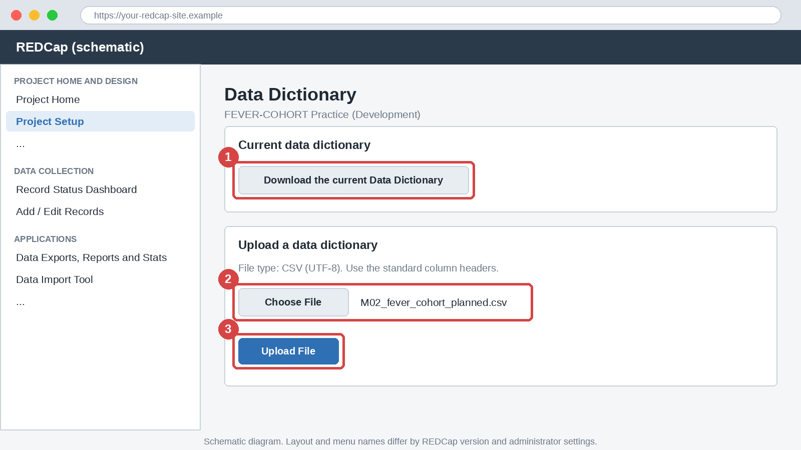
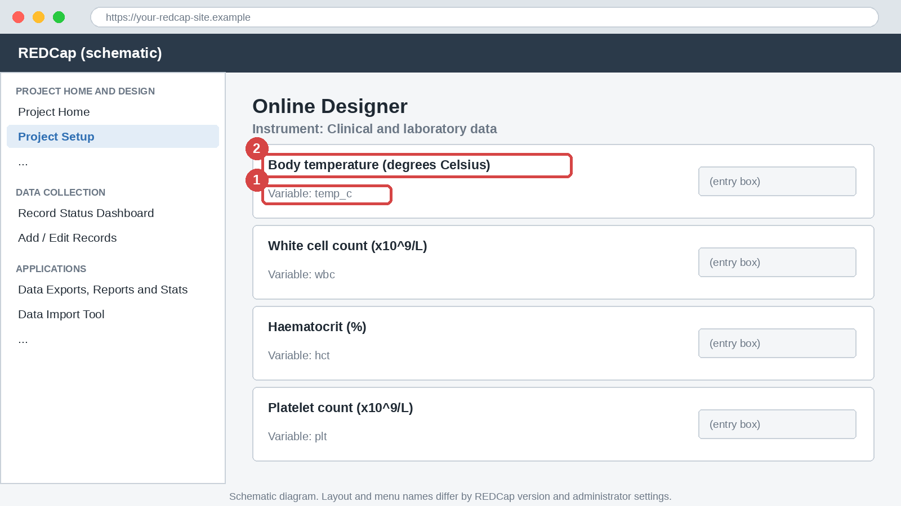

# Module 2: Planning Before Building

## Part A: English

### 1. Title block

| Item | Detail |
|------|--------|
| Module | 2 of 20 |
| Level | Beginner |
| Estimated time | 45 to 60 minutes |
| Assumed REDCap version | 14 or later. Menu names differ by version and by administrator settings. |
| Prerequisites | Module 1. A practice project helps for Track A but is not required. |
| Case studies used | A (FEVER-COHORT), with C (HTN-APP) in Exercises 2 and 3 |

> ⚠️ **Pitfall:** Never enter real patient data, real identifiers or real participants into a practice project. Use synthetic data only.

### 2. Learning objectives

By the end of this module you will be able to:

1. Trace a study from protocol to data collection schedule, case report form (CRF) and variable list.
2. Apply naming and coding conventions so that variables are clear and ready for analysis.
3. Separate identifiers from non-identifiers, and collected variables from derived variables.
4. Draft a data dictionary in a spreadsheet, upload it to a practice project and check the result.
5. Outline a data management plan and pilot a CRF before build.

### 3. Why this matters

**Data quality:** a variable that is unclear or recorded twice produces conflicting values. Planning removes these problems before data exist.

**Analysis:** the statistician needs one column per variable, with consistent codes and units. Planning decides how much cleaning follows.

**Compliance:** deciding early which fields are identifiers, and who may see them, supports ethics approval and data protection.

**Career:** a clean, documented data dictionary is the clearest proof that you can run the data side of a study.

### 4. Core concepts

**The planning chain.** Build in this order: protocol, data collection schedule, CRF, variable list, data dictionary. Each step answers one question.

| Step | Question | Output |
|------|----------|--------|
| Protocol | What must we measure to answer the research question? | Outcomes, eligibility and exposures |
| Schedule | When is each measure collected? | Visit by assessment table |
| CRF | On which form is it recorded? | One page or screen per topic |
| Variable list | What exactly is stored? | Name, label, type, coding, unit |
| Data dictionary | How is it entered in REDCap? | CSV with the standard columns |

**One fact, recorded once.** Record each fact in one place only. If date of birth is collected, calculate age instead of typing it. Duplicates drift apart.

**Variable naming conventions**

- Use lowercase letters, digits and underscores only, and start with a letter.
- Make names meaningful: `temp_c` is better than `q7`.
- Add a short prefix for groups, for example `kap_k1` to `kap_k5` for knowledge items.
- Keep names short, and add the timepoint where it prevents confusion, for example `sbp_base` and `sbp_wk12`.
- Do not end a name in `_complete`, which REDCap uses for form status. Verify in your REDCap instance.

**Coding conventions**

| Topic | Convention | Example |
|-------|------------|---------|
| Yes or no | Use 1 for Yes and 0 for No (the yes/no field type does this) | `hosp_admit` |
| Choices | Numeric codes, with the same code meaning the same thing across variables | `1, Female \| 2, Male` |
| Unknown | One fixed code such as 99, kept apart from real answers | `99, Unknown` |
| Units | Put the unit in the label and use one unit per variable | `Haematocrit (%)` |
| Dates | One format, year first | `date_ymd` |

**Missing data.** Decide the approach in advance. A blank means "not yet entered". Use an explicit code when the value is unknown, not done or not applicable. A numeric field cannot hold a text code, so use the project-level Missing Data Codes (Module 7). Verify in your REDCap instance that they are available.

**Identifiers and non-identifiers.** Direct identifiers are names, telephone numbers, addresses and national ID numbers. Dates such as date of birth and visit dates are treated as identifiers under many rules. Mark them in the `Identifier?` column. Keep contact details in a separate form with restricted rights, and link them to the participant by `record_id` only. Rights are covered in Module 16.

**Collected versus derived variables**

| Type | Rule | Example |
|------|------|---------|
| Collected | Typed or measured once, at the source | `dob`, `enrol_date`, `temp_c` |
| Derived | Calculated from collected variables, never typed | `age_years`, `fever_days` |

**Design with the analysis in mind (tidy data).** Each variable is one column, each observation is one row, and each kind of observation belongs in its own table. Do not create `plt_d3`, `plt_d5` and `plt_d7` as separate variables. Repeated visits are handled by events (Module 8) and repeating instruments (Module 9).

**Piloting a CRF.** Test the paper form with 3 to 5 people before building. Time them, and note blank answers, misread questions and choices that do not fit.

**Data management plan (DMP) outline**

```text
1. Study summary and data flow
2. Roles and responsibilities
3. CRFs and data dictionary
4. Naming and coding conventions
5. Data entry and verification
6. Data quality checks
7. Identifiers, access and security
8. Change control
9. Export, backup and archiving
10. Documentation and version log
```

**Worked example (FEVER-COHORT).** The protocol states that adults with fever are enrolled and that blood counts are measured at each visit. This gives the schedule below.

| Assessment | Baseline | Day 3 | Day 5 | Day 7 | Day 28 |
|------------|----------|-------|-------|-------|--------|
| Eligibility and consent | X | | | | |
| Demographics and onset date | X | | | | |
| Temperature | X | X | X | X | |
| WBC, haematocrit, platelets | X | X | X | X | |
| Hospital admission | X | | | | |
| Outcome | | | | | X |

From the baseline column come the variables. A short extract is shown.

| Variable | Label | Type | Coding or unit | Identifier | Derived |
|----------|-------|------|----------------|------------|---------|
| `dob` | Date of birth | date | `date_ymd` | y | No |
| `age_years` | Age at enrolment | calc | years | No | Yes |
| `temp_c` | Body temperature | number | degrees Celsius, 34 to 42 | No | No |
| `hosp_admit` | Admitted at baseline | yes/no | 1 Yes, 0 No | No | No |

### 5. Step-by-step walkthrough

Work in a spreadsheet first and REDCap second. Menu names may differ in your version.

1. From the protocol, write the primary outcome and the main exposures in one line each.
2. Draw the data collection schedule as a table of assessments by visits.
3. Sketch one CRF per topic on paper or on one spreadsheet tab each. Remove any item that nobody will analyse.
4. For every item, write one row in a variable list: name, label, type, coding, unit, validation, identifier, derived or collected.
5. Check the list against the conventions in Section 4. Fix duplicates and unclear names.
6. Copy the layout of `data/M02_fever_cohort_planned.csv`, which has the 18 standard columns. Save your own file as UTF-8 CSV. The two calculated fields use `datediff` and `rounddown`, explained in Module 4. Verify in your REDCap instance.
7. In a practice project in Development status, open **Project Setup** and select **Data Dictionary**. Choose your CSV and upload it. Menu location and button names: Verify in your REDCap instance. An upload replaces the existing design, so never upload into a live project.

   > 📷 **Figure 1:** Data Dictionary page (schematic). Find (1) the button to download the current data dictionary, (2) the file chooser and (3) the Upload File button.

   

8. Open **Online Designer** and select an instrument. Compare each field with your plan.

   > 📷 **Figure 2:** Online Designer instrument (schematic). Find (1) the variable name under each field and (2) the field label with its unit.

   

9. Pilot the form with three synthetic records, one with a deliberately wrong value. Update your CSV, not only the project, so that the file stays the master copy.

### 6. If this is not enabled

> 🔒 **Admin-dependent:** Uploading a data dictionary needs the project design right, and some instances restrict it. Verify in your REDCap instance.

**What to request from the administrator:** the design right in your practice project, or a practice project created for you.

**Conceptual walkthrough without access:** complete Steps 1 to 6 in a spreadsheet and use Track B in each exercise.

### 7. Exercises

**Exercise 1 (guided): From protocol to variable list**

Protocol extract: adults with fever for up to 7 days. At baseline record sex, date of birth, onset date, temperature, WBC, haematocrit, platelets and hospital admission. Repeat temperature and the three blood counts on Day 3, Day 5 and Day 7. Record survival status on Day 28.

**Track A (live REDCap practice project):**

1. Upload `data/M02_fever_cohort_planned.csv` into your FEVER-COHORT practice project.
2. In Online Designer, count the instruments and fields, and find the two calculated fields.
3. Self-check: you find 4 instruments and 14 fields, and both calculated fields are marked as derived.

**Track B (no access):** Draw the schedule table from the extract. List the baseline variables with name, type and coding. Open `data/M02_fever_cohort_planned.csv` in a spreadsheet and compare.

<details>
<summary>Answer key</summary>

**Track A:** 4 instruments (enrolment, clinical_lab, outcome, contact) and 14 fields. The calculated fields are `age_years` and `fever_days`. Instrument names shown in Online Designer may differ in capitalisation. Verify in your REDCap instance.

**Track B:** The schedule is the table in Section 4. The baseline variables are `sex`, `dob`, `onset_date`, `temp_c`, `wbc`, `hct`, `plt` and `hosp_admit`, with `age_years` and `fever_days` derived. Do not create `plt_d3` or similar names. Repeated visits are handled in Module 8.

</details>

**Exercise 2 (independent): Find the planning errors**

The file `data/M02_htn_app_draft_flawed.csv` is a deliberately flawed draft dictionary for HTN-APP.

**Track A (live REDCap practice project):**

1. Create a practice project named "HTN-APP Practice".
2. Upload the flawed file and record every error message REDCap reports. Wording differs by version.
3. Correct the file, upload it again and read it in Online Designer.
4. Self-check: the corrected file uploads without errors.

**Track B (no access):** Open the file in a spreadsheet. List at least six problems and give a fix for each.

<details>
<summary>Answer key</summary>

1. `Record ID` is not a valid name (capital letters and a space). Use `record_id`.
2. `age` and `dob` are both collected. Keep `dob` and calculate age.
3. `smoker` uses 1 Yes and 2 No. Use the yes/no field type (1 and 0).
4. `sbp_base` has no unit and no validation. Add "(mmHg)" and a number range such as 70 to 250.
5. `dbp_base` appears twice. Use `dbp_base` once and give the second reading its own name.
6. `bmi` is collected beside height and weight. Make it a calculated field.
7. `participant_name` is a direct identifier that is not flagged and sits in the clinical form. Flag it and move it to a restricted form, or do not collect it.
8. `bp_category` has an invalid field type and choices without the `|` separator. Use `radio` with `1, Normal | 2, Grade 1 | 3, Grade 2`.

REDCap reports only errors that block the upload (items 1, 5 and 8). The other problems are found by reading.

</details>

**Exercise 3 (challenge): Week 12 CRF for HTN-APP**

Draft 8 to 10 variables for the Week 12 visit of HTN-APP. Include `sbp_wk12`, `dbp_wk12`, a visit date, one yes/no item, one choice item with an unknown code, and a derived `sbp_change` (week 12 minus baseline). Add one sentence on how missing values are handled.

**Track A (live REDCap practice project):**

1. Write the dictionary as a CSV using the 18 standard columns.
2. Upload it to the HTN-APP practice project.
3. Enter three synthetic records, one with a blank week 12 value.
4. Self-check: the upload is accepted, `sbp_change` shows a value only when both readings exist, and the blank is visible as blank.

**Track B (no access):** Write the table in a spreadsheet and check each row against the conventions in Section 4.

<details>
<summary>Answer key</summary>

A sample answer (any equivalent design is accepted):

| Variable | Label | Type | Coding or rule |
|----------|-------|------|----------------|
| `visit_date_wk12` | Date of week 12 visit | text | `date_ymd`, identifier y |
| `sbp_wk12` | Systolic BP at week 12 (mmHg) | text | number 70 to 250 |
| `dbp_wk12` | Diastolic BP at week 12 (mmHg) | text | number 40 to 150 |
| `app_use_wk12` | Used the app in the last 7 days? | yesno | 1 Yes, 0 No |
| `med_change` | Change in BP medication | radio | 1 None, 2 Dose changed, 3 Drug changed, 99 Unknown |
| `sbp_change` | Change in systolic BP (mmHg) | calc | `[sbp_wk12] - [sbp_base]` |

Missing values: a blank means not yet entered, `99` means unknown for choices, and a missing numeric reading uses a project Missing Data Code (Module 7). The formula: Verify in your REDCap instance.

</details>

### 8. Quiz

**Question 1 (multiple choice).** Which is a valid variable name?

- A. `Systolic BP`
- B. `sbp_base`
- C. `1_sbp`
- D. `SBP-base`

<details>
<summary>Answer</summary>

B. Lowercase letters, digits and underscores only, starting with a letter.

</details>

**Question 2 (multiple choice).** Which approach follows "one fact, recorded once"?

- A. Collect `dob` and `age`
- B. Collect `dob` and calculate `age_years`
- C. Collect `age` twice
- D. Collect `age` as free text

<details>
<summary>Answer</summary>

B. The derived value cannot disagree with its source.

</details>

**Question 3 (short answer).** How should yes/no questions be coded?

<details>
<summary>Answer</summary>

1 for Yes and 0 for No, which is what the yes/no field type stores.

</details>

**Question 4 (multiple choice).** Where should a participant's telephone number be kept?

- A. In the main clinical form
- B. In a separate form with restricted rights, flagged as an identifier
- C. In the field note
- D. In the variable name

<details>
<summary>Answer</summary>

B. This limits who can see it and supports de-identified export.

</details>

**Question 5 (short answer).** Why avoid `plt_d3`, `plt_d5` and `plt_d7` as separate variables?

<details>
<summary>Answer</summary>

They spread one measure across columns. Events or repeating instruments keep one `plt` variable with one row per visit, which is tidier for analysis.

</details>

**Question 6 (multiple choice).** What is the main purpose of piloting a paper CRF?

- A. To meet the protocol deadline
- B. To find unclear questions and missing choices before build
- C. To train the statistician
- D. To test the server

<details>
<summary>Answer</summary>

B. Fixing a paper form costs minutes, and fixing a live project costs much more.

</details>

### 9. Common pitfalls

> ⚠️ **Pitfall:** Building in REDCap before the variable list exists. Design choices are then made on the fly.

> ⚠️ **Pitfall:** Changing codes after data entry starts. Old and new records then mean different things.

> ⚠️ **Pitfall:** Using free text for answers that have a short list of choices.

> ⚠️ **Pitfall:** Editing the project in the browser only. Keep the data dictionary file as the master and update it with every change.

### 10. Career tips

> 🎯 **Career tip:** Show a data dictionary and a one-page data management plan in your portfolio. They persuade more than screenshots.

> 🎯 **Career tip:** In grant applications, state your conventions and missing data approach. It signals experience with real study data.

> 🎯 **Career tip:** Offer to review a colleague's draft CRF against a conventions checklist. It is a quick way to become the trusted data person.

### 11. Downloadable files

| File | Contents | How to use |
|------|----------|------------|
| [M02_fever_cohort_planned.csv](data/M02_fever_cohort_planned.csv) | Planned FEVER-COHORT dictionary with 14 fields in 4 instruments, two calculated fields and flagged identifiers | Upload in Exercise 1, or copy its layout for your own dictionary |
| [M02_htn_app_draft_flawed.csv](data/M02_htn_app_draft_flawed.csv) | Deliberately flawed HTN-APP draft with planning and upload errors | Use in Exercise 2 to find and fix errors |

Open CSV files in a text editor or import them as UTF-8 text so that values are not auto-formatted.

### 12. Key takeaways

- Plan in order: protocol, schedule, CRF, variable list, data dictionary.
- Record each fact once, and calculate derived values instead of typing them.
- Use lowercase names with underscores, numeric codes, one unit per variable and a fixed code for unknown.
- Flag identifiers, and keep contact details in a restricted form.
- Pilot the paper CRF, and keep the data dictionary file as the master copy.

### 13. Next module

Next: [Module 3, Creating a project, Online Designer, instruments and field types](../03_project_designer_field_types/Module_03_project_designer_field_types.md).

Topics: creating a project, the Project Setup checklist, instruments, field types and the record identifier.

### 14. Version table

| Version | Date |
|---------|------|
| 1.0 | 2026-10-09 |

---

## Part B: Burmese

### 1. ခေါင်းစဉ်အချက်အလက် (Title block)

| အချက် | အသေးစိတ် |
|-------|----------|
| မော်ဂျူး | ၂၀ ခုအနက် 2 ခု |
| အဆင့် | အခြေခံ (Beginner) |
| ခန့်မှန်းကြာချိန် | 45 မှ 60 မိနစ် |
| ယူဆထားသော REDCap ဗားရှင်း | 14 နှင့်အထက်။ မီနူးအမည်များသည် ဗားရှင်းနှင့် စီမံခန့်ခွဲသူ (Administrator) ၏ ဆက်တင်များပေါ် မူတည်ပြီး ကွဲပြားနိုင်ပါတယ်။ |
| ကြိုတင်လိုအပ်ချက် | မော်ဂျူး 1။ လေ့ကျင့်ရေးပရောဂျက်ရှိရင် Track A အတွက် အထောက်အကူဖြစ်ပေမယ့် မဖြစ်မနေ မလိုပါ။ |
| အသုံးပြုသော ဖြစ်ရပ်လေ့လာမှုများ | A (FEVER-COHORT)၊ လေ့ကျင့်ခန်း 2 နဲ့ 3 မှာ C (HTN-APP) ကိုပါ သုံးပါတယ် |

> ⚠️ **Pitfall:** လက်တွေ့လူနာဒေတာ၊ တကယ့်ကိုယ်ရေးကိုယ်တာ အချက်အလက်နဲ့ တကယ့်ပါဝင်သူတွေရဲ့ အချက်အလက်တွေကို လေ့ကျင့်ရေး ပရောဂျက်ထဲ ဘယ်တော့မှ မထည့်ပါနဲ့။ ဖန်တီးထားတဲ့ (synthetic) ဒေတာကိုပဲ သုံးပါ။

### 2. သင်ယူရမည့် ရည်မှန်းချက်များ (Learning objectives)

ဒီမော်ဂျူးအဆုံးမှာ သင်ဟာ အောက်ပါအရာတွေကို လုပ်နိုင်ပါလိမ့်မယ်။

1. လေ့လာမှုတစ်ခုကို သုတေသနစာတမ်းအစီအစဉ် (Protocol) ကနေ ဒေတာစုဆောင်းမည့် အချိန်ဇယား (Data collection schedule)၊ လေ့လာမှုမှတ်တမ်းဖောင် (Case Report Form, CRF) နဲ့ variable စာရင်းအထိ လမ်းကြောင်းအတိုင်း ချမှတ်နိုင်ပါမယ်။
2. variable တိုင်းက ရှင်းလင်းပြီး ခွဲခြမ်းစိတ်ဖြာဖို့ အဆင်သင့်ဖြစ်အောင် အမည်ပေးခြင်းနဲ့ ကုဒ်သတ်မှတ်ခြင်း စံနှုန်းတွေ (Naming and coding conventions) ကို သုံးနိုင်ပါမယ်။
3. ဖော်ထုတ်နိုင်တဲ့ အချက်အလက် (Identifier) နဲ့ မဟုတ်တာကို ခွဲခြားနိုင်ပြီး၊ စုဆောင်းတဲ့ variable (collected variable) နဲ့ တွက်ချက်ထုတ်ယူတဲ့ variable (derived variable) ကိုလည်း ခွဲခြားနိုင်ပါမယ်။
4. data dictionary မူကြမ်းကို spreadsheet ထဲမှာ ရေးပြီး လေ့ကျင့်ရေးပရောဂျက်ထဲ upload လုပ်ကာ ရလဒ်ကို စစ်ဆေးနိုင်ပါမယ်။
5. ဒေတာစီမံခန့်ခွဲမှုအစီအစဉ် (Data management plan) ကို ရေးဆွဲပြီး တည်ဆောက်မီ CRF ကို စမ်းသပ်ကြည့် (pilot) နိုင်ပါမယ်။

### 3. ဘာကြောင့် အရေးကြီးသလဲ (Why this matters)

**ဒေတာအရည်အသွေး (Data quality):** မရှင်းလင်းတဲ့ variable ဒါမှမဟုတ် နှစ်ခါ မှတ်ထားတဲ့ variable က ဆန့်ကျင်ဘက်တန်ဖိုးတွေ ထွက်စေပါတယ်။ ဒေတာမရှိသေးခင် စီစဉ်ထားရင် ဒီပြဿနာတွေ ပျောက်သွားပါတယ်။

**ခွဲခြမ်းစိတ်ဖြာမှု (Analysis):** ကိန်းဂဏန်းစာရင်းအင်းပညာရှင် (Statistician) က variable တစ်ခုကို column တစ်ခုနဲ့၊ ကုဒ်နဲ့ ယူနစ်တွေ တစ်သမတ်တည်းဖြစ်တာကို လိုချင်ပါတယ်။ နောက်ပိုင်း သန့်ရှင်းရေး ဘယ်လောက်လုပ်ရမလဲဆိုတာ စီစဉ်မှုက ဆုံးဖြတ်ပါတယ်။

**စည်းမျဉ်းလိုက်နာမှု (Compliance):** ဘယ် field တွေက identifier ဖြစ်လဲ၊ ဘယ်သူ ကြည့်ခွင့်ရှိလဲဆိုတာ စောစီးစွာ ဆုံးဖြတ်ထားရင် ကျင့်ဝတ်ကော်မတီ ခွင့်ပြုချက်နဲ့ ဒေတာကာကွယ်ရေးကို ထောက်ပံ့ပေးပါတယ်။

**အလုပ်အကိုင် (Career):** သန့်ရှင်းပြီး မှတ်တမ်းကောင်းကောင်းရှိတဲ့ data dictionary က လေ့လာမှုတစ်ခုရဲ့ ဒေတာဘက်ခြမ်းကို စီမံနိုင်တယ်ဆိုတာကို အရှင်းလင်းဆုံး သက်သေပြပါတယ်။

### 4. အဓိကအယူအဆများ (Core concepts)

**စီစဉ်မှု လမ်းကြောင်း (The planning chain).** ဒီအစီအစဉ်အတိုင်း တည်ဆောက်ပါ: protocol၊ ဒေတာစုဆောင်းမည့် အချိန်ဇယား၊ CRF၊ variable စာရင်း၊ data dictionary။ အဆင့်တစ်ခုစီက မေးခွန်းတစ်ခုကို ဖြေပါတယ်။

| အဆင့် | မေးခွန်း | ရလဒ် |
|-------|----------|------|
| Protocol | သုတေသနမေးခွန်းကို ဖြေဖို့ ဘာတွေ တိုင်းရမလဲ။ | ရလဒ်များ၊ ပါဝင်ခွင့်နဲ့ ထိတွေ့မှုများ (Outcomes, eligibility and exposures) |
| Schedule | တိုင်းတာမှုတစ်ခုစီကို ဘယ်အချိန်မှာ စုဆောင်းမလဲ။ | ခရီးစဉ်နဲ့ အကဲဖြတ်မှု ဇယား (Visit by assessment table) |
| CRF | ဘယ်ဖောင်မှာ မှတ်မလဲ။ | ခေါင်းစဉ်တစ်ခုကို စာမျက်နှာ တစ်ခု သို့မဟုတ် မျက်နှာပြင် တစ်ခု |
| Variable list | အတိအကျ ဘာကို သိမ်းမလဲ။ | အမည်၊ label၊ အမျိုးအစား၊ ကုဒ်၊ ယူနစ် |
| Data dictionary | REDCap ထဲမှာ ဘယ်လို ထည့်မလဲ။ | စံ column တွေပါတဲ့ CSV |

**အချက်တစ်ခုကို တစ်နေရာတည်း မှတ်ပါ (One fact, recorded once).** အချက်တစ်ခုစီကို တစ်နေရာတည်းမှာပဲ မှတ်ပါ။ မွေးသက္ကရာဇ် (date of birth) ကို စုဆောင်းထားရင် အသက်ကို ရိုက်မထည့်ဘဲ တွက်ချက်ပါ။ ထပ်နေတဲ့ မှတ်တမ်းတွေက တဖြည်းဖြည်း မကိုက်ညီဖြစ်သွားပါတယ်။

**Variable အမည်ပေးခြင်း စံနှုန်းများ (Variable naming conventions)**

- အင်္ဂလိပ်စာလုံးအသေး၊ ဂဏန်းနဲ့ underscore တွေကိုပဲ သုံးပြီး စာလုံးနဲ့ စပါ။
- အမည်ကို အဓိပ္ပာယ်ရှိအောင် ပေးပါ: `temp_c` က `q7` ထက် ပိုကောင်းပါတယ်။
- အုပ်စုတွေအတွက် prefix တိုတစ်ခု ထည့်ပါ။ ဥပမာ အသိပညာ မေးခွန်းတွေအတွက် `kap_k1` မှ `kap_k5` အထိ။
- အမည်ကို တိုတိုထားပြီး ရှုပ်ထွေးမှုကို ကာကွယ်ပေးမယ့် အချိန်ကာလကို ထည့်ပါ။ ဥပမာ `sbp_base` နဲ့ `sbp_wk12`။
- အမည်ကို `_complete` နဲ့ မအဆုံးသတ်ပါနဲ့။ ဒီပုံစံကို REDCap က ဖောင်အခြေအနေ (form status) အတွက် သုံးပါတယ်။ Verify in your REDCap instance။

**ကုဒ်သတ်မှတ်ခြင်း စံနှုန်းများ (Coding conventions)**

| ခေါင်းစဉ် | စံနှုန်း | ဥပမာ |
|----------|---------|------|
| Yes သို့မဟုတ် No | Yes အတွက် 1၊ No အတွက် 0 သုံးပါ (yes/no field type က ဒီလိုလုပ်ပေးပါတယ်) | `hosp_admit` |
| ရွေးချယ်စရာများ | ကိန်းဂဏန်းကုဒ်တွေ သုံးပါ။ ကုဒ်တူရင် variable တွေအားလုံးမှာ အဓိပ္ပာယ်တူရမယ် | `1, Female \| 2, Male` |
| မသိ (Unknown) | 99 လို ပုံသေကုဒ်တစ်ခု သုံးပြီး တကယ့်အဖြေတွေနဲ့ ခွဲထားပါ | `99, Unknown` |
| ယူနစ် (Units) | ယူနစ်ကို label ထဲ ထည့်ပြီး variable တစ်ခုကို ယူနစ်တစ်မျိုးတည်း သုံးပါ | `Haematocrit (%)` |
| ရက်စွဲ (Dates) | ပုံစံတစ်မျိုးတည်း၊ နှစ်ကို ရှေ့ဆုံးထားပါ | `date_ymd` |

**ပျောက်ဆုံးနေတဲ့ ဒေတာ (Missing data).** ချဉ်းကပ်မယ့်နည်းကို ကြိုတင် ဆုံးဖြတ်ပါ။ အလွတ် (blank) ဆိုတာ "မထည့်ရသေးဘူး" လို့ ဆိုလိုပါတယ်။ တန်ဖိုးက မသိ၊ မလုပ်ခဲ့ ဒါမှမဟုတ် မသက်ဆိုင်ရင် ရှင်းလင်းတဲ့ ကုဒ်တစ်ခု သုံးပါ။ ကိန်းဂဏန်း field ထဲမှာ စာသားကုဒ် ထည့်လို့ မရတဲ့အတွက် ပရောဂျက်အဆင့် Missing Data Codes ကို သုံးပါ (မော်ဂျူး 7)။ ဒါတွေ ရနိုင်မရနိုင် Verify in your REDCap instance။

**ဖော်ထုတ်နိုင်တဲ့ အချက်အလက်နဲ့ မဟုတ်တာ (Identifiers and non-identifiers).** တိုက်ရိုက် identifier တွေက အမည်၊ ဖုန်းနံပါတ်၊ လိပ်စာနဲ့ အမျိုးသားမှတ်ပုံတင်နံပါတ်တွေ ဖြစ်ပါတယ်။ မွေးသက္ကရာဇ်နဲ့ ခရီးစဉ်ရက်စွဲတွေလို ရက်စွဲတွေကို စည်းမျဉ်းအများစုမှာ identifier အဖြစ် သတ်မှတ်ပါတယ်။ `Identifier?` column မှာ အမှတ်အသားလုပ်ပါ။ ဆက်သွယ်ရန်အချက်အလက်တွေကို ကန့်သတ်ထားတဲ့ ခွင့်ပြုချက်နဲ့ သီးသန့်ဖောင်တစ်ခုထဲမှာ ထားပြီး `record_id` တစ်ခုတည်းနဲ့ ပါဝင်သူနဲ့ ချိတ်ပါ။ ခွင့်ပြုချက် (Rights) တွေကို မော်ဂျူး 16 မှာ ဖော်ပြပါမယ်။

**စုဆောင်းတဲ့ variable နဲ့ တွက်ချက်ထုတ်ယူတဲ့ variable (Collected versus derived variables)**

| အမျိုးအစား | စည်းမျဉ်း | ဥပမာ |
|------------|-----------|------|
| စုဆောင်းတဲ့ (Collected) | ရင်းမြစ်မှာ တစ်ခါတည်း ရိုက်ထည့်ခြင်း သို့မဟုတ် တိုင်းတာခြင်း | `dob`, `enrol_date`, `temp_c` |
| တွက်ချက်ထုတ်ယူတဲ့ (Derived) | စုဆောင်းထားတဲ့ variable တွေကနေ တွက်ချက်တာ၊ ဘယ်တော့မှ ရိုက်မထည့်ပါ | `age_years`, `fever_days` |

**ခွဲခြမ်းစိတ်ဖြာမှုကို စိတ်ထဲထားပြီး ဒီဇိုင်းဆွဲခြင်း (Design with the analysis in mind, tidy data).** variable တစ်ခုက column တစ်ခု၊ လေ့လာတွေ့ရှိချက် (observation) တစ်ခုက အတန်းတစ်ခု ဖြစ်ပြီး observation အမျိုးအစားတစ်ခုစီက ကိုယ်ပိုင်ဇယားတစ်ခု ရှိရပါမယ်။ `plt_d3`, `plt_d5` နဲ့ `plt_d7` ကို သီးခြား variable တွေအဖြစ် မဖန်တီးပါနဲ့။ ခရီးစဉ်ထပ်ခါထပ်ခါကို events (မော်ဂျူး 8) နဲ့ repeating instruments (မော်ဂျူး 9) က ကိုင်တွယ်ပါတယ်။

**CRF ကို စမ်းသပ်ကြည့်ခြင်း (Piloting a CRF).** မတည်ဆောက်ခင် စာရွက်ဖောင်ကို လူ 3 မှ 5 ယောက်နဲ့ စမ်းကြည့်ပါ။ အချိန်ယူကြည့်ပြီး အဖြေအလွတ်တွေ၊ မှားဖတ်တဲ့ မေးခွန်းတွေနဲ့ မကိုက်တဲ့ ရွေးချယ်စရာတွေကို မှတ်ထားပါ။

**ဒေတာစီမံခန့်ခွဲမှုအစီအစဉ် (Data management plan, DMP) ဖွဲ့စည်းပုံ**

```text
1. Study summary and data flow
2. Roles and responsibilities
3. CRFs and data dictionary
4. Naming and coding conventions
5. Data entry and verification
6. Data quality checks
7. Identifiers, access and security
8. Change control
9. Export, backup and archiving
10. Documentation and version log
```

**လက်တွေ့နမူနာ (Worked example, FEVER-COHORT).** Protocol မှာ အဖျားရှိတဲ့ လူကြီးတွေကို စာရင်းသွင်းပြီး ခရီးစဉ်တိုင်းမှာ သွေးရောဂါစစ်ဆေးမှုတွေ တိုင်းတယ်လို့ ဖော်ပြထားပါတယ်။ အောက်ပါ အချိန်ဇယားကို ရပါတယ်။

| Assessment | Baseline | Day 3 | Day 5 | Day 7 | Day 28 |
|------------|----------|-------|-------|-------|--------|
| Eligibility and consent | X | | | | |
| Demographics and onset date | X | | | | |
| Temperature | X | X | X | X | |
| WBC, haematocrit, platelets | X | X | X | X | |
| Hospital admission | X | | | | |
| Outcome | | | | | X |

Baseline column ကနေ variable တွေ ထွက်လာပါတယ်။ အတိုချုပ် ထုတ်နုတ်ချက်ကို ပြထားပါတယ်။

| Variable | Label | Type | Coding or unit | Identifier | Derived |
|----------|-------|------|----------------|------------|---------|
| `dob` | Date of birth | date | `date_ymd` | y | No |
| `age_years` | Age at enrolment | calc | years | No | Yes |
| `temp_c` | Body temperature | number | degrees Celsius, 34 to 42 | No | No |
| `hosp_admit` | Admitted at baseline | yes/no | 1 Yes, 0 No | No | No |

### 5. အဆင့်ဆင့် လမ်းညွှန် (Step-by-step walkthrough)

spreadsheet ထဲမှာ အရင်လုပ်ပြီး REDCap ထဲမှာ နောက်မှ လုပ်ပါ။ မီနူးအမည်တွေက သင့်ဗားရှင်းမှာ ကွဲနိုင်ပါတယ်။

1. Protocol ကနေ အဓိကရလဒ် (primary outcome) နဲ့ အဓိကထိတွေ့မှုတွေ (exposures) ကို တစ်ကြောင်းစီ ရေးပါ။
2. ဒေတာစုဆောင်းမည့် အချိန်ဇယားကို အကဲဖြတ်မှုတွေနဲ့ ခရီးစဉ်တွေ ဖြတ်ထားတဲ့ ဇယားအဖြစ် ဆွဲပါ။
3. ခေါင်းစဉ်တစ်ခုစီအတွက် CRF တစ်ခုကို စာရွက်ပေါ်မှာ သို့မဟုတ် spreadsheet tab တစ်ခုစီမှာ ပုံကြမ်းဆွဲပါ။ ဘယ်သူမှ ခွဲခြမ်းစိတ်ဖြာမှာ မဟုတ်တဲ့ အချက်ကို ဖယ်ပါ။
4. အချက်တစ်ခုစီအတွက် variable စာရင်းမှာ အတန်းတစ်ခု ရေးပါ: အမည်၊ label၊ အမျိုးအစား၊ ကုဒ်၊ ယူနစ်၊ validation၊ identifier၊ derived သို့မဟုတ် collected။
5. စာရင်းကို ပိုင်း 4 ထဲက စံနှုန်းတွေနဲ့ တိုက်ဆိုင်စစ်ပါ။ ထပ်နေတာတွေနဲ့ မရှင်းတဲ့ အမည်တွေကို ပြင်ပါ။
6. `data/M02_fever_cohort_planned.csv` ရဲ့ ပုံစံကို ကူးပါ။ အဲဒီမှာ စံ column 18 ခု ပါပါတယ်။ သင့်ဖိုင်ကို UTF-8 CSV အဖြစ် သိမ်းပါ။ ဖိုင်ထဲက calculated field နှစ်ခုက `datediff` နဲ့ `rounddown` ကို သုံးထားပြီး မော်ဂျူး 4 မှာ ရှင်းပြပါမယ်။ Verify in your REDCap instance။
7. Development အခြေအနေက လေ့ကျင့်ရေးပရောဂျက်မှာ **Project Setup** ကို ဖွင့်ပြီး **Data Dictionary** ကို ရွေးပါ။ သင့် CSV ကို ရွေးပြီး upload လုပ်ပါ။ မီနူးတည်နေရာနဲ့ ခလုတ်အမည်တွေ: Verify in your REDCap instance။ Upload လုပ်ရင် ရှိပြီးသား ဒီဇိုင်းကို အစားထိုးတာမို့ လက်ရှိသုံးနေတဲ့ (live) ပရောဂျက်ထဲ ဘယ်တော့မှ မ upload လုပ်ပါနဲ့။

   > 📷 **ပုံ 1:** Data Dictionary စာမျက်နှာ (ပုံကြမ်း)။ (1) လက်ရှိ data dictionary ကို download လုပ်တဲ့ ခလုတ်၊ (2) ဖိုင်ရွေးတဲ့နေရာနဲ့ (3) Upload File ခလုတ်ကို ရှာပါ။

   

8. **Online Designer** ကို ဖွင့်ပြီး instrument တစ်ခုကို ရွေးပါ။ field တစ်ခုစီကို သင့်အစီအစဉ်နဲ့ နှိုင်းယှဉ်ပါ။

   > 📷 **ပုံ 2:** Online Designer instrument (ပုံကြမ်း)။ (1) field တစ်ခုစီအောက်က variable အမည်နဲ့ (2) ယူနစ်ပါတဲ့ field label ကို ရှာပါ။

   

9. ဖောင်ကို synthetic record သုံးခုနဲ့ စမ်းသပ်ကြည့်ပါ။ တစ်ခုမှာ တမင်မှားတဲ့ တန်ဖိုးထည့်ပါ။ ပရောဂျက်ထဲတင် မကဘဲ သင့် CSV ကိုပါ ပြင်ပါ။ ဒါမှ ဖိုင်က မူရင်းကူးယူမူ (master copy) အဖြစ် ရှိနေမှာပါ။

### 6. မဖွင့်ထားရင် (If this is not enabled)

> 🔒 **Admin-dependent:** Data dictionary upload လုပ်ဖို့ ပရောဂျက်ဒီဇိုင်းခွင့် (design right) လိုပြီး instance အချို့မှာ ကန့်သတ်ထားပါတယ်။ Verify in your REDCap instance။

**စီမံခန့်ခွဲသူထံ တောင်းဆိုရမည့်အရာ:** သင့်လေ့ကျင့်ရေးပရောဂျက်မှာ design right၊ သို့မဟုတ် သင့်အတွက် ဖန်တီးပေးထားတဲ့ လေ့ကျင့်ရေးပရောဂျက်။

**ဝင်ခွင့်မရှိရင် အယူအဆအရ လမ်းညွှန်:** အဆင့် 1 မှ 6 ကို spreadsheet ထဲမှာ ပြီးအောင်လုပ်ပြီး လေ့ကျင့်ခန်းတိုင်းမှာ Track B ကို သုံးပါ။

### 7. လေ့ကျင့်ခန်းများ (Exercises)

**လေ့ကျင့်ခန်း 1 (လမ်းညွှန်ပါ): Protocol ကနေ variable စာရင်းအထိ**

Protocol ထုတ်နုတ်ချက်: အဖျားရှိတာ 7 ရက်အထိ ရှိတဲ့ လူကြီးတွေ။ Baseline မှာ sex၊ date of birth၊ onset date၊ temperature၊ WBC၊ haematocrit၊ platelets နဲ့ hospital admission ကို မှတ်ပါ။ Day 3၊ Day 5 နဲ့ Day 7 မှာ temperature နဲ့ သွေးရောဂါစစ်ဆေးမှု သုံးမျိုးကို ထပ်မှတ်ပါ။ Day 28 မှာ အသက်ရှင်ကျန်မှု အခြေအနေကို မှတ်ပါ။

**Track A (live REDCap လေ့ကျင့်ရေးပရောဂျက်):**

1. `data/M02_fever_cohort_planned.csv` ကို သင့် FEVER-COHORT လေ့ကျင့်ရေးပရောဂျက်ထဲ upload လုပ်ပါ။
2. Online Designer မှာ instrument တွေနဲ့ field တွေကို ရေတွက်ပြီး calculated field နှစ်ခုကို ရှာပါ။
3. ကိုယ်တိုင်စစ်ဆေးခြင်း: instrument 4 ခုနဲ့ field 14 ခု တွေ့ရပြီး calculated field နှစ်ခုလုံးကို derived အဖြစ် သတ်မှတ်ထားတာ တွေ့ရပါမယ်။

**Track B (ဝင်ခွင့်မရှိရင်):** ထုတ်နုတ်ချက်ကနေ အချိန်ဇယားကို ဆွဲပါ။ baseline variable တွေကို အမည်၊ အမျိုးအစားနဲ့ ကုဒ်နဲ့ စာရင်းပြုစုပါ။ `data/M02_fever_cohort_planned.csv` ကို spreadsheet မှာဖွင့်ပြီး နှိုင်းယှဉ်ပါ။

<details>
<summary>အဖြေသော့ (Answer key)</summary>

**Track A:** instrument 4 ခု (enrolment, clinical_lab, outcome, contact) နဲ့ field 14 ခု။ calculated field တွေက `age_years` နဲ့ `fever_days` ဖြစ်ပါတယ်။ Online Designer မှာပြတဲ့ instrument အမည်တွေရဲ့ စာလုံးကြီးစာလုံးသေး ကွဲနိုင်ပါတယ်။ Verify in your REDCap instance။

**Track B:** အချိန်ဇယားက ပိုင်း 4 ထဲက ဇယားပါပဲ။ baseline variable တွေက `sex`, `dob`, `onset_date`, `temp_c`, `wbc`, `hct`, `plt` နဲ့ `hosp_admit` ဖြစ်ပြီး `age_years` နဲ့ `fever_days` ကို derived အဖြစ် ထားပါတယ်။ `plt_d3` လို အမည်တွေ မဖန်တီးပါနဲ့။ ထပ်ခါထပ်ခါ ခရီးစဉ်တွေကို မော်ဂျူး 8 မှာ ကိုင်တွယ်ပါမယ်။

</details>

**လေ့ကျင့်ခန်း 2 (လွတ်လပ်စွာလုပ်ပါ): စီစဉ်မှု အမှားတွေ ရှာပါ**

`data/M02_htn_app_draft_flawed.csv` ဖိုင်က HTN-APP အတွက် တမင်အမှားထည့်ထားတဲ့ data dictionary မူကြမ်း ဖြစ်ပါတယ်။

**Track A (live REDCap လေ့ကျင့်ရေးပရောဂျက်):**

1. "HTN-APP Practice" အမည်နဲ့ လေ့ကျင့်ရေးပရောဂျက်တစ်ခု ဖန်တီးပါ။
2. အမှားပါတဲ့ ဖိုင်ကို upload လုပ်ပြီး REDCap ပြတဲ့ error message တိုင်းကို မှတ်ပါ။ စာသားက ဗားရှင်းအလိုက် ကွဲပါတယ်။
3. ဖိုင်ကို ပြင်ပြီး ထပ် upload လုပ်ကာ Online Designer မှာ ဖတ်ကြည့်ပါ။
4. ကိုယ်တိုင်စစ်ဆေးခြင်း: ပြင်ပြီးတဲ့ ဖိုင်က error မရှိဘဲ upload ဖြစ်ပါတယ်။

**Track B (ဝင်ခွင့်မရှိရင်):** ဖိုင်ကို spreadsheet မှာဖွင့်ပါ။ ပြဿနာ အနည်းဆုံး 6 ခု စာရင်းပြုစုပြီး တစ်ခုချင်းစီအတွက် ပြင်နည်း ပေးပါ။

<details>
<summary>အဖြေသော့ (Answer key)</summary>

1. `Record ID` က မှန်ကန်တဲ့ အမည် မဟုတ်ပါဘူး (စာလုံးကြီးနဲ့ နေရာလွတ် ပါနေလို့)။ `record_id` ကို သုံးပါ။
2. `age` နဲ့ `dob` နှစ်ခုလုံး စုဆောင်းထားပါတယ်။ `dob` ကို ထားပြီး အသက်ကို တွက်ချက်ပါ။
3. `smoker` က 1 Yes နဲ့ 2 No သုံးထားပါတယ်။ yes/no field type (1 နဲ့ 0) ကို သုံးပါ။
4. `sbp_base` မှာ ယူနစ်နဲ့ validation မရှိပါဘူး။ "(mmHg)" နဲ့ 70 မှ 250 လို ကိန်းဂဏန်းအပိုင်းအခြား ထည့်ပါ။
5. `dbp_base` က နှစ်ခါ ပါနေပါတယ်။ `dbp_base` ကို တစ်ခါပဲ သုံးပြီး ဒုတိယဖတ်ရှုမှုကို ကိုယ်ပိုင်အမည်ပေးပါ။
6. `bmi` ကို height နဲ့ weight ဘေးမှာ စုဆောင်းထားပါတယ်။ calculated field ဖြစ်အောင် လုပ်ပါ။
7. `participant_name` က အမှတ်အသားမလုပ်ထားတဲ့ တိုက်ရိုက် identifier ဖြစ်ပြီး clinical ဖောင်ထဲမှာ ရှိနေပါတယ်။ အမှတ်အသားလုပ်ပြီး ကန့်သတ်ထားတဲ့ ဖောင်သို့ ရွှေ့ပါ၊ ဒါမှမဟုတ် မစုဆောင်းပါနဲ့။
8. `bp_category` မှာ field type မမှန်ပါဘူး၊ ရွေးချယ်စရာတွေမှာလည်း `|` ခြားတဲ့ပုံစံ မပါပါဘူး။ `radio` ကို သုံးပြီး `1, Normal | 2, Grade 1 | 3, Grade 2` လို ရေးပါ။

REDCap က upload ကို ပိတ်တဲ့ error တွေကိုပဲ ပြပါတယ် (အချက် 1၊ 5 နဲ့ 8)။ ကျန်တဲ့ ပြဿနာတွေကို ဖတ်ကြည့်မှ တွေ့ပါတယ်။

</details>

**လေ့ကျင့်ခန်း 3 (စိန်ခေါ်မှု): HTN-APP အတွက် Week 12 CRF**

HTN-APP ရဲ့ Week 12 ခရီးစဉ်အတွက် variable 8 မှ 10 ခု ရေးပါ။ `sbp_wk12`၊ `dbp_wk12`၊ ခရီးစဉ်ရက်စွဲ၊ yes/no အချက်တစ်ခု၊ မသိကုဒ်ပါတဲ့ ရွေးချယ်ရတဲ့ အချက်တစ်ခုနဲ့ derived variable `sbp_change` (week 12 မှ baseline ကို နုတ်) တို့ ပါရပါမယ်။ ပျောက်ဆုံးတန်ဖိုးတွေကို ဘယ်လိုကိုင်တွယ်မလဲဆိုတာ စာကြောင်းတစ်ကြောင်း ထပ်ရေးပါ။

**Track A (live REDCap လေ့ကျင့်ရေးပရောဂျက်):**

1. စံ column 18 ခုနဲ့ dictionary ကို CSV အဖြစ် ရေးပါ။
2. HTN-APP လေ့ကျင့်ရေးပရောဂျက်ထဲ upload လုပ်ပါ။
3. synthetic record သုံးခု ထည့်ပါ။ တစ်ခုမှာ week 12 တန်ဖိုး အလွတ်ထားပါ။
4. ကိုယ်တိုင်စစ်ဆေးခြင်း: upload လက်ခံခံရပါတယ်၊ `sbp_change` က ဖတ်ရှုမှုနှစ်ခုလုံး ရှိမှပဲ တန်ဖိုးပြပါတယ်၊ အလွတ်ကို အလွတ်အဖြစ် မြင်ရပါတယ်။

**Track B (ဝင်ခွင့်မရှိရင်):** ဇယားကို spreadsheet မှာ ရေးပါ။ အတန်းတစ်ခုစီကို ပိုင်း 4 ထဲက စံနှုန်းတွေနဲ့ တိုက်ဆိုင်စစ်ပါ။

<details>
<summary>အဖြေသော့ (Answer key)</summary>

နမူနာအဖြေ (ညီမျှတဲ့ ဒီဇိုင်းမှန်သမျှ လက်ခံပါတယ်):

| Variable | Label | Type | Coding or rule |
|----------|-------|------|----------------|
| `visit_date_wk12` | Date of week 12 visit | text | `date_ymd`, identifier y |
| `sbp_wk12` | Systolic BP at week 12 (mmHg) | text | number 70 to 250 |
| `dbp_wk12` | Diastolic BP at week 12 (mmHg) | text | number 40 to 150 |
| `app_use_wk12` | Used the app in the last 7 days? | yesno | 1 Yes, 0 No |
| `med_change` | Change in BP medication | radio | 1 None, 2 Dose changed, 3 Drug changed, 99 Unknown |
| `sbp_change` | Change in systolic BP (mmHg) | calc | `[sbp_wk12] - [sbp_base]` |

ပျောက်ဆုံးတန်ဖိုးများ: အလွတ်ဆိုတာ မထည့်ရသေးဘူးလို့ ဆိုလိုပါတယ်၊ ရွေးချယ်စရာတွေမှာ `99` က မသိဘူးလို့ ဆိုလိုပါတယ်၊ ကိန်းဂဏန်းဖတ်ရှုမှု ပျောက်နေရင် ပရောဂျက်ရဲ့ Missing Data Code ကို သုံးပါတယ် (မော်ဂျူး 7)။ ဖော်မြူလာ: Verify in your REDCap instance။

</details>

### 8. မေးခွန်းလွှာ (Quiz)

**မေးခွန်း 1 (ရွေးချယ်ဖြေ).** ဘယ်ဟာက မှန်ကန်တဲ့ variable အမည်လဲ။

- A. `Systolic BP`
- B. `sbp_base`
- C. `1_sbp`
- D. `SBP-base`

<details>
<summary>အဖြေ (Answer)</summary>

B. စာလုံးအသေး၊ ဂဏန်းနဲ့ underscore တွေကိုပဲ သုံးပြီး စာလုံးနဲ့ စရပါတယ်။

</details>

**မေးခွန်း 2 (ရွေးချယ်ဖြေ).** "အချက်တစ်ခုကို တစ်နေရာတည်း မှတ်ပါ" ကို ဘယ်နည်းက လိုက်နာသလဲ။

- A. `dob` နဲ့ `age` ကို စုဆောင်းတယ်
- B. `dob` ကို စုဆောင်းပြီး `age_years` ကို တွက်ချက်တယ်
- C. `age` ကို နှစ်ခါ စုဆောင်းတယ်
- D. `age` ကို free text အဖြစ် စုဆောင်းတယ်

<details>
<summary>အဖြေ (Answer)</summary>

B. တွက်ချက်ထုတ်ယူတဲ့တန်ဖိုးက သူ့ရင်းမြစ်နဲ့ မကိုက်ညီဖြစ်လို့ မရပါဘူး။

</details>

**မေးခွန်း 3 (အတိုဖြေ).** yes/no မေးခွန်းတွေကို ဘယ်လို ကုဒ်သတ်မှတ်သင့်လဲ။

<details>
<summary>အဖြေ (Answer)</summary>

Yes အတွက် 1၊ No အတွက် 0 ဖြစ်ပြီး yes/no field type က ဒီလိုပဲ သိမ်းပါတယ်။

</details>

**မေးခွန်း 4 (ရွေးချယ်ဖြေ).** ပါဝင်သူရဲ့ ဖုန်းနံပါတ်ကို ဘယ်မှာ ထားသင့်လဲ။

- A. အဓိက clinical ဖောင်ထဲမှာ
- B. ကန့်သတ်ထားတဲ့ ခွင့်ပြုချက်နဲ့ သီးသန့်ဖောင်တစ်ခုထဲမှာ၊ identifier အဖြစ် အမှတ်အသားလုပ်ပြီး
- C. field note ထဲမှာ
- D. variable အမည်ထဲမှာ

<details>
<summary>အဖြေ (Answer)</summary>

B. ဒါက ဘယ်သူ ကြည့်နိုင်လဲဆိုတာကို ကန့်သတ်ပေးပြီး identifier ဖယ်ထုတ်တဲ့ export ကို ထောက်ပံ့ပေးပါတယ်။

</details>

**မေးခွန်း 5 (အတိုဖြေ).** `plt_d3`, `plt_d5` နဲ့ `plt_d7` ကို သီးခြား variable တွေအဖြစ် ဘာကြောင့် ရှောင်သင့်လဲ။

<details>
<summary>အဖြေ (Answer)</summary>

တိုင်းတာမှုတစ်ခုကို column အများအပြားထဲ ဖြန့်ထားလို့ပါ။ Events ဒါမှမဟုတ် repeating instruments က `plt` variable တစ်ခုတည်းနဲ့ ခရီးစဉ်တစ်ခုကို အတန်းတစ်ခု ထားပေးလို့ ခွဲခြမ်းစိတ်ဖြာဖို့ ပိုစနစ်ကျပါတယ်။

</details>

**မေးခွန်း 6 (ရွေးချယ်ဖြေ).** စာရွက် CRF ကို စမ်းသပ်ကြည့်ခြင်း (pilot) ရဲ့ အဓိကရည်ရွယ်ချက်က ဘာလဲ။

- A. Protocol နောက်ဆုံးရက်ကို ပြည့်မီဖို့
- B. တည်ဆောက်မီ မရှင်းတဲ့ မေးခွန်းတွေနဲ့ ပျောက်နေတဲ့ ရွေးချယ်စရာတွေကို ရှာဖို့
- C. ကိန်းဂဏန်းစာရင်းအင်းပညာရှင်ကို လေ့ကျင့်ပေးဖို့
- D. server ကို စမ်းဖို့

<details>
<summary>အဖြေ (Answer)</summary>

B. စာရွက်ဖောင်ကို ပြင်ရတာ မိနစ်ပိုင်းပဲ ကြာပေမယ့် လက်ရှိသုံးနေတဲ့ ပရောဂျက်ကို ပြင်ရတာက ပိုကုန်ကျပါတယ်။

</details>

### 9. အဖြစ်များသော အမှားများ (Common pitfalls)

> ⚠️ **Pitfall:** variable စာရင်း မရှိသေးဘဲ REDCap ထဲမှာ တည်ဆောက်တာ။ ဒီဇိုင်းဆုံးဖြတ်ချက်တွေကို အလျင်စလို လုပ်ရတဲ့အတွက် ဖြစ်ပါတယ်။

> ⚠️ **Pitfall:** ဒေတာထည့်တာ စပြီးမှ ကုဒ်တွေ ပြောင်းတာ။ အဟောင်းနဲ့ အသစ် မှတ်တမ်းတွေက အဓိပ္ပာယ် မတူတော့ပါဘူး။

> ⚠️ **Pitfall:** ရွေးချယ်စရာ စာရင်းတိုတိုနဲ့ ဖြေလို့ရတဲ့ အဖြေတွေအတွက် free text သုံးတာ။

> ⚠️ **Pitfall:** browser ထဲမှာပဲ ပရောဂျက်ကို ပြင်တာ။ data dictionary ဖိုင်ကို မူရင်း (master) အဖြစ် ထားပြီး ပြောင်းလဲမှုတိုင်းနဲ့အတူ ပြင်ပါ။

### 10. အလုပ်အကိုင် အကြံပြုချက်များ (Career tips)

> 🎯 **Career tip:** သင့် portfolio မှာ data dictionary နဲ့ တစ်မျက်နှာတည်းပါ ဒေတာစီမံခန့်ခွဲမှုအစီအစဉ်ကို ပြပါ။ ဖန်သားပြင်ပုံတွေထက် ပိုယုံကြည်မှု ရစေပါတယ်။

> 🎯 **Career tip:** ရန်ပုံငွေလျှောက်လွှာတွေမှာ သင့်စံနှုန်းတွေနဲ့ ပျောက်ဆုံးဒေတာ ကိုင်တွယ်မယ့်နည်းကို ဖော်ပြပါ။ တကယ့်လေ့လာမှုဒေတာနဲ့ အတွေ့အကြုံရှိတယ်ဆိုတာ ပြသပါတယ်။

> 🎯 **Career tip:** လုပ်ဖော်ကိုင်ဖက်ရဲ့ CRF မူကြမ်းကို စံနှုန်းစစ်ရင်းစာရင်းနဲ့ ပြန်လည်သုံးသပ်ပေးဖို့ ကမ်းလှမ်းပါ။ ယုံကြည်ရတဲ့ ဒေတာသမား ဖြစ်လာဖို့ မြန်တဲ့ နည်းလမ်းတစ်ခုပါ။

### 11. ဒေါင်းလုဒ်လုပ်နိုင်သော ဖိုင်များ (Downloadable files)

| ဖိုင် | ပါဝင်မှု | အသုံးပြုနည်း |
|-------|---------|-------------|
| [M02_fever_cohort_planned.csv](data/M02_fever_cohort_planned.csv) | instrument 4 ခုထဲက field 14 ခု၊ calculated field နှစ်ခုနဲ့ အမှတ်အသားလုပ်ထားတဲ့ identifier တွေပါတဲ့ FEVER-COHORT စီစဉ်ထားတဲ့ dictionary | လေ့ကျင့်ခန်း 1 မှာ upload လုပ်ပါ၊ သို့မဟုတ် သင့် dictionary အတွက် ပုံစံကူးပါ |
| [M02_htn_app_draft_flawed.csv](data/M02_htn_app_draft_flawed.csv) | စီစဉ်မှုနဲ့ upload အမှားတွေပါတဲ့ တမင်အမှားထည့်ထားတဲ့ HTN-APP မူကြမ်း | လေ့ကျင့်ခန်း 2 မှာ အမှားတွေ ရှာပြီး ပြင်ဖို့ သုံးပါ |

တန်ဖိုးတွေ အလိုအလျောက် ပုံစံမပြောင်းသွားအောင် CSV ဖိုင်တွေကို text editor မှာဖွင့်ပါ၊ သို့မဟုတ် UTF-8 စာသားအဖြစ် import လုပ်ပါ။

### 12. အဓိက သင်ခန်းစာများ (Key takeaways)

- ဒီအစီအစဉ်အတိုင်း စီစဉ်ပါ: protocol၊ အချိန်ဇယား၊ CRF၊ variable စာရင်း၊ data dictionary။
- အချက်တစ်ခုကို တစ်နေရာတည်း မှတ်ပြီး derived တန်ဖိုးတွေကို ရိုက်မထည့်ဘဲ တွက်ချက်ပါ။
- စာလုံးအသေးနဲ့ underscore အမည်တွေ၊ ကိန်းဂဏန်းကုဒ်တွေ၊ variable တစ်ခုကို ယူနစ်တစ်မျိုးနဲ့ မသိအတွက် ပုံသေကုဒ်တစ်ခု သုံးပါ။
- identifier တွေကို အမှတ်အသားလုပ်ပြီး ဆက်သွယ်ရန်အချက်အလက်တွေကို ကန့်သတ်ထားတဲ့ ဖောင်ထဲ ထားပါ။
- စာရွက် CRF ကို စမ်းသပ်ကြည့်ပြီး data dictionary ဖိုင်ကို မူရင်းကူးယူမူအဖြစ် ထားပါ။

### 13. နောက်မော်ဂျူး (Next module)

နောက်မော်ဂျူး: [Module 3၊ ပရောဂျက်ဖန်တီးခြင်း၊ Online Designer၊ instruments နဲ့ field types (Creating a project, Online Designer, instruments and field types)](../03_project_designer_field_types/Module_03_project_designer_field_types.md)။

ခေါင်းစဉ်များ: ပရောဂျက်ဖန်တီးခြင်း၊ Project Setup စစ်ရင်းစာရင်း၊ instruments၊ field types နဲ့ record identifier။

### 14. ဗားရှင်းဇယား (Version table)

| ဗားရှင်း | ရက်စွဲ |
|----------|--------|
| 1.0 | 2026-10-09 |
