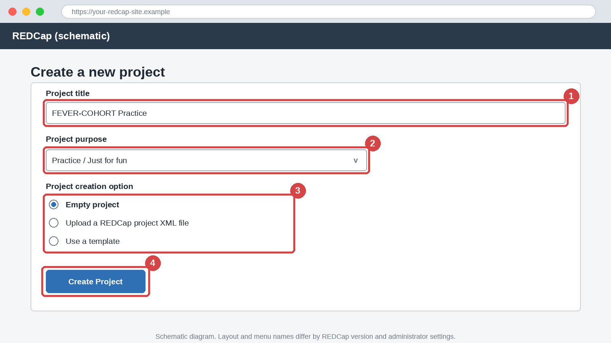
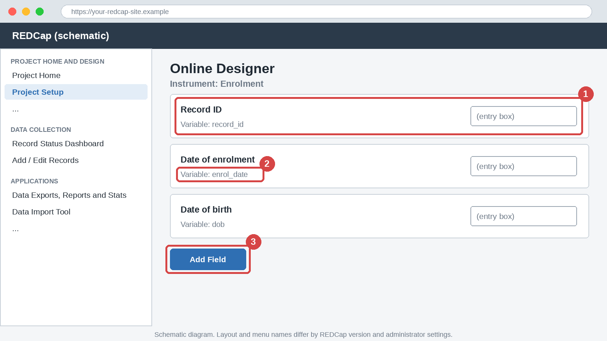
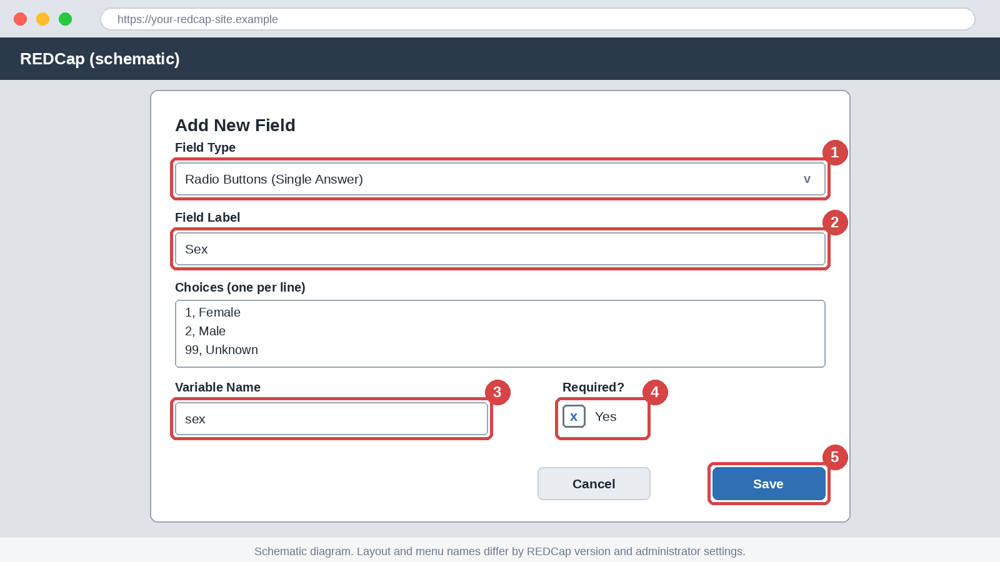
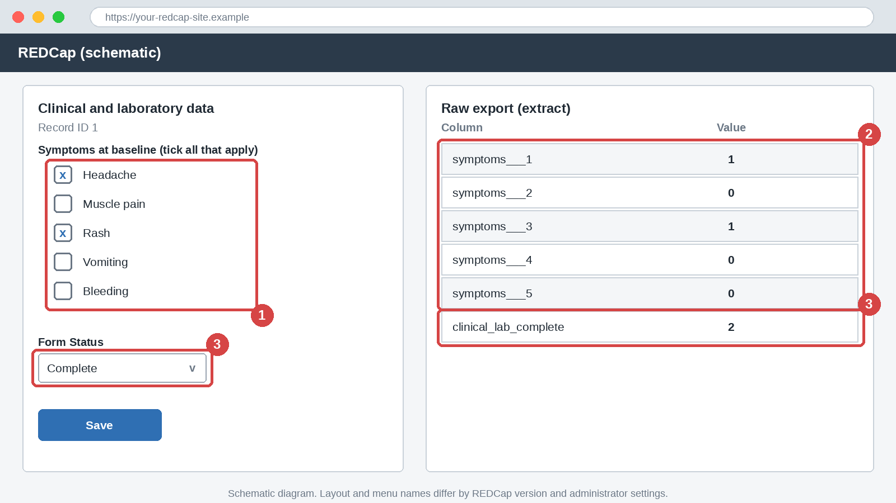

# Module 3: Creating a Project, Online Designer, Instruments and Field Types

## Part A: English

### 1. Title block

| Item | Detail |
|------|--------|
| Module | 3 of 20 |
| Level | Beginner |
| Estimated time | 45 to 60 minutes |
| Assumed REDCap version | 14 or later. Menu names differ by version and by administrator settings. |
| Prerequisites | Modules 1 and 2. A practice project is needed for Track A. |
| Case studies used | A (FEVER-COHORT), with B (HHKAP) in Exercise 3 |

> ⚠️ **Pitfall:** Never enter real patient data, real identifiers or real participants into a practice project. Use synthetic data only.

### 2. Learning objectives

By the end of this module you will be able to:

1. Create a practice project from the Create New Project page.
2. Work through the Project Setup checklist in the right order.
3. Build instruments in Online Designer and add fields to them.
4. Choose the correct field type for a given variable.
5. Explain how the record identifier, required fields, form status and checkbox fields are stored and exported.

### 3. Why this matters

**Data quality:** the field type decides what a user can type. A radio field accepts only listed choices.

**Analysis:** the field type decides the shape of the exported data. A checkbox field gives several columns, not one.

**Compliance:** the record identifier links every form. If it holds a name or national ID, the identifier travels into every export.

**Career:** building a clean project in Online Designer is the most visible REDCap skill on a research team.

### 4. Core concepts

**Creating a project.** The Create New Project page offers three starting options. Wording differs by version. Verify in your REDCap instance.

| Option | Use it when | Covered in |
|--------|-------------|------------|
| Empty project | You build the design yourself in Online Designer | This module |
| Upload a REDCap project XML file | You copy a complete project, including settings | Module 6 |
| Use a template | You start from a Shared Library or institutional template | Module 6 |

You can also create an empty project and upload a data dictionary into it, as in Module 2. Choose the purpose honestly. Use "Practice / Just for fun" for training, because other purposes may trigger extra questions or approvals. Verify in your REDCap instance.

**The Project Setup checklist.** Project Setup lists the main steps. Work from top to bottom.

1. Main project settings: title, purpose, longitudinal design and surveys.
2. Enable optional modules and customizations, for example record auto-numbering.
3. Design your data collection instruments, which opens Online Designer.
4. Define events (longitudinal projects only, Module 8).
5. Move to Production, after testing (Module 17).

Step names differ by version. Verify in your REDCap instance. A new project starts in Development status, where fields can be added, changed and deleted freely.

**Instruments.** An instrument (also called a form) is one page of related fields, for example enrolment or clinical and laboratory data. Plan one instrument per CRF topic. Each has a unique lowercase name, shown as `Form Name` in the data dictionary. Data entry rights are set per instrument (Module 16).

**Field types.** The field type decides how a value is entered, stored and exported.

| Field type | Dictionary code | Use it for | Note |
|------------|-----------------|------------|------|
| Text Box | `text` | Short text, numbers and dates | Validation is set in Module 4 |
| Notes Box | `notes` | Long free text | Hard to analyse, so use sparingly |
| Calculated Field | `calc` | Values derived from other fields | Never typed (Module 4) |
| Drop-down List | `dropdown` | One answer from a long list | Choices are hidden until opened |
| Radio Buttons | `radio` | One answer from a short list | All choices are visible |
| Checkboxes | `checkbox` | Several answers at once | One export column per choice |
| Yes - No | `yesno` | A binary question | Stored as 1 and 0 |
| True - False | `truefalse` | A statement to confirm | Stored as 1 and 0 |
| Slider | `slider` | A scale or visual analogue score | Stored as a number. Verify in your REDCap instance. |
| File Upload | `file` | Scans and documents | The file is not part of the CSV export. Verify in your REDCap instance. |
| Descriptive Text | `descriptive` | Instructions between fields | Stores no data |

Online Designer names are longer than the dictionary codes, for example "Radio Buttons (Single Answer)". Verify in your REDCap instance. Two features are not field types: a section header splits a long instrument into titled parts, and a matrix of fields shows questions that share the same choices as a grid. In the dictionary, a matrix is a set of radio or checkbox rows with the same `Matrix Group Name`.

**The record identifier.** The first field of the first instrument is the record identifier, usually `record_id`. Every form links to it. It must be unique, and it must not be a name, a national ID number or a hospital number. Use an anonymous study number. With record auto-numbering, REDCap assigns the next number. Without it, users type the identifier, which suits site-coded IDs such as `S1-001`. Verify in your REDCap instance.

**Required fields, field notes and form status**

- A required field is marked with an asterisk, and REDCap warns the user if it is blank at save. Require only what the analysis needs, because forced answers produce invented values.
- A field note is a short hint under the field, for example "Enter a number such as 38.5".
- Form status is set at the bottom of each form: Incomplete (0), Unverified (1) or Complete (2). REDCap stores it in an automatic variable named `<form_name>_complete`, which is why Module 2 asked you not to end your own variable names in `_complete`.

**How checkbox fields are stored (worked example, FEVER-COHORT).** A checkbox field is stored as one variable per choice. The choice code is added after three underscores. The value is 1 if ticked and 0 if not.

| Choice code | Label | Export column | Headache and Rash ticked |
|-------------|-------|---------------|--------------------------|
| 1 | Headache | `symptoms___1` | 1 |
| 2 | Muscle pain | `symptoms___2` | 0 |
| 3 | Rash | `symptoms___3` | 1 |
| 4 | Vomiting | `symptoms___4` | 0 |
| 5 | Bleeding | `symptoms___5` | 0 |

A labelled export shows Checked or Unchecked instead of 1 and 0. Verify in your REDCap instance. Never change a choice code after data entry starts.

### 5. Step-by-step walkthrough

Use a practice project only. Menu names may differ in your version.

1. From **My Projects**, select **New Project**. Verify in your REDCap instance.
2. On the Create New Project page, enter the title "FEVER-COHORT Practice" and choose the purpose "Practice / Just for fun". Select the empty project option and click **Create Project**.

   > 📷 **Figure 1:** Create New Project page (schematic). Find (1) the project title, (2) the project purpose, (3) the project creation option and (4) the Create Project button.

   

3. Open **Project Setup**. Read the checklist from top to bottom and confirm the status is Development.
4. Select **Online Designer**, create an instrument named "Enrolment" and open it for editing. The first field is the record identifier.

   > 📷 **Figure 2:** Online Designer, instrument open for editing (schematic). Find (1) the record identifier field, (2) the variable name under a field label and (3) the Add Field button.

   

5. Click **Add Field**. Choose the field type, type the label and the variable name, and tick **Required** where needed. Click **Save**.

   > 📷 **Figure 3:** Add New Field dialog (schematic). Find (1) the field type list, (2) the field label, (3) the variable name, (4) the required setting and (5) the Save button.

   

6. Add the enrolment fields from Exercise 1. For choice fields, type one choice per line as `code, label`, for example `1, Female`.
7. Create a second instrument named "Clinical and laboratory data". Add `temp_c` as a text field with the field note "Enter a number such as 38.5". Add `symptoms` as a checkbox with the five choices from Section 4.
8. Open **Add / Edit Records**, create a record, tick Headache and Rash, set the form status to Complete and save.

   > 📷 **Figure 4:** Data entry and raw export (schematic). Find (1) the ticked checkboxes, (2) the five `symptoms` export columns and (3) the form status and its `clinical_lab_complete` column.

   

9. Export the data as raw CSV from **Data Exports, Reports and Stats** and open the file in a text editor. Find the `symptoms___1` to `symptoms___5` columns. Menu names: Verify in your REDCap instance.

Alternatively, upload `data/M03_fever_cohort_field_types.csv` as in Module 2 and compare it with your design.

### 6. If this is not enabled

> 🔒 **Admin-dependent:** Some instances allow only administrators to create projects, or hold new projects for approval. Verify in your REDCap instance.

**What to request from the administrator:** a practice project in Development status with design rights for you, or permission to create practice projects.

**Conceptual walkthrough without access:** open the two CSV files in a spreadsheet. Each row is one field, the `Form Name` column gives the instruments and the `Field Type` column gives the Add New Field choices. Use Track B in each exercise.

### 7. Exercises

**Exercise 1 (guided): Build the enrolment instrument**

Build the first instrument of FEVER-COHORT Practice with `record_id`, `enrol_date`, `dob`, `sex` and `onset_date`.

**Track A (live REDCap practice project):**

1. Create the project and the instrument "Enrolment".
2. Add `enrol_date`, `dob` and `onset_date` as required text fields (validation comes in Module 4).
3. Add `sex` as radio buttons with `1, Female`, `2, Male` and `99, Unknown`.
4. Add a record, leave `enrol_date` blank and save.
5. Self-check: the designer shows 5 fields in this order, and REDCap warns about the blank required field. Warning wording differs by version.

**Track B (no access):** Open `data/M03_fever_cohort_field_types.csv` in a spreadsheet. List the fields of the `enrolment` form with their field types.

Answer key

**Track A:** 5 fields in the order `record_id`, `enrol_date`, `dob`, `sex`, `onset_date`. The warning names the blank required field. Whether you may save anyway depends on the version. Verify in your REDCap instance.

**Track B:** The `enrolment` form has 8 fields: `record_id` (text), `enrol_date` (text), `dob` (text), `age_years` (calc), `sex` (radio), `onset_date` (text), `fever_days` (calc) and `consent_confirm` (truefalse).

**Exercise 2 (independent): Choose the field types**

Choose the best field type and give its dictionary code for each item.

| No. | Item |
|-----|------|
| 1 | Haematocrit (%) |
| 2 | Sex (female, male, unknown) |
| 3 | District of residence (40 districts) |
| 4 | Symptoms (more than one may apply) |
| 5 | Admitted to hospital? |
| 6 | Self-rated pain from 0 to 100 |
| 7 | Free-text clinical comments |
| 8 | Days from onset to enrolment |
| 9 | Scanned laboratory report |

**Track A (live REDCap practice project):**

1. In the "Clinical and laboratory data" instrument, add one field for each item that fits there.
2. Upload `data/M03_fever_cohort_field_types.csv` into a second practice project and compare with the `Field Type` column.
3. Self-check: your choices match the file, or you can explain each difference.

**Track B (no access):** Write your answers with a one-line reason each. Compare with the CSV.

Answer key

| No. | Field type | Code |
|-----|------------|------|
| 1 | Text Box with a number validation | `text` |
| 2 | Radio Buttons | `radio` |
| 3 | Drop-down List | `dropdown` |
| 4 | Checkboxes | `checkbox` |
| 5 | Yes - No | `yesno` |
| 6 | Slider | `slider` |
| 7 | Notes Box | `notes` |
| 8 | Calculated Field | `calc` |
| 9 | File Upload | `file` |

Item 3 is not in the sample file, which uses a drop-down for `outcome_d28`. Any reasoned equivalent is accepted.

**Exercise 3 (challenge): Predict the export**

**Track A (live REDCap practice project):**

1. In FEVER-COHORT Practice, enter a record with Headache and Rash ticked and the form status set to Complete.
2. Create a second practice project "HHKAP Practice" by uploading `data/M03_hhkap_matrix_demo.csv`. Enter a record with `kap_a1` Agree, `kap_a2` Neutral and `kap_a3` Strongly agree.
3. Export both projects as raw CSV.
4. Self-check: the export matches your prediction from Track B.

**Track B (no access):** Write the predicted raw export columns and values for (a) `symptoms` and `clinical_lab_complete`, and (b) `kap_a1` to `kap_a3`. Explain in one sentence why the checkbox gives 5 columns and the matrix gives 3.

Answer key

(a) `symptoms___1` = 1, `symptoms___2` = 0, `symptoms___3` = 1, `symptoms___4` = 0, `symptoms___5` = 0, and `clinical_lab_complete` = 2.

(b) `kap_a1` = 4, `kap_a2` = 3, `kap_a3` = 5.

A checkbox is one question with many possible ticks, so each choice gets its own column. A matrix is three separate single-answer questions that share one set of choices, so each question gets one column.

### 8. Quiz

**Question 1 (multiple choice).** Which field type lets a user select more than one answer?

- A. Radio Buttons
- B. Drop-down List
- C. Checkboxes
- D. Yes - No

Answer

C. Checkboxes allow several selections and are exported as one column per choice.

**Question 2 (multiple choice).** A record has choices 1 and 3 ticked in `symptoms`. Which raw export columns equal 1?

- A. `symptoms` only
- B. `symptoms___1` and `symptoms___3`
- C. `symptoms_1` and `symptoms_3`
- D. `symptoms___13`

Answer

B. The choice code follows three underscores, and each ticked choice is 1.

**Question 3 (multiple choice).** Which is the safest record identifier?

- A. National ID number
- B. Patient initials
- C. Hospital number
- D. Anonymous study number such as `S1-001`

Answer

D. The identifier appears in every form and export, so it must not identify the person.

**Question 4 (short answer).** Why use a calculated field for age instead of a text field?

Answer

A calculated value follows `dob` and the enrolment date and cannot disagree with them. A typed age can.

**Question 5 (multiple choice).** In form status, which code means Complete?

- A. 0
- B. 1
- C. 2
- D. 99

Answer

C. 0 is Incomplete, 1 is Unverified and 2 is Complete.

**Question 6 (short answer).** When should a drop-down list be preferred over radio buttons?

Answer

When the list is long, for example 40 districts. For about 6 choices or fewer, radio buttons keep every choice visible.

### 9. Common pitfalls

> ⚠️ **Pitfall:** Using a name, national ID or hospital number as `record_id`. It then appears in every export.

> ⚠️ **Pitfall:** Using a text field for answers with a short list of choices. Spelling variants then need cleaning.

> ⚠️ **Pitfall:** Treating a checkbox field as one column in analysis. The export has one column per choice.

> ⚠️ **Pitfall:** Changing choice codes after data entry starts. Old and new records then mean different things.

> ⚠️ **Pitfall:** Making every field required. Users type placeholder values to get past the warning.

### 10. Career tips

> 🎯 **Career tip:** Keep a practice project with one example of every field type. It is a fast demonstration in an interview.

> 🎯 **Career tip:** When you hand data to a statistician, add a note on how checkbox fields are exported. It saves a round of questions.

> 🎯 **Career tip:** Say "I build from a data dictionary and verify in Online Designer" on your CV. It shows a controlled, repeatable way of working.

### 11. Downloadable files

| File | Contents | How to use |
|------|----------|------------|
| [M03_fever_cohort_field_types.csv](data/M03_fever_cohort_field_types.csv) | FEVER-COHORT dictionary with 17 fields in 3 instruments, covering all 11 dictionary field types | Upload in Exercise 2, or compare with your own design |
| [M03_hhkap_matrix_demo.csv](data/M03_hhkap_matrix_demo.csv) | HHKAP dictionary with 7 fields, including a matrix of three attitude items | Upload in Exercise 3 |

Open CSV files in a text editor or import them as UTF-8 text so that values are not auto-formatted.

### 12. Key takeaways

- Create practice projects as empty projects in Development status, and follow the Project Setup checklist from top to bottom.
- Build one instrument per topic in Online Designer.
- Choose the field type by the answer you need: text for values, radio or drop-down for one choice, checkboxes for several, yes/no for binary.
- Keep the record identifier anonymous and unique, and require only essential fields.
- A checkbox field exports as one column per choice, and form status is stored in `<form_name>_complete`.

### 13. Next module

Next: Module 4, Field validation, branching logic, calculated fields.

Topics: text validation, hard and soft limits, branching logic syntax and calculated fields such as age and BMI.

### 14. Version table

| Version | Date |
|---------|------|
| 1.0 | 2026-10-10 |

---

## Part B: Burmese

### 1. ခေါင်းစဉ်အချက်အလက် (Title block)

| အချက် | အသေးစိတ် |
|-------|----------|
| မော်ဂျူး | 20 ခုအနက် 3 ခု |
| အဆင့် | အခြေခံ (Beginner) |
| ခန့်မှန်းကြာချိန် | 45 မှ 60 မိနစ် |
| ယူဆထားသော REDCap ဗားရှင်း | 14 နှင့်အထက်။ မီနူးအမည်များသည် ဗားရှင်းနှင့် စီမံခန့်ခွဲသူ (Administrator) ၏ ဆက်တင်များပေါ် မူတည်ပြီး ကွဲပြားနိုင်ပါတယ်။ |
| ကြိုတင်လိုအပ်ချက် | မော်ဂျူး 1 နဲ့ 2။ Track A အတွက် လေ့ကျင့်ရေးပရောဂျက် လိုပါတယ်။ |
| အသုံးပြုသော ဖြစ်ရပ်လေ့လာမှုများ | A (FEVER-COHORT)၊ လေ့ကျင့်ခန်း 3 မှာ B (HHKAP) ကိုပါ သုံးပါတယ် |

> ⚠️ **Pitfall:** လက်တွေ့လူနာဒေတာ၊ တကယ့်ကိုယ်ရေးကိုယ်တာ အချက်အလက်နဲ့ တကယ့်ပါဝင်သူတွေရဲ့ အချက်အလက်တွေကို လေ့ကျင့်ရေး ပရောဂျက်ထဲ ဘယ်တော့မှ မထည့်ပါနဲ့။ ဖန်တီးထားတဲ့ (synthetic) ဒေတာကိုပဲ သုံးပါ။

### 2. သင်ယူရမည့် ရည်မှန်းချက်များ (Learning objectives)

ဒီမော်ဂျူးအဆုံးမှာ သင်ဟာ အောက်ပါအရာတွေကို လုပ်နိုင်ပါလိမ့်မယ်။

1. Create New Project စာမျက်နှာကနေ လေ့ကျင့်ရေးပရောဂျက်တစ်ခု ဖန်တီးနိုင်ပါမယ်။
2. Project Setup စစ်ရင်းစာရင်း (checklist) ကို အစီအစဉ်မှန်မှန် လိုက်လုပ်နိုင်ပါမယ်။
3. Online Designer မှာ instrument တွေ တည်ဆောက်ပြီး field တွေ ထည့်နိုင်ပါမယ်။
4. variable တစ်ခုစီအတွက် မှန်ကန်တဲ့ field type ကို ရွေးနိုင်ပါမယ်။
5. record identifier၊ required field၊ form status နဲ့ checkbox field တွေကို ဘယ်လို သိမ်းပြီး export လုပ်လဲဆိုတာ ရှင်းပြနိုင်ပါမယ်။

### 3. ဘာကြောင့် အရေးကြီးသလဲ (Why this matters)

**ဒေတာအရည်အသွေး (Data quality):** field type က အသုံးပြုသူ ဘာရိုက်လို့ရလဲဆိုတာကို ဆုံးဖြတ်ပါတယ်။ radio field က စာရင်းထဲက ရွေးချယ်စရာတွေကိုပဲ လက်ခံပါတယ်။

**ခွဲခြမ်းစိတ်ဖြာမှု (Analysis):** field type က export လုပ်လိုက်တဲ့ ဒေတာရဲ့ ပုံသဏ္ဍာန်ကို ဆုံးဖြတ်ပါတယ်။ checkbox field က column တစ်ခုမဟုတ်ဘဲ column အများကြီး ထွက်ပါတယ်။

**စည်းမျဉ်းလိုက်နာမှု (Compliance):** record identifier က ဖောင်တိုင်းကို ချိတ်ဆက်ပေးပါတယ်။ အဲဒီမှာ အမည် ဒါမှမဟုတ် အမျိုးသားမှတ်ပုံတင်နံပါတ် ပါနေရင် identifier က export တိုင်းထဲ လိုက်သွားပါလိမ့်မယ်။

**အလုပ်အကိုင် (Career):** Online Designer မှာ သန့်ရှင်းတဲ့ ပရောဂျက်တစ်ခု တည်ဆောက်နိုင်တာက သုတေသနအဖွဲ့တစ်ခုမှာ အထင်ရှားဆုံး REDCap ကျွမ်းကျင်မှု ဖြစ်ပါတယ်။

### 4. အဓိကအယူအဆများ (Core concepts)

**ပရောဂျက်ဖန်တီးခြင်း (Creating a project).** Create New Project စာမျက်နှာမှာ စတင်ဖို့ ရွေးချယ်စရာ သုံးခု ပါပါတယ်။ စာသားက ဗားရှင်းအလိုက် ကွဲပါတယ်။ Verify in your REDCap instance။

| ရွေးချယ်စရာ | ဘယ်အချိန် သုံးမလဲ | ဖော်ပြထားတဲ့ မော်ဂျူး |
|-------------|------------------|--------------------|
| Empty project | Online Designer မှာ ဒီဇိုင်းကို ကိုယ်တိုင်ဆောက်တဲ့အခါ | ဒီမော်ဂျူး |
| Upload a REDCap project XML file | ဆက်တင်တွေအပါအဝင် ပရောဂျက်တစ်ခုလုံးကို ကူးတဲ့အခါ | မော်ဂျူး 6 |
| Use a template | Shared Library သို့မဟုတ် အဖွဲ့အစည်းရဲ့ template ကနေ စတဲ့အခါ | မော်ဂျူး 6 |

empty project တစ်ခု ဖန်တီးပြီး မော်ဂျူး 2 မှာလို data dictionary ကို upload လုပ်လို့လည်း ရပါတယ်။ ရည်ရွယ်ချက် (purpose) ကို ရိုးရိုးသားသား ရွေးပါ။ လေ့ကျင့်ရေးအတွက် "Practice / Just for fun" ကို သုံးပါ၊ အခြားရည်ရွယ်ချက်တွေက မေးခွန်းတိုး သို့မဟုတ် ခွင့်ပြုချက် လိုလာနိုင်လို့ပါ။ Verify in your REDCap instance။

**Project Setup စစ်ရင်းစာရင်း (The Project Setup checklist).** Project Setup မှာ အဓိကအဆင့်တွေ စာရင်းပြထားပါတယ်။ အပေါ်ကနေ အောက်ကို လုပ်သွားပါ။

1. Main project settings: ခေါင်းစဉ်၊ ရည်ရွယ်ချက်၊ longitudinal ဒီဇိုင်းနဲ့ surveys။
2. Enable optional modules and customizations၊ ဥပမာ record auto-numbering။
3. Design your data collection instruments၊ ဒါက Online Designer ကို ဖွင့်ပေးပါတယ်။
4. Define events (longitudinal ပရောဂျက်တွေအတွက်ပဲ၊ မော်ဂျူး 8)။
5. Production သို့ ရွှေ့ပါ၊ စမ်းသပ်ပြီးမှ (မော်ဂျူး 17)။

အဆင့်အမည်တွေက ဗားရှင်းအလိုက် ကွဲပါတယ်။ Verify in your REDCap instance။ ပရောဂျက်အသစ်က Development အခြေအနေနဲ့ စပါတယ်၊ အဲဒီမှာ field တွေကို လွတ်လပ်စွာ ထည့်၊ ပြင်၊ ဖျက်လို့ရပါတယ်။

**Instrument များ (Instruments).** instrument (form လို့လည်း ခေါ်ပါတယ်) ဆိုတာ သက်ဆိုင်ရာ field တွေပါတဲ့ စာမျက်နှာတစ်ခုပါ။ ဥပမာ enrolment ဒါမှမဟုတ် clinical and laboratory data။ CRF ခေါင်းစဉ်တစ်ခုကို instrument တစ်ခု စီစဉ်ပါ။ တစ်ခုစီမှာ စာလုံးအသေးနဲ့ ထူးခြားတဲ့ အမည်တစ်ခု ရှိပြီး data dictionary မှာ `Form Name` အဖြစ် ပေါ်ပါတယ်။ ဒေတာထည့်ခွင့် (Data entry rights) ကို instrument တစ်ခုချင်းစီအလိုက် သတ်မှတ်ပါတယ် (မော်ဂျူး 16)။

**Field types (Field types).** field type က တန်ဖိုးတစ်ခုကို ဘယ်လိုထည့်၊ သိမ်း၊ export လုပ်လဲဆိုတာ ဆုံးဖြတ်ပါတယ်။

| Field type | Dictionary code | အသုံးပြုရန် | မှတ်ချက် |
|------------|-----------------|-------------|----------|
| Text Box | `text` | စာတို၊ ကိန်းဂဏန်းနဲ့ ရက်စွဲ | Validation ကို မော်ဂျူး 4 မှာ သတ်မှတ်ပါတယ် |
| Notes Box | `notes` | စာရှည် (free text) | ခွဲခြမ်းစိတ်ဖြာဖို့ ခက်လို့ ရှောင်ပါ |
| Calculated Field | `calc` | တခြား field တွေကနေ တွက်ထုတ်တဲ့ တန်ဖိုး | ဘယ်တော့မှ ရိုက်မထည့်ပါ (မော်ဂျူး 4) |
| Drop-down List | `dropdown` | စာရင်းရှည်ကနေ အဖြေတစ်ခု | ဖွင့်မှ ရွေးချယ်စရာတွေ မြင်ရပါတယ် |
| Radio Buttons | `radio` | စာရင်းတိုကနေ အဖြေတစ်ခု | ရွေးချယ်စရာအားလုံး မြင်ရပါတယ် |
| Checkboxes | `checkbox` | အဖြေအများကြီး တစ်ပြိုင်နက် | ရွေးချယ်စရာတစ်ခုချင်းစီအတွက် export column တစ်ခု |
| Yes - No | `yesno` | နှစ်မျိုးရွေး မေးခွန်း | 1 နဲ့ 0 အဖြစ် သိမ်းပါတယ် |
| True - False | `truefalse` | အတည်ပြုရမယ့် ထုတ်ပြန်ချက် | 1 နဲ့ 0 အဖြစ် သိမ်းပါတယ် |
| Slider | `slider` | စကေး ဒါမှမဟုတ် visual analogue ရမှတ် | ကိန်းဂဏန်းအဖြစ် သိမ်းပါတယ်။ Verify in your REDCap instance။ |
| File Upload | `file` | စကင်ဖတ်ထားတဲ့ ဖိုင်နဲ့ စာရွက်စာတမ်း | ဖိုင်က CSV export ထဲ မပါပါဘူး။ Verify in your REDCap instance။ |
| Descriptive Text | `descriptive` | field တွေကြားက ညွှန်ကြားချက် | ဒေတာ မသိမ်းပါဘူး |

Online Designer ထဲက အမည်တွေက dictionary code တွေထက် ပိုရှည်ပါတယ်၊ ဥပမာ "Radio Buttons (Single Answer)"။ Verify in your REDCap instance။ field type မဟုတ်တဲ့ လက္ခဏာနှစ်ခု ရှိပါတယ်။ section header က instrument ရှည်ကို ခေါင်းစဉ်ပါတဲ့ အပိုင်းတွေအဖြစ် ခွဲပေးပြီး matrix of fields က တူညီတဲ့ ရွေးချယ်စရာတွေ မျှဝေတဲ့ မေးခွန်းတွေကို ဇယားကွက်အဖြစ် ပြပါတယ်။ dictionary မှာ matrix ဆိုတာ `Matrix Group Name` တူတဲ့ radio ဒါမှမဟုတ် checkbox အတန်းတွေရဲ့ အစုပါ။

**Record identifier (The record identifier).** ပထမ instrument ရဲ့ ပထမ field က record identifier ဖြစ်ပြီး ပုံမှန်အားဖြင့် `record_id` ပါ။ ဖောင်တိုင်းက ဒါနဲ့ ချိတ်ထားပါတယ်။ ထူးခြားရမယ် (unique)၊ အမည်၊ အမျိုးသားမှတ်ပုံတင်နံပါတ် ဒါမှမဟုတ် ဆေးရုံနံပါတ် မဖြစ်ရပါဘူး။ အမည်မသိ လေ့လာမှုနံပါတ်တစ်ခု သုံးပါ။ record auto-numbering ဖွင့်ထားရင် REDCap က နောက်နံပါတ်ကို ပေးပါတယ်။ မဖွင့်ရင် အသုံးပြုသူတွေက identifier ကို ကိုယ်တိုင်ရိုက်ရပြီး `S1-001` လို ဆိုက်ကုဒ်ပါတဲ့ ID တွေနဲ့ ကိုက်ပါတယ်။ Verify in your REDCap instance။

**Required field၊ field note နဲ့ form status (Required fields, field notes and form status)**

- required field ကို ကြယ်ပွင့် (asterisk) နဲ့ အမှတ်အသားလုပ်ထားပြီး save လုပ်တဲ့အခါ အလွတ်ဖြစ်နေရင် REDCap က သတိပေးပါတယ်။ ခွဲခြမ်းစိတ်ဖြာမှုမှာ တကယ်လိုတာကိုပဲ required လုပ်ပါ၊ အတင်းဖြေခိုင်းရင် ဖန်တီးထားတဲ့ တန်ဖိုးတွေ ထွက်လာလို့ပါ။
- field note ဆိုတာ field အောက်က အရိပ်အမြွက်စာတို ဖြစ်ပါတယ်၊ ဥပမာ "Enter a number such as 38.5"။
- form status ကို ဖောင်တစ်ခုစီရဲ့ အောက်ဆုံးမှာ သတ်မှတ်ပါတယ်: Incomplete (0)၊ Unverified (1) သို့မဟုတ် Complete (2)။ REDCap က ဒါကို `<form_name>_complete` လို့ အမည်ပေးထားတဲ့ အလိုအလျောက် variable ထဲ သိမ်းပါတယ်။ ဒါကြောင့်ပဲ မော်ဂျူး 2 မှာ သင့် variable အမည်တွေကို `_complete` နဲ့ မအဆုံးသတ်ဖို့ ပြောခဲ့တာပါ။

**checkbox field တွေကို ဘယ်လိုသိမ်းလဲ (How checkbox fields are stored, worked example, FEVER-COHORT).** checkbox field တစ်ခုကို ရွေးချယ်စရာတစ်ခုချင်းစီအတွက် variable တစ်ခုစီ သိမ်းပါတယ်။ ရွေးချယ်စရာကုဒ်ကို underscore သုံးခုပြီးနောက် ထည့်ပါတယ်။ အမှန်ခြစ်ထားရင် တန်ဖိုးက 1၊ မခြစ်ရင် 0 ပါ။

| ရွေးချယ်စရာကုဒ် | Label | Export column | Headache နဲ့ Rash ကို ခြစ်ထားရင် |
|-----------------|-------|---------------|--------------------------------|
| 1 | Headache | `symptoms___1` | 1 |
| 2 | Muscle pain | `symptoms___2` | 0 |
| 3 | Rash | `symptoms___3` | 1 |
| 4 | Vomiting | `symptoms___4` | 0 |
| 5 | Bleeding | `symptoms___5` | 0 |

labelled export မှာ 1 နဲ့ 0 အစား Checked သို့မဟုတ် Unchecked လို့ ပြပါတယ်။ Verify in your REDCap instance။ ဒေတာထည့်တာ စပြီးရင် ရွေးချယ်စရာကုဒ်ကို ဘယ်တော့မှ မပြောင်းပါနဲ့။

### 5. အဆင့်ဆင့် လမ်းညွှန် (Step-by-step walkthrough)

လေ့ကျင့်ရေးပရောဂျက်မှာပဲ လုပ်ပါ။ မီနူးအမည်တွေက သင့်ဗားရှင်းမှာ ကွဲနိုင်ပါတယ်။

1. **My Projects** ကနေ **New Project** ကို ရွေးပါ။ Verify in your REDCap instance။
2. Create New Project စာမျက်နှာမှာ ခေါင်းစဉ် "FEVER-COHORT Practice" ကို ရိုက်ပြီး ရည်ရွယ်ချက် "Practice / Just for fun" ကို ရွေးပါ။ empty project ရွေးချယ်စရာကို ရွေးပြီး **Create Project** ကို နှိပ်ပါ။

   > 📷 **ပုံ 1:** Create New Project စာမျက်နှာ (ပုံကြမ်း)။ (1) ပရောဂျက်ခေါင်းစဉ်၊ (2) ပရောဂျက်ရည်ရွယ်ချက်၊ (3) ပရောဂျက်ဖန်တီးမယ့် ရွေးချယ်စရာနဲ့ (4) Create Project ခလုတ်ကို ရှာပါ။

   

3. **Project Setup** ကို ဖွင့်ပါ။ စစ်ရင်းစာရင်းကို အပေါ်ကနေ အောက်ကို ဖတ်ပြီး အခြေအနေက Development ဖြစ်တာ အတည်ပြုပါ။
4. **Online Designer** ကို ရွေးပြီး "Enrolment" အမည်နဲ့ instrument တစ်ခု ဖန်တီးကာ တည်းဖြတ်ဖို့ ဖွင့်ပါ။ ပထမ field က record identifier ပါ။

   > 📷 **ပုံ 2:** Online Designer၊ တည်းဖြတ်ဖို့ ဖွင့်ထားတဲ့ instrument (ပုံကြမ်း)။ (1) record identifier field၊ (2) field label အောက်က variable အမည်နဲ့ (3) Add Field ခလုတ်ကို ရှာပါ။

   

5. **Add Field** ကို နှိပ်ပါ။ field type ကို ရွေးပြီး label နဲ့ variable အမည်ကို ရိုက်ကာ လိုအပ်ရင် **Required** ကို ခြစ်ပါ။ **Save** ကို နှိပ်ပါ။

   > 📷 **ပုံ 3:** Add New Field dialog (ပုံကြမ်း)။ (1) field type စာရင်း၊ (2) field label၊ (3) variable အမည်၊ (4) required ဆက်တင်နဲ့ (5) Save ခလုတ်ကို ရှာပါ။

   

6. လေ့ကျင့်ခန်း 1 ထဲက enrolment field တွေကို ထည့်ပါ။ ရွေးချယ်စရာ field တွေအတွက် ရွေးချယ်စရာတစ်ခုကို တစ်ကြောင်းစီ `code, label` ပုံစံနဲ့ ရိုက်ပါ၊ ဥပမာ `1, Female`။
7. "Clinical and laboratory data" အမည်နဲ့ ဒုတိယ instrument တစ်ခု ဖန်တီးပါ။ `temp_c` ကို text field အဖြစ် ထည့်ပြီး field note "Enter a number such as 38.5" ထည့်ပါ။ `symptoms` ကို ပိုင်း 4 ထဲက ရွေးချယ်စရာ ငါးခုနဲ့ checkbox အဖြစ် ထည့်ပါ။
8. **Add / Edit Records** ကို ဖွင့်ပြီး record တစ်ခုဖန်တီးကာ Headache နဲ့ Rash ကို ခြစ်ပါ။ form status ကို Complete လို့ ထားပြီး save လုပ်ပါ။

   > 📷 **ပုံ 4:** ဒေတာထည့်ခြင်းနဲ့ raw export (ပုံကြမ်း)။ (1) ခြစ်ထားတဲ့ checkbox တွေ၊ (2) `symptoms` export column ငါးခုနဲ့ (3) form status နဲ့ သူ့ရဲ့ `clinical_lab_complete` column ကို ရှာပါ။

   

9. **Data Exports, Reports and Stats** ကနေ ဒေတာကို raw CSV အဖြစ် export လုပ်ပြီး ဖိုင်ကို text editor မှာ ဖွင့်ပါ။ `symptoms___1` မှ `symptoms___5` column တွေကို ရှာပါ။ မီနူးအမည်တွေ: Verify in your REDCap instance။

တနည်းအားဖြင့် `data/M03_fever_cohort_field_types.csv` ကို မော်ဂျူး 2 မှာလို upload လုပ်ပြီး သင့်ဒီဇိုင်းနဲ့ နှိုင်းယှဉ်ပါ။

### 6. မဖွင့်ထားရင် (If this is not enabled)

> 🔒 **Admin-dependent:** instance အချို့မှာ စီမံခန့်ခွဲသူတွေကိုပဲ ပရောဂျက်ဖန်တီးခွင့် ပေးတာ၊ ဒါမှမဟုတ် ပရောဂျက်အသစ်တွေကို ခွင့်ပြုချက်စောင့်ခိုင်းတာ ရှိပါတယ်။ Verify in your REDCap instance။

**စီမံခန့်ခွဲသူထံ တောင်းဆိုရမည့်အရာ:** Development အခြေအနေက လေ့ကျင့်ရေးပရောဂျက်တစ်ခုမှာ သင့်အတွက် design right၊ သို့မဟုတ် လေ့ကျင့်ရေးပရောဂျက် ဖန်တီးခွင့်။

**ဝင်ခွင့်မရှိရင် အယူအဆအရ လမ်းညွှန်:** CSV ဖိုင်နှစ်ဖိုင်ကို spreadsheet မှာ ဖွင့်ပါ။ အတန်းတစ်ခုက field တစ်ခုပါ၊ `Form Name` column က instrument တွေကို ပေးပြီး `Field Type` column က Add New Field ရွေးချယ်စရာတွေကို ပေးပါတယ်။ လေ့ကျင့်ခန်းတိုင်းမှာ Track B ကို သုံးပါ။

### 7. လေ့ကျင့်ခန်းများ (Exercises)

**လေ့ကျင့်ခန်း 1 (လမ်းညွှန်ပါ): enrolment instrument တည်ဆောက်ပါ**

FEVER-COHORT Practice ရဲ့ ပထမ instrument ကို `record_id`, `enrol_date`, `dob`, `sex` နဲ့ `onset_date` ပါအောင် တည်ဆောက်ပါ။

**Track A (live REDCap လေ့ကျင့်ရေးပရောဂျက်):**

1. ပရောဂျက်နဲ့ "Enrolment" instrument ကို ဖန်တီးပါ။
2. `enrol_date`, `dob` နဲ့ `onset_date` ကို required text field တွေအဖြစ် ထည့်ပါ (validation ကို မော်ဂျူး 4 မှာ လေ့လာပါမယ်)။
3. `sex` ကို `1, Female`, `2, Male` နဲ့ `99, Unknown` ပါတဲ့ radio buttons အဖြစ် ထည့်ပါ။
4. record တစ်ခု ထည့်ပြီး `enrol_date` ကို အလွတ်ထားကာ save လုပ်ပါ။
5. ကိုယ်တိုင်စစ်ဆေးခြင်း: designer မှာ field 5 ခုကို ဒီအစီအစဉ်အတိုင်း မြင်ရပြီး အလွတ်ထားတဲ့ required field အကြောင်း REDCap က သတိပေးပါတယ်။ သတိပေးစာသားက ဗားရှင်းအလိုက် ကွဲပါတယ်။

**Track B (ဝင်ခွင့်မရှိရင်):** `data/M03_fever_cohort_field_types.csv` ကို spreadsheet မှာ ဖွင့်ပါ။ `enrolment` form ရဲ့ field တွေကို field type နဲ့အတူ စာရင်းပြုစုပါ။

အဖြေသော့ (Answer key)

**Track A:** field 5 ခုကို `record_id`, `enrol_date`, `dob`, `sex`, `onset_date` အစီအစဉ်အတိုင်း တွေ့ရပါမယ်။ သတိပေးစာက အလွတ်ထားတဲ့ required field ကို ပြောပါတယ်။ ဒါပေမယ့် ဘာဖြစ်ဖြစ် save လုပ်လို့ရမရက ဗားရှင်းပေါ် မူတည်ပါတယ်။ Verify in your REDCap instance။

**Track B:** `enrolment` form မှာ field 8 ခု ရှိပါတယ်: `record_id` (text), `enrol_date` (text), `dob` (text), `age_years` (calc), `sex` (radio), `onset_date` (text), `fever_days` (calc) နဲ့ `consent_confirm` (truefalse)။

**လေ့ကျင့်ခန်း 2 (လွတ်လပ်စွာလုပ်ပါ): field type တွေ ရွေးပါ**

ပစ္စည်းတစ်ခုစီအတွက် အကောင်းဆုံး field type ကို ရွေးပြီး သူ့ dictionary code ကို ပေးပါ။

| No. | ပစ္စည်း (Item) |
|-----|---------------|
| 1 | Haematocrit (%) |
| 2 | လိင် (Sex): အမ၊ အမျိုးသား၊ မသိ |
| 3 | နေထိုင်ရာ ခရိုင် (District of residence): ခရိုင် 40 ခု |
| 4 | လက္ခဏာများ (Symptoms): တစ်ခုထက်မက ဖြစ်နိုင်ပါတယ် |
| 5 | ဆေးရုံတင်ခဲ့လား (Admitted to hospital?) |
| 6 | 0 မှ 100 အထိ ကိုယ်တိုင်ပေးတဲ့ နာကျင်မှုရမှတ် (Self-rated pain) |
| 7 | free-text ဆေးပညာဆိုင်ရာ မှတ်ချက် (Free-text clinical comments) |
| 8 | ရောဂါစတာကနေ စာရင်းသွင်းတာအထိ ရက်အရေအတွက် (Days from onset to enrolment) |
| 9 | စကင်ဖတ်ထားတဲ့ ဓာတ်ခွဲခန်းအစီရင်ခံစာ (Scanned laboratory report) |

**Track A (live REDCap လေ့ကျင့်ရေးပရောဂျက်):**

1. "Clinical and laboratory data" instrument ထဲမှာ အဲဒီနေရာနဲ့ ကိုက်တဲ့ ပစ္စည်းတစ်ခုစီအတွက် field တစ်ခုစီ ထည့်ပါ။
2. `data/M03_fever_cohort_field_types.csv` ကို ဒုတိယ လေ့ကျင့်ရေးပရောဂျက်ထဲ upload လုပ်ပြီး `Field Type` column နဲ့ နှိုင်းယှဉ်ပါ။
3. ကိုယ်တိုင်စစ်ဆေးခြင်း: သင့်ရွေးချယ်မှုတွေက ဖိုင်နဲ့ ကိုက်ပါတယ်၊ ဒါမှမဟုတ် ကွာခြားချက်တစ်ခုစီကို ရှင်းပြနိုင်ပါတယ်။

**Track B (ဝင်ခွင့်မရှိရင်):** သင့်အဖြေတွေကို အကြောင်းပြချက် တစ်ကြောင်းစီနဲ့ ရေးပါ။ CSV နဲ့ နှိုင်းယှဉ်ပါ။

အဖြေသော့ (Answer key)

| No. | Field type | Code |
|-----|------------|------|
| 1 | Text Box with a number validation | `text` |
| 2 | Radio Buttons | `radio` |
| 3 | Drop-down List | `dropdown` |
| 4 | Checkboxes | `checkbox` |
| 5 | Yes - No | `yesno` |
| 6 | Slider | `slider` |
| 7 | Notes Box | `notes` |
| 8 | Calculated Field | `calc` |
| 9 | File Upload | `file` |

အချက် 3 က နမူနာဖိုင်ထဲ မပါပါဘူး၊ ဖိုင်က `outcome_d28` အတွက် drop-down သုံးထားပါတယ်။ အကြောင်းပြချက်ရှိတဲ့ ညီမျှတဲ့ အဖြေမှန်သမျှ လက်ခံပါတယ်။

**လေ့ကျင့်ခန်း 3 (စိန်ခေါ်မှု): export ကို ကြိုတင်ခန့်မှန်းပါ**

**Track A (live REDCap လေ့ကျင့်ရေးပရောဂျက်):**

1. FEVER-COHORT Practice မှာ Headache နဲ့ Rash ကို ခြစ်ထားပြီး form status ကို Complete လို့ ထားတဲ့ record တစ်ခု ထည့်ပါ။
2. `data/M03_hhkap_matrix_demo.csv` ကို upload လုပ်ပြီး ဒုတိယ လေ့ကျင့်ရေးပရောဂျက် "HHKAP Practice" ကို ဖန်တီးပါ။ `kap_a1` ကို Agree၊ `kap_a2` ကို Neutral၊ `kap_a3` ကို Strongly agree လို့ ဖြေထားတဲ့ record တစ်ခု ထည့်ပါ။
3. ပရောဂျက်နှစ်ခုလုံးကို raw CSV အဖြစ် export လုပ်ပါ။
4. ကိုယ်တိုင်စစ်ဆေးခြင်း: export က Track B မှာ သင်ခန့်မှန်းထားတာနဲ့ ကိုက်ပါတယ်။

**Track B (ဝင်ခွင့်မရှိရင်):** (a) `symptoms` နဲ့ `clinical_lab_complete`၊ (b) `kap_a1` မှ `kap_a3` အတွက် ခန့်မှန်းထားတဲ့ raw export column တွေနဲ့ တန်ဖိုးတွေကို ရေးပါ။ checkbox က column 5 ခု၊ matrix က column 3 ခု ဘာကြောင့် ထွက်လဲဆိုတာ စာကြောင်းတစ်ကြောင်းနဲ့ ရှင်းပြပါ။

အဖြေသော့ (Answer key)

(a) `symptoms___1` = 1, `symptoms___2` = 0, `symptoms___3` = 1, `symptoms___4` = 0, `symptoms___5` = 0 ပြီး `clinical_lab_complete` = 2။

(b) `kap_a1` = 4, `kap_a2` = 3, `kap_a3` = 5။

checkbox က ခြစ်လို့ရတဲ့ အဖြေအများကြီးပါတဲ့ မေးခွန်းတစ်ခုမို့ ရွေးချယ်စရာတစ်ခုစီက column တစ်ခုစီ ရပါတယ်။ matrix ကတော့ ရွေးချယ်စရာအစုတစ်ခုတည်းကို မျှဝေတဲ့ အဖြေတစ်ခုတည်းရွေးရတဲ့ မေးခွန်းသုံးခု ဖြစ်လို့ မေးခွန်းတစ်ခုစီက column တစ်ခုစီ ရပါတယ်။

### 8. မေးခွန်းလွှာ (Quiz)

**မေးခွန်း 1 (ရွေးချယ်ဖြေ).** ဘယ် field type က အသုံးပြုသူကို အဖြေတစ်ခုထက်မက ရွေးခွင့်ပေးသလဲ။

- A. Radio Buttons
- B. Drop-down List
- C. Checkboxes
- D. Yes - No

အဖြေ (Answer)

C. Checkboxes က ရွေးချယ်မှုအများကြီးကို ခွင့်ပြုပြီး ရွေးချယ်စရာတစ်ခုစီအတွက် column တစ်ခုစီအဖြစ် export လုပ်ပါတယ်။

**မေးခွန်း 2 (ရွေးချယ်ဖြေ).** record တစ်ခုမှာ `symptoms` ရဲ့ ရွေးချယ်စရာ 1 နဲ့ 3 ကို ခြစ်ထားပါတယ်။ ဘယ် raw export column တွေက 1 ဖြစ်မလဲ။

- A. `symptoms` တစ်ခုတည်း
- B. `symptoms___1` နဲ့ `symptoms___3`
- C. `symptoms_1` နဲ့ `symptoms_3`
- D. `symptoms___13`

အဖြေ (Answer)

B. ရွေးချယ်စရာကုဒ်က underscore သုံးခုနောက်မှာ လာပြီး ခြစ်ထားတဲ့ ရွေးချယ်စရာတိုင်းက 1 ဖြစ်ပါတယ်။

**မေးခွန်း 3 (ရွေးချယ်ဖြေ).** ဘယ်ဟာက အလုံခြုံဆုံး record identifier လဲ။

- A. အမျိုးသားမှတ်ပုံတင်နံပါတ်
- B. လူနာရဲ့ အမည်အတိုကောက် စာလုံးတွေ
- C. ဆေးရုံနံပါတ်
- D. `S1-001` လို အမည်မသိ လေ့လာမှုနံပါတ်

အဖြေ (Answer)

D. identifier က ဖောင်တိုင်းနဲ့ export တိုင်းမှာ ပေါ်လို့ လူကို ဖော်ထုတ်လို့ မရပါဘူး။

**မေးခွန်း 4 (အတိုဖြေ).** အသက်အတွက် text field အစား calculated field ကို ဘာကြောင့် သုံးသင့်လဲ။

အဖြေ (Answer)

တွက်ထုတ်တဲ့တန်ဖိုးက `dob` နဲ့ enrolment ရက်စွဲကို လိုက်ပြီး သူတို့နဲ့ မကိုက်ညီဖြစ်လို့ မရပါဘူး။ ရိုက်ထည့်တဲ့ အသက်ကတော့ ဖြစ်နိုင်ပါတယ်။

**မေးခွန်း 5 (ရွေးချယ်ဖြေ).** form status မှာ ဘယ်ကုဒ်က Complete ကို ဆိုလိုသလဲ။

- A. 0
- B. 1
- C. 2
- D. 99

အဖြေ (Answer)

C. 0 က Incomplete၊ 1 က Unverified၊ 2 က Complete ပါ။

**မေးခွန်း 6 (အတိုဖြေ).** radio buttons အစား drop-down list ကို ဘယ်အချိန် ပိုသုံးသင့်လဲ။

အဖြေ (Answer)

ခရိုင် 40 ခုလို စာရင်းရှည်တဲ့အခါပါ။ ရွေးချယ်စရာ 6 ခုလောက် ဒါမှမဟုတ် ပိုနည်းရင် radio buttons က ရွေးချယ်စရာအားလုံးကို မြင်ရအောင် ထားပေးပါတယ်။

### 9. အဖြစ်များသော အမှားများ (Common pitfalls)

> ⚠️ **Pitfall:** `record_id` အဖြစ် အမည်၊ အမျိုးသားမှတ်ပုံတင်နံပါတ် ဒါမှမဟုတ် ဆေးရုံနံပါတ် သုံးတာ။ အဲဒါက export တိုင်းမှာ ပေါ်လာပါလိမ့်မယ်။

> ⚠️ **Pitfall:** ရွေးချယ်စရာစာရင်းတိုနဲ့ အဖြေတွေအတွက် text field သုံးတာ။ စာလုံးပေါင်းကွဲတွေ ပေါ်လာပြီး သန့်ရှင်းရေး လုပ်ရပါတယ်။

> ⚠️ **Pitfall:** ခွဲခြမ်းစိတ်ဖြာရာမှာ checkbox field ကို column တစ်ခုလို့ ယူဆတာ။ export မှာ ရွေးချယ်စရာတစ်ခုစီအတွက် column တစ်ခုစီ ရှိပါတယ်။

> ⚠️ **Pitfall:** ဒေတာထည့်တာ စပြီးမှ ရွေးချယ်စရာကုဒ်တွေ ပြောင်းတာ။ အဟောင်းနဲ့ အသစ် မှတ်တမ်းတွေက အဓိပ္ပာယ် မတူတော့ပါဘူး။

> ⚠️ **Pitfall:** field တိုင်းကို required လုပ်တာ။ သတိပေးချက်ကို ကျော်ဖို့ အသုံးပြုသူတွေက အစားထိုးတန်ဖိုးတွေ ရိုက်ထည့်ကြပါတယ်။

### 10. အလုပ်အကိုင် အကြံပြုချက်များ (Career tips)

> 🎯 **Career tip:** field type တစ်မျိုးစီ၏ နမူနာတစ်ခုစီပါတဲ့ လေ့ကျင့်ရေးပရောဂျက်တစ်ခု ထိန်းထားပါ။ အင်တာဗျူးမှာ လျင်မြန်တဲ့ သရုပ်ပြချက် ဖြစ်ပါတယ်။

> 🎯 **Career tip:** ကိန်းဂဏန်းစာရင်းအင်းပညာရှင်ဆီ ဒေတာပေးတဲ့အခါ checkbox field တွေကို ဘယ်လို export လုပ်လဲဆိုတဲ့ မှတ်စုတစ်ခု ထည့်ပေးပါ။ မေးခွန်းတစ်ပတ်စာ လျှော့ပေးပါတယ်။

> 🎯 **Career tip:** သင့် CV မှာ "data dictionary ကနေ တည်ဆောက်ပြီး Online Designer မှာ စစ်ဆေးတယ်" လို့ ရေးပါ။ ထိန်းချုပ်ထားပြီး ပြန်လုပ်လို့ရတဲ့ အလုပ်လုပ်ပုံကို ပြသပါတယ်။

### 11. ဒေါင်းလုဒ်လုပ်နိုင်သော ဖိုင်များ (Downloadable files)

| ဖိုင် | ပါဝင်မှု | အသုံးပြုနည်း |
|-------|---------|-------------|
| [M03_fever_cohort_field_types.csv](data/M03_fever_cohort_field_types.csv) | instrument 3 ခုထဲက field 17 ခုပါပြီး dictionary field type 11 မျိုးလုံးကို ဖုံးလွှမ်းတဲ့ FEVER-COHORT dictionary | လေ့ကျင့်ခန်း 2 မှာ upload လုပ်ပါ၊ ဒါမှမဟုတ် သင့်ဒီဇိုင်းနဲ့ နှိုင်းယှဉ်ပါ |
| [M03_hhkap_matrix_demo.csv](data/M03_hhkap_matrix_demo.csv) | သဘောထားမေးခွန်းသုံးခုပါတဲ့ matrix အပါအဝင် field 7 ခုပါတဲ့ HHKAP dictionary | လေ့ကျင့်ခန်း 3 မှာ upload လုပ်ပါ |

တန်ဖိုးတွေ အလိုအလျောက် ပုံစံမပြောင်းသွားအောင် CSV ဖိုင်တွေကို text editor မှာဖွင့်ပါ၊ သို့မဟုတ် UTF-8 စာသားအဖြစ် import လုပ်ပါ။

### 12. အဓိက သင်ခန်းစာများ (Key takeaways)

- လေ့ကျင့်ရေးပရောဂျက်တွေကို Development အခြေအနေက empty project အဖြစ် ဖန်တီးပြီး Project Setup စစ်ရင်းစာရင်းကို အပေါ်ကနေ အောက်ကို လိုက်လုပ်ပါ။
- Online Designer မှာ ခေါင်းစဉ်တစ်ခုကို instrument တစ်ခု တည်ဆောက်ပါ။
- လိုအပ်တဲ့အဖြေအလိုက် field type ရွေးပါ: တန်ဖိုးအတွက် text၊ ရွေးချယ်မှုတစ်ခုအတွက် radio ဒါမှမဟုတ် drop-down၊ အများကြီးအတွက် checkboxes၊ နှစ်မျိုးရွေးအတွက် yes/no။
- record identifier ကို အမည်မသိနဲ့ ထူးခြားအောင် ထားပြီး မရှိမဖြစ်လိုတဲ့ field တွေကိုပဲ required လုပ်ပါ။
- checkbox field က ရွေးချယ်စရာတစ်ခုစီအတွက် column တစ်ခုစီ export ဖြစ်ပြီး form status ကို `<form_name>_complete` ထဲ သိမ်းပါတယ်။

### 13. နောက်မော်ဂျူး (Next module)

နောက်မော်ဂျူး: Module 4၊ Field validation, branching logic, calculated fields (field စစ်ဆေးမှု၊ ခွဲထွက်ယုတ္တိဗေဒနဲ့ တွက်ချက်တဲ့ field များ)။

ခေါင်းစဉ်များ: text validation၊ hard နဲ့ soft limit တွေ၊ branching logic syntax နဲ့ အသက်၊ BMI လို calculated field တွေ။

### 14. ဗားရှင်းဇယား (Version table)

| ဗားရှင်း | ရက်စွဲ |
|----------|--------|
| 1.0 | 2026-10-10 |
