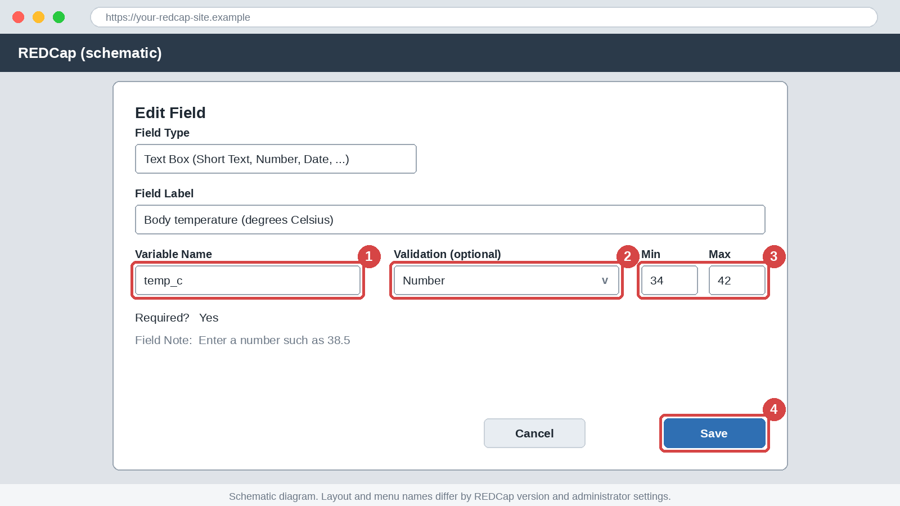
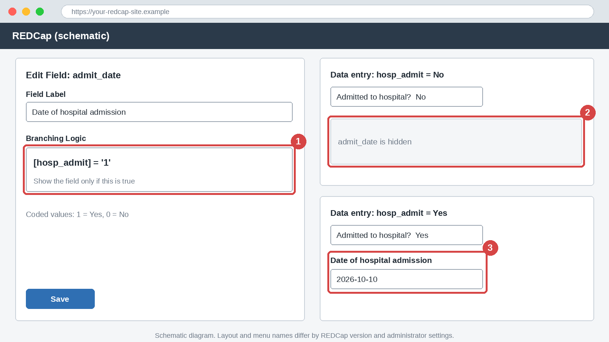
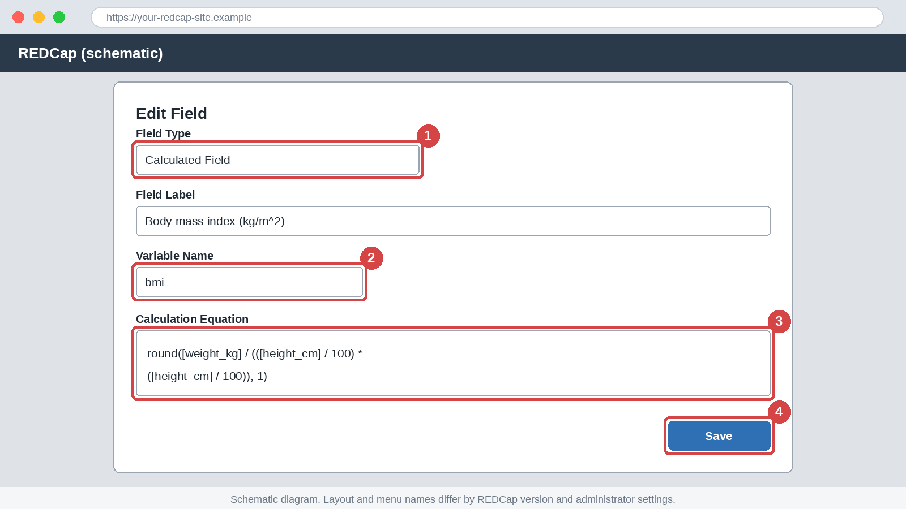
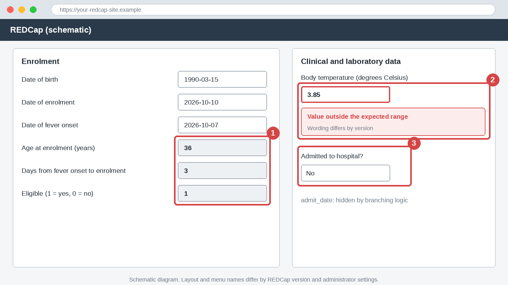

# Module 4: Field Validation, Branching Logic and Calculated Fields

## Part A: English

### 1. Title block

| Item | Detail |
|------|--------|
| Module | 4 of 20 |
| Level | Beginner to Intermediate |
| Estimated time | 45 to 60 minutes |
| Assumed REDCap version | 14 or later. Menu names differ by version and by administrator settings. |
| Prerequisites | Modules 2 and 3. A practice project is needed for Track A. |
| Case studies used | A (FEVER-COHORT), with B (HHKAP) in Exercise 2 |

> ⚠️ **Pitfall:** Never enter real patient data, real identifiers or real participants into a practice project. Use synthetic data only.

### 2. Learning objectives

By the end of this module you will be able to:

1. Apply text validation types, with minimum and maximum limits, to date and numeric fields.
2. Distinguish hard from soft validation and choose between them.
3. Write branching logic with the correct syntax, including for checkbox fields.
4. Write calculated fields for age, BMI and an eligibility flag.
5. Test logic with a test record and recognise common syntax errors.

### 3. Why this matters

**Data quality:** validation stops a typing slip, such as a temperature of 3.85, at the moment of entry. Cleaning it later costs far more.

**Analysis:** a validated number field exports as a clean numeric column. A calculated field gives every analyst the same age and BMI.

**Compliance:** branching logic hides questions that do not apply, so users do not collect data that the protocol does not need.

**Career:** reading and writing REDCap logic is the skill that separates a form builder from a data manager.

### 4. Core concepts

**Text validation.** A text box accepts any characters until you give it a validation type. Choose the type in the field settings. In the data dictionary it is the `Text Validation Type OR Show Slider Number` column.

| Validation | Dictionary code | Accepts | Example |
|------------|-----------------|---------|---------|
| Date (Y-M-D) | `date_ymd` | A date in that order | 2026-10-10 |
| Date (D-M-Y) | `date_dmy` | A date in that order | 10-10-2026 |
| Integer | `integer` | Whole numbers | 250 |
| Number | `number` | Any number, with decimals | 38.5 |
| Email | `email` | An email address | name@example.org |
| Phone | `phone` | A telephone number | (555) 010-0100 |

The phone type follows a North American pattern in many versions, so it may reject local numbers. Verify in your REDCap instance. Where it does not fit, use a plain text field with a field note. Use one date format across the project, because calculations must name the same format.

**Minimum and maximum.** The `Text Validation Min` and `Text Validation Max` columns set a plausible range, for example 34 to 42 for `temp_c`. Dates take limits in the same format as the field.

**Hard versus soft validation.**

| Type | What happens | Typical use |
|------|--------------|-------------|
| Hard | The value is rejected until it is corrected | Wrong format, such as letters in an integer field |
| Soft | The user is warned but may confirm the value | Unusual but possible values, such as a platelet count of 1400 |

A format check is hard: "hot" cannot be saved as a number. A range check is soft in the standard behaviour, and the user may confirm an out-of-range value. The action tag `@FORCE-MINMAX` makes a range limit hard. Verify in your REDCap instance. Action tags are covered in Module 5. Use soft limits for clinical values, because a hard limit set too narrow blocks true data. Set limits from the protocol and clinical plausibility, not from the first records you see.

**Worked example (FEVER-COHORT).** `temp_c` uses `number`, minimum 34 and maximum 42.

| Entry | Result |
|-------|--------|
| 38.5 | Accepted |
| 3.85 | Outside the range, so the user is warned (a decimal slip) |
| hot | Not a number, so it is rejected |

**Branching logic.** Branching logic shows a field only when a condition is true. It is written in the Online Designer field settings, or in the `Branching Logic (Show field only if...)` dictionary column. The syntax has four rules: put variable names in square brackets, compare with the stored code in quotes, join conditions with `and` or `or`, and use parentheses to group.

| Goal | Logic |
|------|-------|
| Yes - No field is Yes | `[hosp_admit] = '1'` |
| A coded choice is selected | `[outcome_d28] = '3'` |
| Not equal to a value | `[sex] <> '99'` |
| Number comparison | `[age_years] >= 65` |
| A field has a value | `[onset_date] <> ''` |
| Checkbox choice 5 is ticked | `[symptoms(5)] = '1'` |
| Checkbox choice 5 is not ticked | `[symptoms(5)] = '0'` |
| Both conditions | `[hosp_admit] = '1' and [icu_stay] = '1'` |
| Either condition | `[outcome_d28] = '2' or [outcome_d28] = '3'` |

Compare with the code, not the label: write `'1'`, not `Yes`. For a checkbox, put the choice code in round brackets. `symptoms___5` is the export column name and does not work in logic. A field that is hidden by branching logic is not required. REDCap may clear a value that was entered before the field was hidden. Verify in your REDCap instance.

**Calculated fields.** A calculated field is a field whose value comes from an equation. The equation is typed in the Calculation Equation box, and in the dictionary it sits in the `Choices, Calculations, OR Slider Labels` column. Users never type into it. The result is a number.

| Function | Use | Example |
|----------|-----|---------|
| `round(x, n)` | Round to n decimal places | `round([wbc], 1)` |
| `rounddown(x, n)` | Cut the decimals without rounding up | `rounddown([age_years], 0)` |
| `datediff(d1, d2, "unit", "format", true)` | Difference between two dates | see below |
| `if(test, a, b)` | Return a if the test is true, otherwise b | `if([sex] = 1, 1, 0)` |
| `min()`, `max()`, `sum()` | Lowest, highest or total of listed fields | `sum([score_a], [score_b])` |

The `datediff` unit is "y" for years, "M" for months or "d" for days. The format ("ymd", "dmy" or "mdy") must match the date validation of the fields. The last argument `true` keeps the sign, so the result is positive when the second date is later. Verify the unit codes in your REDCap instance. The field names in the last row are illustrative.

**Worked examples (FEVER-COHORT).**

| Variable | Equation | Example inputs | Result |
|----------|----------|----------------|--------|
| `age_years` | `rounddown(datediff([dob], [enrol_date], "y", "ymd", true), 0)` | dob 1990-03-15, enrolment 2026-10-10 | 36 |
| `fever_days` | `datediff([onset_date], [enrol_date], "d", "ymd", true)` | onset 2026-10-07, enrolment 2026-10-10 | 3 |
| `bmi` | `round([weight_kg] / (([height_cm] / 100) * ([height_cm] / 100)), 1)` | 70 kg, 170 cm | 24.2 |
| `eligible` | `if([age_years] >= 18, if([fever_days] <= 7, if([consent_confirm] = 1, 1, 0), 0), 0)` | age 36, 3 days, consent true | 1 |

The eligibility flag uses nested `if` calls so that each test is explicit. Whether `and` and `or` can be used inside a calculation depends on the version. Verify in your REDCap instance.

Three habits keep calculations safe. Avoid the word "today" in an equation that records a fact, such as age at enrolment, because the value then changes on a later save. Expect a blank result when an input is blank. Verify in your REDCap instance. After you change an equation on a live project, check that old records were recalculated. Module 7 covers the Data Quality check for this.

**In a CSV cell.** Wrap an equation that contains commas or quotes in double quotes, and double every quote inside it. Spreadsheet programs do this on export. Never paste logic through a word processor, because curly quotes break it.

### 5. Step-by-step walkthrough

Use the FEVER-COHORT Practice project from Module 3. Menu names may differ in your version.

1. Open **Online Designer** and open the instrument "Clinical and laboratory data". Edit the field `temp_c`. Verify in your REDCap instance.
2. In the field settings, set the validation to Number, the minimum to 34 and the maximum to 42. Click **Save**.

   > 📷 **Figure 1:** Edit Field dialog (schematic). Find (1) the variable name, (2) the validation type, (3) the minimum and maximum and (4) the Save button.

   

3. Set `plt` to Integer with limits 1 and 1500, and set date fields such as `enrol_date` to the date format Y-M-D.
4. Add `hosp_admit` as a Yes - No field. Add `admit_date` as a date field and open its branching logic box. Type `[hosp_admit] = '1'` and save.

   > 📷 **Figure 2:** Branching logic (schematic). Find (1) the branching logic box, (2) the hidden `admit_date` when `hosp_admit` is No and (3) the visible `admit_date` when `hosp_admit` is Yes.

   

5. Add `height_cm` and `weight_kg` as number fields. Add `bmi`, choose the field type Calculated Field, and type the equation from Section 4.

   > 📷 **Figure 3:** Calculated field (schematic). Find (1) the Calculated Field type, (2) the variable name, (3) the Calculation Equation box and (4) the Save button.

   

6. In the "Enrolment" instrument, add `age_years`, `fever_days` and `eligible` as calculated fields with the equations from Section 4.
7. Open **Add / Edit Records**, create a record and enter dob 1990-03-15, enrolment date 2026-10-10 and onset date 2026-10-07. Tick the consent field. Check that age is 36, fever days is 3 and eligible is 1.
8. In the clinical form, enter `temp_c` as 3.85 and set `hosp_admit` to No.

   > 📷 **Figure 4:** Test record (schematic). Find (1) the three calculated values, (2) the range warning on `temp_c` and (3) `hosp_admit` set to No, with `admit_date` hidden.

   

Alternatively, upload `data/M04_fever_cohort_validation.csv` as in Module 2 and compare it with your design.

### 6. If this is not enabled

> 🔒 **Admin-dependent:** Design rights, and in some instances the use of certain action tags, depend on your user role and administrator settings. Verify in your REDCap instance.

**What to request from the administrator:** a practice project in Development status with design rights for you.

**Conceptual walkthrough without access:** open `data/M04_fever_cohort_validation.csv` in a spreadsheet. The `Text Validation Type OR Show Slider Number`, min and max columns hold the validation. The `Branching Logic (Show field only if...)` column holds branching logic. Calculated fields show their equations in the `Choices, Calculations, OR Slider Labels` column. Use Track B in each exercise.

### 7. Exercises

**Exercise 1 (guided): Add validation to FEVER-COHORT fields**

**Track A (live REDCap practice project):**

1. Set `temp_c` to Number with limits 34 and 42, and `plt` to Integer with limits 1 and 1500.
2. Set `hct` to Number with limits 15 and 65.
3. Create a record and try the entries 38.5, 3.85 and "hot" in `temp_c`, and 250.5 in `plt`.
4. Self-check: 38.5 is accepted, 3.85 triggers a range warning, "hot" is rejected and 250.5 is rejected.

**Track B (no access):** Open `data/M04_fever_cohort_validation.csv` in a spreadsheet. List the validation type, minimum and maximum of `enrol_date`, `temp_c`, `hct`, `plt` and `contact_email`. Then predict what happens for each entry in Track A step 3.

Answer key

| Variable | Validation | Min | Max |
|----------|------------|-----|-----|
| `enrol_date` | `date_ymd` | none | none |
| `temp_c` | `number` | 34 | 42 |
| `hct` | `number` | 15 | 65 |
| `plt` | `integer` | 1 | 1500 |
| `contact_email` | `email` | none | none |

Entries: 38.5 is accepted. 3.85 is outside the range and gives a warning that the user can confirm or correct. "hot" is rejected because it is not a number. 250.5 is rejected in `plt` because it is not a whole number. How the warning is worded and whether it can be overridden depend on the version. Verify in your REDCap instance.

**Exercise 2 (independent): Write the logic**

Write the logic for each item.

| No. | Item |
|-----|------|
| 1 | Show `admit_date` only if `hosp_admit` is Yes (code 1) |
| 2 | Show `bleed_site` only if Bleeding (code 5) is ticked in `symptoms` |
| 3 | Show `death_date` only if `outcome_d28` is Died (code 3) |
| 4 | HHKAP: show `hcw_role_other` only if `consent` is Yes (code 1) and `hcw_role` is Other (code 4) |
| 5 | Calculate `bmi` from `weight_kg` and `height_cm`, rounded to 1 decimal place |
| 6 | Calculate `eligible`: 1 if age is 18 or more, fever lasted 7 days or less and consent is confirmed, otherwise 0 |

**Track A (live REDCap practice project):**

1. Enter the logic for items 1 to 3, 5 and 6 in FEVER-COHORT Practice. Add `hcw_role_other` to HHKAP Practice from Module 3 for item 4.
2. Create two test records per item, one that should show or calculate and one that should not.
3. Self-check: every test record behaves as expected, and `bmi` is 24.2 for 70 kg and 170 cm.

**Track B (no access):** Write your answers on paper, then check them against the `Branching Logic (Show field only if...)` and `Choices, Calculations, OR Slider Labels` columns of `data/M04_fever_cohort_validation.csv`. Item 4 is not in the file.

Answer key

| No. | Logic or equation |
|-----|-------------------|
| 1 | `[hosp_admit] = '1'` |
| 2 | `[symptoms(5)] = '1'` |
| 3 | `[outcome_d28] = '3'` |
| 4 | `[consent] = '1' and [hcw_role] = '4'` |
| 5 | `round([weight_kg] / (([height_cm] / 100) * ([height_cm] / 100)), 1)` |
| 6 | `if([age_years] >= 18, if([fever_days] <= 7, if([consent_confirm] = 1, 1, 0), 0), 0)` |

Equivalent forms that give the same result are accepted. Quote the code as shown, because that is the standard form.

**Exercise 3 (challenge): Find the errors**

The file `data/M04_validation_logic_flawed.csv` is deliberately flawed. It has 8 errors in validation, branching logic and calculations. Find and correct them.

**Track A (live REDCap practice project):**

1. Upload the file into a new practice project and note every error that REDCap reports. Some errors may not be reported at upload. Verify in your REDCap instance.
2. Correct the file in a spreadsheet, save it as UTF-8 CSV and upload it again.
3. Enter a test record. Self-check: the upload has no errors, age is calculated correctly and `bmi` is calculated.

**Track B (no access):** Read the file in a spreadsheet. List each error with the variable name, the problem and the corrected value.

Answer key

| No. | Variable | Problem | Correction |
|-----|----------|---------|------------|
| 1 | `dob` | Validation is `date_dmy`, but the age equation reads dates as "ymd" | Use `date_ymd` |
| 2 | `age_years` | The equation has an unclosed parenthesis | Add the final `)` |
| 3 | `eligible` | `=>` is not an operator | Use `>=` |
| 4 | `temp_c` | Minimum 42 and maximum 34 are swapped | Minimum 34, maximum 42 |
| 5 | `plt` | `numeric` is not a validation type | Use `integer` |
| 6 | `bmi` | `[weight]` is not a variable in the project | Use `[weight_kg]` |
| 7 | `bleed_site` | `[symptoms___5]` is the export column name | Use `[symptoms(5)]` |
| 8 | `admit_date` | `'Yes'` is a label, but the stored code is 1 | Use `[hosp_admit] = '1'` |

### 8. Quiz

**Question 1 (multiple choice).** Which validation type accepts only whole numbers?

- A. `number`
- B. `integer`
- C. `text`
- D. `email`

Answer

B. `integer` rejects decimals. `number` accepts them.

**Question 2 (multiple choice).** Which logic shows `admit_date` only when `hosp_admit` is Yes?

- A. `[hosp_admit] = Yes`
- B. `[hosp_admit] = '1'`
- C. `[hosp_admit___1] = '1'`
- D. `hosp_admit = 1`

Answer

B. Use square brackets around the variable name and the stored code in quotes.

**Question 3 (multiple choice).** Which logic tests whether Bleeding (code 5) is ticked in `symptoms`?

- A. `[symptoms___5] = '1'`
- B. `[symptoms(5)] = '1'`
- C. `[symptoms] = '5'`
- D. `[symptoms(Bleeding)] = '1'`

Answer

B. A checkbox choice is written with its code in round brackets.

**Question 4 (short answer).** Why are soft limits usually better than hard limits for laboratory values?

Answer

A true value can lie outside a planned range. A soft limit warns the user without blocking genuine data.

**Question 5 (multiple choice).** What does `datediff([onset_date], [enrol_date], "d", "ymd", true)` return for onset 2026-10-07 and enrolment 2026-10-10?

- A. -3
- B. 3
- C. 10
- D. 0

Answer

B. The result is the later date minus the earlier date, in days, and it is positive.

**Question 6 (short answer).** Why use `[enrol_date]` instead of "today" when calculating age at enrolment?

Answer

"Today" changes the result each time the record is saved on a later date. `[enrol_date]` fixes age at enrolment.

**Question 7 (multiple choice).** Using the BMI equation, what is the BMI for 80 kg and 180 cm?

- A. 24.7
- B. 44.4
- C. 0.2
- D. 2.5

Answer

A. 80 divided by (1.8 x 1.8) is 24.69, which rounds to 24.7.

### 9. Common pitfalls

> ⚠️ **Pitfall:** Using the label instead of the stored code in logic, for example `'Yes'` instead of `'1'`. The condition never becomes true.

> ⚠️ **Pitfall:** Writing `[symptoms___5]` in branching logic. The export column name is not valid logic. Use `[symptoms(5)]`.

> ⚠️ **Pitfall:** Setting hard limits that are narrower than real life. Users then change true values to pass the check.

> ⚠️ **Pitfall:** Mixing date formats, for example `date_dmy` fields with a "ymd" equation. Calculations return wrong or blank results.

> ⚠️ **Pitfall:** Pasting logic from a word processor. Curly quotes and hidden characters break the syntax.

> ⚠️ **Pitfall:** Building long chains of branching without testing every path. A hidden field may carry no data when you expected some.

### 10. Career tips

> 🎯 **Career tip:** Keep a one-page logic log for each project, with the logic, its purpose and its test result. Auditors and new team members value it.

> 🎯 **Career tip:** Be ready to explain age and BMI equations in an interview. It shows you can trace a derived value back to its source.

> 🎯 **Career tip:** In a grant or protocol, write that range and logic checks are applied at entry. It supports your data quality plan.

### 11. Downloadable files

| File | Contents | How to use |
|------|----------|------------|
| [M04_fever_cohort_validation.csv](data/M04_fever_cohort_validation.csv) | FEVER-COHORT dictionary with 25 fields in 3 instruments, with validation, branching logic and 4 calculated fields | Upload to a practice project, or use it as the answer reference |
| [M04_validation_logic_flawed.csv](data/M04_validation_logic_flawed.csv) | Deliberately flawed dictionary with 14 fields and 8 errors | Use in Exercise 3 |

Open CSV files in a text editor or import them as UTF-8 text so that values are not auto-formatted.

### 12. Key takeaways

- Validation types control what can be typed. Format checks are hard, and range checks are soft in the standard behaviour.
- Set ranges from the protocol and clinical plausibility.
- Branching logic uses square brackets, quoted stored codes and `and` or `or`. Checkbox choices use `[variable(code)]`.
- Calculated fields derive values such as age, BMI and eligibility from other fields, and no one types into them.
- Test every branch and every equation with a test record before you rely on it.

### 13. Next module

Next: Module 5, Piping, Smart Variables, action tags, field embedding.

Topics: piping, Smart Variables, action tags, field embedding and Form Display Logic.

### 14. Version table

| Version | Date |
|---------|------|
| 1.0 | 2026-10-17 |

---

## Part B: Burmese

### 1. ခေါင်းစဉ်အချက်အလက် (Title block)

| အချက် | အသေးစိတ် |
|-------|----------|
| မော်ဂျူး | 20 ခုအနက် 4 ခု |
| အဆင့် | အခြေခံမှ အလယ်အလတ် (Beginner to Intermediate) |
| ခန့်မှန်းကြာချိန် | 45 မှ 60 မိနစ် |
| ယူဆထားသော REDCap ဗားရှင်း | 14 နှင့်အထက်။ မီနူးအမည်များသည် ဗားရှင်းနှင့် စီမံခန့်ခွဲသူ (Administrator) ၏ ဆက်တင်များပေါ် မူတည်ပြီး ကွဲပြားနိုင်ပါတယ်။ |
| ကြိုတင်လိုအပ်ချက် | မော်ဂျူး 2 နဲ့ 3။ Track A အတွက် လေ့ကျင့်ရေးပရောဂျက် လိုပါတယ်။ |
| အသုံးပြုသော ဖြစ်ရပ်လေ့လာမှုများ | A (FEVER-COHORT)၊ လေ့ကျင့်ခန်း 2 မှာ B (HHKAP) ကိုပါ သုံးပါတယ် |

> ⚠️ **Pitfall:** လက်တွေ့လူနာဒေတာ၊ တကယ့်ကိုယ်ရေးကိုယ်တာ အချက်အလက်နဲ့ တကယ့်ပါဝင်သူတွေရဲ့ အချက်အလက်တွေကို လေ့ကျင့်ရေး ပရောဂျက်ထဲ ဘယ်တော့မှ မထည့်ပါနဲ့။ ဖန်တီးထားတဲ့ (synthetic) ဒေတာကိုပဲ သုံးပါ။

### 2. သင်ယူရမည့် ရည်မှန်းချက်များ (Learning objectives)

ဒီမော်ဂျူးအဆုံးမှာ သင်ဟာ အောက်ပါအရာတွေကို လုပ်နိုင်ပါလိမ့်မယ်။

1. ရက်စွဲနဲ့ ကိန်းဂဏန်း field တွေမှာ အနည်းဆုံးနဲ့ အများဆုံး ကန့်သတ်ချက်ပါတဲ့ text validation type တွေကို သုံးနိုင်ပါမယ်။
2. hard validation နဲ့ soft validation ကို ခွဲခြားပြီး ရွေးချယ်နိုင်ပါမယ်။
3. checkbox field တွေအပါအဝင် branching logic ကို syntax မှန်မှန်ကန်ကန် ရေးနိုင်ပါမယ်။
4. အသက်၊ BMI နဲ့ eligibility flag အတွက် calculated field တွေ ရေးနိုင်ပါမယ်။
5. test record နဲ့ logic ကို စမ်းသပ်ပြီး syntax အမှား အဖြစ်များတာတွေကို မှတ်သားနိုင်ပါမယ်။

### 3. ဘာကြောင့် အရေးကြီးသလဲ (Why this matters)

**ဒေတာအရည်အသွေး (Data quality):** validation က ထည့်တဲ့ အချိန်မှာတင် 3.85 လို အပူချိန်ရိုက်မှား တာမျိုးကို တားပေးပါတယ်။ နောက်မှ သန့်ရှင်းရေးလုပ်ရင် ကုန်ကျစရိတ် အများကြီး ပိုများပါတယ်။

**ခွဲခြမ်းစိတ်ဖြာမှု (Analysis):** validation လုပ်ထားတဲ့ number field က သန့်ရှင်းတဲ့ ကိန်းဂဏန်း column အဖြစ် export ဖြစ်ပါတယ်။ calculated field က analyst အားလုံးကို တူညီတဲ့ အသက်နဲ့ BMI ပေးပါတယ်။

**စည်းမျဉ်းလိုက်နာမှု (Compliance):** branching logic က မသက်ဆိုင်တဲ့ မေးခွန်းတွေကို ဖျောက်ထားပေးတဲ့အတွက် protocol မလိုအပ်တဲ့ ဒေတာကို အသုံးပြုသူတွေ မစုဆောင်းမိပါဘူး။

**အလုပ်အကိုင် (Career):** REDCap logic ကို ဖတ်တတ်ရေးတတ်တာက ဖောင်ဆောက်သူနဲ့ ဒေတာမန်နေဂျာကို ခွဲခြားပေးတဲ့ ကျွမ်းကျင်မှုပါ။

### 4. အဓိကအယူအဆများ (Core concepts)

**Text validation (Text validation).** text box ကို validation type မပေးမချင်း ဘယ်စာလုံးမဆို လက်ခံပါတယ်။ field settings မှာ type ကို ရွေးပါ။ data dictionary မှာ `Text Validation Type OR Show Slider Number` column ပါ။

| Validation | Dictionary code | လက်ခံတာ | ဥပမာ |
|------------|-----------------|---------|------|
| Date (Y-M-D) | `date_ymd` | အဲဒီအစီအစဉ်အတိုင်း ရက်စွဲ | 2026-10-10 |
| Date (D-M-Y) | `date_dmy` | အဲဒီအစီအစဉ်အတိုင်း ရက်စွဲ | 10-10-2026 |
| Integer | `integer` | ကိန်းပြည့် | 250 |
| Number | `number` | ဒသမပါတဲ့ ဘယ်ကိန်းဂဏန်းမဆို | 38.5 |
| Email | `email` | အီးမေးလ်လိပ်စာ | name@example.org |
| Phone | `phone` | တယ်လီဖုန်းနံပါတ် | (555) 010-0100 |

phone type က ဗားရှင်းများစွာမှာ မြောက်အမေရိကပုံစံကို လိုက်တာမို့ ပြည်တွင်းနံပါတ်တွေကို ပယ်နိုင်ပါတယ်။ Verify in your REDCap instance။ မကိုက်ရင် ရိုးရိုး text field နဲ့ field note သုံးပါ။ ပရောဂျက်တစ်ခုလုံးမှာ ရက်စွဲပုံစံ တစ်မျိုးတည်း သုံးပါ၊ တွက်ချက်မှုတွေက ပုံစံတူကို ပြောရလို့ပါ။

**အနည်းဆုံးနဲ့ အများဆုံး (Minimum and maximum).** `Text Validation Min` နဲ့ `Text Validation Max` column တွေက ဖြစ်နိုင်ချေရှိတဲ့ အကွာအဝေးကို သတ်မှတ်ပါတယ်၊ ဥပမာ `temp_c` အတွက် 34 မှ 42။ ရက်စွဲတွေက field ရဲ့ ပုံစံအတိုင်း ကန့်သတ်ချက်ကို ယူပါတယ်။

**Hard validation နဲ့ soft validation (Hard versus soft validation).**

| အမျိုးအစား | ဘာဖြစ်လဲ | ပုံမှန်အသုံးပြုပုံ |
|------------|----------|------------------|
| Hard | ပြင်မချင်း တန်ဖိုးကို ပယ်ပါတယ် | integer field ထဲ စာလုံးထည့်တာလို ပုံစံမှား |
| Soft | အသုံးပြုသူကို သတိပေးပေမယ့် အတည်ပြုခွင့် ရှိပါတယ် | ပုံမှန်မဟုတ်ပေမယ့် ဖြစ်နိုင်တဲ့ တန်ဖိုး၊ ဥပမာ platelet count 1400 |

ပုံစံစစ်ဆေးမှုက hard ပါ၊ "hot" ကို ကိန်းဂဏန်းအဖြစ် save လို့ မရပါဘူး။ အကွာအဝေးစစ်ဆေးမှုကတော့ စံအတိုင်း soft ဖြစ်ပြီး အသုံးပြုသူက အကွာအဝေးပြင်ပ တန်ဖိုးကို အတည်ပြုနိုင်ပါတယ်။ action tag `@FORCE-MINMAX` က အကွာအဝေးကန့်သတ်ချက်ကို hard ဖြစ်စေပါတယ်။ Verify in your REDCap instance။ action tag တွေကို မော်ဂျူး 5 မှာ လေ့လာပါမယ်။ ဆေးပညာဆိုင်ရာ တန်ဖိုးတွေအတွက် soft limit သုံးပါ၊ hard limit ကို ကျဉ်းလွန်းအောင် သတ်မှတ်ရင် အမှန်တကယ်ဒေတာကို တားမိပါတယ်။ ကန့်သတ်ချက်တွေကို protocol နဲ့ ဆေးပညာအရ ဖြစ်နိုင်ချေကနေ သတ်မှတ်ပါ၊ ပထမဆုံး မှတ်တမ်းတွေကို ကြည့်ပြီး မသတ်မှတ်ပါနဲ့။

**ဥပမာ (FEVER-COHORT).** `temp_c` က `number` ကို သုံးပြီး အနည်းဆုံး 34၊ အများဆုံး 42 ပါ။

| ထည့်တဲ့တန်ဖိုး | ရလဒ် |
|---------------|------|
| 38.5 | လက်ခံပါတယ် |
| 3.85 | အကွာအဝေးပြင်ပမို့ အသုံးပြုသူကို သတိပေးပါတယ် (ဒသမနေရာ မှားတာ) |
| hot | ကိန်းဂဏန်းမဟုတ်လို့ ပယ်ပါတယ် |

**Branching logic (Branching logic).** branching logic က အခြေအနေတစ်ခု မှန်တဲ့အခါမှ field ကို ပြပေးပါတယ်။ Online Designer ရဲ့ field settings မှာ ဒါမှမဟုတ် dictionary ရဲ့ `Branching Logic (Show field only if...)` column မှာ ရေးပါတယ်။ syntax စည်းကမ်း လေးချက်ရှိပါတယ်: variable အမည်ကို လေးထောင့်ကွင်း (square brackets) ထဲ ထည့်ပါ၊ သိမ်းထားတဲ့ကုဒ်နဲ့ quotes ထဲမှာ နှိုင်းယှဉ်ပါ၊ အခြေအနေတွေကို `and` ဒါမှမဟုတ် `or` နဲ့ ဆက်ပါ၊ အုပ်စုဖွဲ့ဖို့ ကွင်းစကွင်းပိတ် (parentheses) သုံးပါ။

| ရည်ရွယ်ချက် | Logic |
|-------------|-------|
| Yes - No field က Yes ဖြစ်တယ် | `[hosp_admit] = '1'` |
| ကုဒ်ပါတဲ့ ရွေးချယ်စရာတစ်ခု ရွေးထားတယ် | `[outcome_d28] = '3'` |
| တန်ဖိုးတစ်ခုနဲ့ မညီဘူး | `[sex] <> '99'` |
| ကိန်းဂဏန်း နှိုင်းယှဉ်ချက် | `[age_years] >= 65` |
| field တစ်ခုမှာ တန်ဖိုးရှိတယ် | `[onset_date] <> ''` |
| checkbox ရွေးချယ်စရာ 5 ကို ခြစ်ထားတယ် | `[symptoms(5)] = '1'` |
| checkbox ရွေးချယ်စရာ 5 ကို မခြစ်ထားဘူး | `[symptoms(5)] = '0'` |
| အခြေအနေနှစ်ခုလုံး | `[hosp_admit] = '1' and [icu_stay] = '1'` |
| တစ်ခုခု | `[outcome_d28] = '2' or [outcome_d28] = '3'` |

label နဲ့ မဟုတ်ဘဲ ကုဒ်နဲ့ နှိုင်းယှဉ်ပါ: `Yes` မဟုတ်ဘဲ `'1'` လို့ ရေးပါ။ checkbox အတွက် ရွေးချယ်စရာကုဒ်ကို ကွင်းစကွင်းပိတ်ထဲ ထည့်ပါ။ `symptoms___5` ဆိုတာ export column အမည်ဖြစ်ပြီး logic ထဲမှာ အလုပ်မလုပ်ပါဘူး။ branching logic နဲ့ ဖျောက်ထားတဲ့ field က required မဟုတ်ပါဘူး။ field မဖျောက်ခင် ထည့်ထားတဲ့ တန်ဖိုးကို REDCap က ရှင်းထုတ်နိုင်ပါတယ်။ Verify in your REDCap instance။

**Calculated field (Calculated fields).** calculated field ဆိုတာ တန်ဖိုးကို ညီမျှခြင်းကနေ ရတဲ့ field ပါ။ ညီမျှခြင်းကို Calculation Equation ကွက်ထဲ ရိုက်ပြီး dictionary မှာတော့ `Choices, Calculations, OR Slider Labels` column ထဲ ရှိပါတယ်။ အသုံးပြုသူတွေ ဒီထဲကို ဘယ်တော့မှ မရိုက်ပါဘူး။ ရလဒ်က ကိန်းဂဏန်းပါ။

| Function | အသုံးပြုပုံ | ဥပမာ |
|----------|-----------|------|
| `round(x, n)` | ဒသမ n နေရာအထိ ပြည့်ပေးတယ် | `round([wbc], 1)` |
| `rounddown(x, n)` | မပြည့်ဘဲ ဒသမကို ဖြတ်တယ် | `rounddown([age_years], 0)` |
| `datediff(d1, d2, "unit", "format", true)` | ရက်စွဲနှစ်ခုကြား ကွာခြားချက် | အောက်မှာ ကြည့်ပါ |
| `if(test, a, b)` | test မှန်ရင် a၊ မမှန်ရင် b ပြန်ပေးတယ် | `if([sex] = 1, 1, 0)` |
| `min()`, `max()`, `sum()` | ပေးထားတဲ့ field တွေထဲက အနည်းဆုံး၊ အများဆုံး ဒါမှမဟုတ် စုစုပေါင်း | `sum([score_a], [score_b])` |

`datediff` ရဲ့ unit က နှစ်အတွက် "y"၊ လအတွက် "M"၊ ရက်အတွက် "d" ပါ။ ပုံစံ ("ymd", "dmy" သို့မဟုတ် "mdy") က field တွေရဲ့ date validation နဲ့ ကိုက်ရပါမယ်။ နောက်ဆုံး argument `true` က သင်္ကေတကို ထိန်းထားတဲ့အတွက် ဒုတိယရက်စွဲ ပိုနောက်ကျရင် ရလဒ်က အပေါင်းဖြစ်ပါတယ်။ unit ကုဒ်တွေကို သင့် REDCap instance မှာ စစ်ဆေးပါ။ Verify in your REDCap instance။ နောက်ဆုံးအတန်းထဲက field အမည်တွေက ဥပမာအတွက်ပဲ ဖြစ်ပါတယ်။

**တွက်ချက်ပုံ ဥပမာများ (FEVER-COHORT).**

| Variable | ညီမျှခြင်း | ထည့်သွင်းတန်ဖိုး ဥပမာ | ရလဒ် |
|----------|-----------|---------------------|------|
| `age_years` | `rounddown(datediff([dob], [enrol_date], "y", "ymd", true), 0)` | dob 1990-03-15၊ enrolment 2026-10-10 | 36 |
| `fever_days` | `datediff([onset_date], [enrol_date], "d", "ymd", true)` | onset 2026-10-07၊ enrolment 2026-10-10 | 3 |
| `bmi` | `round([weight_kg] / (([height_cm] / 100) * ([height_cm] / 100)), 1)` | 70 kg၊ 170 cm | 24.2 |
| `eligible` | `if([age_years] >= 18, if([fever_days] <= 7, if([consent_confirm] = 1, 1, 0), 0), 0)` | အသက် 36၊ 3 ရက်၊ consent true | 1 |

eligibility flag က စစ်ဆေးမှုတစ်ခုစီ ရှင်းလင်းအောင် nested `if` တွေကို သုံးထားပါတယ်။ calculation ထဲမှာ `and` နဲ့ `or` သုံးလို့ရမရက ဗားရှင်းပေါ် မူတည်ပါတယ်။ Verify in your REDCap instance။

တွက်ချက်မှုတွေ ဘေးကင်းအောင် အကျင့်သုံးခု ရှိပါတယ်။ စာရင်းသွင်းချိန်အသက်လို အချက်အလက်ကို မှတ်တမ်းတင်တဲ့ ညီမျှခြင်းထဲ "today" ဆိုတဲ့ စကားလုံးကို ရှောင်ပါ၊ နောက်ရက်မှာ save လုပ်ရင် တန်ဖိုး ပြောင်းသွားလို့ပါ။ input တစ်ခု အလွတ်ဖြစ်နေရင် ရလဒ်လည်း အလွတ်ဖြစ်မယ်လို့ မျှော်လင့်ပါ။ Verify in your REDCap instance။ live ပရောဂျက်မှာ ညီမျှခြင်းကို ပြောင်းပြီးရင် မှတ်တမ်းဟောင်းတွေ ပြန်တွက်ပြီးသားလား စစ်ပါ။ ဒါအတွက် Data Quality စစ်ဆေးမှုကို မော်ဂျူး 7 မှာ လေ့လာပါမယ်။

**CSV cell ထဲမှာ (In a CSV cell).** comma ဒါမှမဟုတ် quotes ပါတဲ့ ညီမျှခြင်းကို double quotes နဲ့ ထုပ်ပါ၊ ထဲက quote တိုင်းကို နှစ်ထပ်ရေးပါ။ spreadsheet ပရိုဂရမ်တွေက export လုပ်ရင် ဒီလိုလုပ်ပေးပါတယ်။ logic ကို word processor ကနေ ကူးမထည့်ပါနဲ့၊ curly quotes တွေက syntax ကို ပျက်စေပါတယ်။

### 5. အဆင့်ဆင့် လမ်းညွှန် (Step-by-step walkthrough)

မော်ဂျူး 3 က FEVER-COHORT Practice ပရောဂျက်ကို သုံးပါ။ မီနူးအမည်တွေက သင့်ဗားရှင်းမှာ ကွဲနိုင်ပါတယ်။

1. **Online Designer** ကို ဖွင့်ပြီး "Clinical and laboratory data" instrument ကို ဖွင့်ပါ။ `temp_c` field ကို တည်းဖြတ်ပါ။ Verify in your REDCap instance။
2. field settings မှာ validation ကို Number၊ အနည်းဆုံးကို 34၊ အများဆုံးကို 42 လို့ သတ်မှတ်ပါ။ **Save** ကို နှိပ်ပါ။

   > 📷 **ပုံ 1:** Edit Field dialog (ပုံကြမ်း)။ (1) variable အမည်၊ (2) validation type၊ (3) အနည်းဆုံးနဲ့ အများဆုံး၊ (4) Save ခလုတ်ကို ရှာပါ။

   

3. `plt` ကို Integer အဖြစ် 1 နဲ့ 1500 ကန့်သတ်ချက်နဲ့ သတ်မှတ်ပါ၊ `enrol_date` လို ရက်စွဲ field တွေကို Y-M-D ရက်စွဲပုံစံ သတ်မှတ်ပါ။
4. `hosp_admit` ကို Yes - No field အဖြစ် ထည့်ပါ။ `admit_date` ကို ရက်စွဲ field အဖြစ် ထည့်ပြီး သူ့ branching logic ကွက်ကို ဖွင့်ပါ။ `[hosp_admit] = '1'` လို့ ရိုက်ပြီး save လုပ်ပါ။

   > 📷 **ပုံ 2:** Branching logic (ပုံကြမ်း)။ (1) branching logic ကွက်၊ (2) `hosp_admit` က No ဖြစ်တဲ့အခါ ဖျောက်ထားတဲ့ `admit_date`၊ (3) `hosp_admit` က Yes ဖြစ်တဲ့အခါ မြင်ရတဲ့ `admit_date` ကို ရှာပါ။

   

5. `height_cm` နဲ့ `weight_kg` ကို number field တွေအဖြစ် ထည့်ပါ။ `bmi` ကို ထည့်ပြီး field type Calculated Field ကို ရွေးကာ ပိုင်း 4 က ညီမျှခြင်းကို ရိုက်ပါ။

   > 📷 **ပုံ 3:** Calculated field (ပုံကြမ်း)။ (1) Calculated Field type၊ (2) variable အမည်၊ (3) Calculation Equation ကွက်နဲ့ (4) Save ခလုတ်ကို ရှာပါ။

   

6. "Enrolment" instrument ထဲမှာ `age_years`၊ `fever_days` နဲ့ `eligible` ကို ပိုင်း 4 ထဲက ညီမျှခြင်းတွေနဲ့ calculated field တွေအဖြစ် ထည့်ပါ။
7. **Add / Edit Records** ကို ဖွင့်ပြီး record တစ်ခု ဖန်တီးကာ dob 1990-03-15၊ enrolment ရက် 2026-10-10 နဲ့ onset ရက် 2026-10-07 ကို ထည့်ပါ။ consent field ကို ခြစ်ပါ။ အသက် 36၊ fever days 3 နဲ့ eligible 1 ဖြစ်တာ စစ်ပါ။
8. clinical form မှာ `temp_c` ကို 3.85 လို့ ထည့်ပြီး `hosp_admit` ကို No လို့ သတ်မှတ်ပါ။

   > 📷 **ပုံ 4:** Test record (ပုံကြမ်း)။ (1) တွက်ထုတ်တဲ့ တန်ဖိုးသုံးခု၊ (2) `temp_c` ပေါ်က အကွာအဝေး သတိပေးချက်နဲ့ (3) `hosp_admit` ကို No လို့ ထားပြီး `admit_date` ကို ဖျောက်ထားတာကို ရှာပါ။

   

တနည်းအားဖြင့် `data/M04_fever_cohort_validation.csv` ကို မော်ဂျူး 2 မှာလို upload လုပ်ပြီး သင့်ဒီဇိုင်းနဲ့ နှိုင်းယှဉ်ပါ။

### 6. မဖွင့်ထားရင် (If this is not enabled)

> 🔒 **Admin-dependent:** design right နဲ့ instance အချို့မှာ action tag အချို့ကို သုံးခွင့်က သင့် user role နဲ့ စီမံခန့်ခွဲသူရဲ့ ဆက်တင်တွေပေါ် မူတည်ပါတယ်။ Verify in your REDCap instance။

**စီမံခန့်ခွဲသူထံ တောင်းဆိုရမည့်အရာ:** Development အခြေအနေက လေ့ကျင့်ရေးပရောဂျက်တစ်ခုမှာ သင့်အတွက် design right။

**ဝင်ခွင့်မရှိရင် အယူအဆအရ လမ်းညွှန်:** `data/M04_fever_cohort_validation.csv` ကို spreadsheet မှာ ဖွင့်ပါ။ `Text Validation Type OR Show Slider Number`၊ min နဲ့ max column တွေမှာ validation ရှိပါတယ်။ `Branching Logic (Show field only if...)` column မှာ branching logic ရှိပါတယ်။ calculated field တွေရဲ့ ညီမျှခြင်းတွေကို `Choices, Calculations, OR Slider Labels` column မှာ မြင်ရပါတယ်။ လေ့ကျင့်ခန်းတိုင်းမှာ Track B ကို သုံးပါ။

### 7. လေ့ကျင့်ခန်းများ (Exercises)

**လေ့ကျင့်ခန်း 1 (လမ်းညွှန်ပါ): FEVER-COHORT field တွေမှာ validation ထည့်ပါ**

**Track A (live REDCap လေ့ကျင့်ရေးပရောဂျက်):**

1. `temp_c` ကို Number အဖြစ် 34 နဲ့ 42 ကန့်သတ်ချက်နဲ့၊ `plt` ကို Integer အဖြစ် 1 နဲ့ 1500 ကန့်သတ်ချက်နဲ့ သတ်မှတ်ပါ။
2. `hct` ကို Number အဖြစ် 15 နဲ့ 65 ကန့်သတ်ချက်နဲ့ သတ်မှတ်ပါ။
3. record တစ်ခု ဖန်တီးပြီး `temp_c` မှာ 38.5၊ 3.85 နဲ့ "hot"၊ `plt` မှာ 250.5 ကို ထည့်ကြည့်ပါ။
4. ကိုယ်တိုင်စစ်ဆေးခြင်း: 38.5 ကို လက်ခံပါတယ်၊ 3.85 က အကွာအဝေး သတိပေးချက် ပေါ်ပါတယ်၊ "hot" ကို ပယ်ပါတယ်၊ 250.5 ကို ပယ်ပါတယ်။

**Track B (ဝင်ခွင့်မရှိရင်):** `data/M04_fever_cohort_validation.csv` ကို spreadsheet မှာ ဖွင့်ပါ။ `enrol_date`၊ `temp_c`၊ `hct`၊ `plt` နဲ့ `contact_email` ရဲ့ validation type၊ အနည်းဆုံးနဲ့ အများဆုံးကို စာရင်းပြုစုပါ။ ပြီးရင် Track A အဆင့် 3 က ထည့်တန်ဖိုးတစ်ခုစီမှာ ဘာဖြစ်မလဲ ခန့်မှန်းပါ။

အဖြေသော့ (Answer key)

| Variable | Validation | Min | Max |
|----------|------------|-----|-----|
| `enrol_date` | `date_ymd` | မရှိ | မရှိ |
| `temp_c` | `number` | 34 | 42 |
| `hct` | `number` | 15 | 65 |
| `plt` | `integer` | 1 | 1500 |
| `contact_email` | `email` | မရှိ | မရှိ |

ထည့်တန်ဖိုးတွေ: 38.5 ကို လက်ခံပါတယ်။ 3.85 က အကွာအဝေးပြင်ပမို့ သတိပေးချက်ပေးပြီး အသုံးပြုသူက အတည်ပြုနိုင်တယ်၊ ဒါမှမဟုတ် ပြင်နိုင်ပါတယ်။ "hot" ကို ကိန်းဂဏန်းမဟုတ်လို့ ပယ်ပါတယ်။ 250.5 ကို `plt` မှာ ကိန်းပြည့်မဟုတ်လို့ ပယ်ပါတယ်။ သတိပေးစာသားနဲ့ override လုပ်လို့ရမရက ဗားရှင်းပေါ် မူတည်ပါတယ်။ Verify in your REDCap instance။

**လေ့ကျင့်ခန်း 2 (လွတ်လပ်စွာလုပ်ပါ): logic ရေးပါ**

ပစ္စည်းတစ်ခုစီအတွက် logic ရေးပါ။

| No. | ပစ္စည်း (Item) |
|-----|---------------|
| 1 | `hosp_admit` က Yes (ကုဒ် 1) ဖြစ်မှသာ `admit_date` ကို ပြပါ |
| 2 | `symptoms` မှာ Bleeding (ကုဒ် 5) ကို ခြစ်ထားမှသာ `bleed_site` ကို ပြပါ |
| 3 | `outcome_d28` က Died (ကုဒ် 3) ဖြစ်မှသာ `death_date` ကို ပြပါ |
| 4 | HHKAP: `consent` က Yes (ကုဒ် 1) ဖြစ်ပြီး `hcw_role` က Other (ကုဒ် 4) ဖြစ်မှသာ `hcw_role_other` ကို ပြပါ |
| 5 | `weight_kg` နဲ့ `height_cm` ကနေ `bmi` ကို ဒသမ 1 နေရာအထိ ပြည့်ပြီး တွက်ပါ |
| 6 | `eligible` ကို တွက်ပါ: အသက် 18 နှစ်နဲ့အထက်၊ ဖျားတာ 7 ရက်နဲ့အောက်၊ consent အတည်ပြုထားရင် 1၊ မဟုတ်ရင် 0 |

**Track A (live REDCap လေ့ကျင့်ရေးပရောဂျက်):**

1. ပစ္စည်း 1 မှ 3၊ 5 နဲ့ 6 အတွက် logic ကို FEVER-COHORT Practice မှာ ထည့်ပါ။ ပစ္စည်း 4 အတွက် မော်ဂျူး 3 က HHKAP Practice မှာ `hcw_role_other` ကို ထည့်ပါ။
2. ပစ္စည်းတစ်ခုစီအတွက် test record နှစ်ခုစီ ဖန်တီးပါ၊ တစ်ခုက ပြ/တွက်သင့်တာ၊ နောက်တစ်ခုက မပြသင့်တာ။
3. ကိုယ်တိုင်စစ်ဆေးခြင်း: test record တိုင်း မျှော်လင့်တဲ့အတိုင်း ပြုမူပါတယ်၊ 70 kg နဲ့ 170 cm အတွက် `bmi` က 24.2 ပါ။

**Track B (ဝင်ခွင့်မရှိရင်):** အဖြေတွေကို စာရွက်ပေါ် ရေးပြီး `data/M04_fever_cohort_validation.csv` ရဲ့ `Branching Logic (Show field only if...)` နဲ့ `Choices, Calculations, OR Slider Labels` column တွေနဲ့ နှိုင်းယှဉ်စစ်ပါ။ ပစ္စည်း 4 က ဖိုင်ထဲမှာ မပါပါဘူး။

အဖြေသော့ (Answer key)

| No. | Logic ဒါမှမဟုတ် ညီမျှခြင်း |
|-----|--------------------------|
| 1 | `[hosp_admit] = '1'` |
| 2 | `[symptoms(5)] = '1'` |
| 3 | `[outcome_d28] = '3'` |
| 4 | `[consent] = '1' and [hcw_role] = '4'` |
| 5 | `round([weight_kg] / (([height_cm] / 100) * ([height_cm] / 100)), 1)` |
| 6 | `if([age_years] >= 18, if([fever_days] <= 7, if([consent_confirm] = 1, 1, 0), 0), 0)` |

ရလဒ်တူတဲ့ ညီမျှတဲ့ပုံစံတွေကို လက်ခံပါတယ်။ ကုဒ်ကို ပြထားတဲ့အတိုင်း quotes နဲ့ ရေးပါ၊ ဒါက စံပုံစံ ဖြစ်လို့ပါ။

**လေ့ကျင့်ခန်း 3 (စိန်ခေါ်မှု): အမှားတွေကို ရှာပါ**

`data/M04_validation_logic_flawed.csv` ဖိုင်ဟာ ရည်ရွယ်ချက်ရှိရှိ အမှားထည့်ထားတဲ့ ဖိုင်ပါ။ validation၊ branching logic နဲ့ တွက်ချက်မှုတွေမှာ အမှား 8 ခု ရှိပါတယ်။ ရှာပြီး ပြင်ပါ။

**Track A (live REDCap လေ့ကျင့်ရေးပရောဂျက်):**

1. ဖိုင်ကို ပရောဂျက်သစ်ထဲ upload လုပ်ပြီး REDCap ပြောတဲ့ အမှားအားလုံးကို မှတ်ပါ။ အမှားအချို့ကို upload မှာ မပြောနိုင်ပါဘူး။ Verify in your REDCap instance။
2. ဖိုင်ကို spreadsheet မှာ ပြင်ပြီး UTF-8 CSV အဖြစ် သိမ်းကာ ထပ် upload လုပ်ပါ။
3. test record တစ်ခု ထည့်ပါ။ ကိုယ်တိုင်စစ်ဆေးခြင်း: upload မှာ အမှားမရှိပါ၊ အသက်ကို မှန်မှန်ကန်ကန် တွက်ပြီး `bmi` ကိုလည်း တွက်ပေးပါတယ်။

**Track B (ဝင်ခွင့်မရှိရင်):** ဖိုင်ကို spreadsheet မှာ ဖတ်ပါ။ အမှားတစ်ခုစီကို variable အမည်၊ ပြဿနာနဲ့ ပြင်ပြီးတန်ဖိုးတို့နဲ့ စာရင်းပြုစုပါ။

အဖြေသော့ (Answer key)

| No. | Variable | ပြဿနာ | ပြင်ဆင်ချက် |
|-----|----------|-------|------------|
| 1 | `dob` | Validation က `date_dmy` ဖြစ်ပေမယ့် အသက်ညီမျှခြင်းက ရက်စွဲကို "ymd" အဖြစ် ဖတ်ပါတယ် | `date_ymd` သုံးပါ |
| 2 | `age_years` | ညီမျှခြင်းမှာ ကွင်းပိတ် မပိတ်ထားပါဘူး | နောက်ဆုံး `)` ထည့်ပါ |
| 3 | `eligible` | `=>` က operator မဟုတ်ပါဘူး | `>=` သုံးပါ |
| 4 | `temp_c` | အနည်းဆုံး 42 နဲ့ အများဆုံး 34 ကို ပြောင်းပြန်ထားပါတယ် | အနည်းဆုံး 34၊ အများဆုံး 42 |
| 5 | `plt` | `numeric` က validation type မဟုတ်ပါဘူး | `integer` သုံးပါ |
| 6 | `bmi` | `[weight]` က ပရောဂျက်ထဲက variable မဟုတ်ပါဘူး | `[weight_kg]` သုံးပါ |
| 7 | `bleed_site` | `[symptoms___5]` က export column အမည် ဖြစ်ပါတယ် | `[symptoms(5)]` သုံးပါ |
| 8 | `admit_date` | `'Yes'` က label ဖြစ်ပေမယ့် သိမ်းထားတဲ့ကုဒ်က 1 ပါ | `[hosp_admit] = '1'` သုံးပါ |

### 8. မေးခွန်းလွှာ (Quiz)

**မေးခွန်း 1 (ရွေးချယ်ဖြေ).** ဘယ် validation type က ကိန်းပြည့်ကိုပဲ လက်ခံသလဲ။

- A. `number`
- B. `integer`
- C. `text`
- D. `email`

အဖြေ (Answer)

B. `integer` က ဒသမကို ပယ်ပါတယ်။ `number` ကတော့ လက်ခံပါတယ်။

**မေးခွန်း 2 (ရွေးချယ်ဖြေ).** `hosp_admit` က Yes ဖြစ်မှသာ `admit_date` ကို ပြမယ့် logic က ဘယ်ဟာလဲ။

- A. `[hosp_admit] = Yes`
- B. `[hosp_admit] = '1'`
- C. `[hosp_admit___1] = '1'`
- D. `hosp_admit = 1`

အဖြေ (Answer)

B. variable အမည်ကို လေးထောင့်ကွင်းထဲ ထည့်ပြီး သိမ်းထားတဲ့ကုဒ်ကို quotes ထဲ ရေးပါ။

**မေးခွန်း 3 (ရွေးချယ်ဖြေ).** `symptoms` မှာ Bleeding (ကုဒ် 5) ကို ခြစ်ထားလားဆိုတာ ဘယ် logic က စစ်သလဲ။

- A. `[symptoms___5] = '1'`
- B. `[symptoms(5)] = '1'`
- C. `[symptoms] = '5'`
- D. `[symptoms(Bleeding)] = '1'`

အဖြေ (Answer)

B. checkbox ရွေးချယ်စရာကို ကုဒ်နဲ့ ကွင်းစကွင်းပိတ်ထဲ ရေးပါတယ်။

**မေးခွန်း 4 (အတိုဖြေ).** ဓာတ်ခွဲခန်းတန်ဖိုးတွေအတွက် hard limit ထက် soft limit က ဘာကြောင့် ပိုကောင်းလဲ။

အဖြေ (Answer)

အမှန်တကယ်တန်ဖိုးက စီစဉ်ထားတဲ့ အကွာအဝေးပြင်ပမှာ ရှိနိုင်ပါတယ်။ soft limit က အမှန်တကယ်ဒေတာကို မတားဘဲ အသုံးပြုသူကို သတိပေးပါတယ်။

**မေးခွန်း 5 (ရွေးချယ်ဖြေ).** onset 2026-10-07 နဲ့ enrolment 2026-10-10 အတွက် `datediff([onset_date], [enrol_date], "d", "ymd", true)` က ဘာပြန်ပေးသလဲ။

- A. -3
- B. 3
- C. 10
- D. 0

အဖြေ (Answer)

B. ရလဒ်က ပိုနောက်ကျတဲ့ရက်စွဲကနေ ပိုစောတဲ့ရက်စွဲကို နုတ်ထားတဲ့ ရက်အရေအတွက်ဖြစ်ပြီး အပေါင်းပါ။

**မေးခွန်း 6 (အတိုဖြေ).** စာရင်းသွင်းချိန်အသက်ကို တွက်တဲ့အခါ "today" အစား `[enrol_date]` ကို ဘာကြောင့် သုံးသလဲ။

အဖြေ (Answer)

"today" က နောက်ရက်မှာ record ကို save လုပ်တိုင်း ရလဒ်ကို ပြောင်းစေပါတယ်။ `[enrol_date]` က စာရင်းသွင်းချိန်အသက်ကို ပုံသေထားပေးပါတယ်။

**မေးခွန်း 7 (ရွေးချယ်ဖြေ).** BMI ညီမျှခြင်းကို သုံးပြီး 80 kg နဲ့ 180 cm အတွက် BMI က ဘယ်လောက်လဲ။

- A. 24.7
- B. 44.4
- C. 0.2
- D. 2.5

အဖြေ (Answer)

A. 80 ကို (1.8 x 1.8) နဲ့ စားရင် 24.69 ရပြီး 24.7 အဖြစ် ပြည့်ပါတယ်။

### 9. အဖြစ်များသော အမှားများ (Common pitfalls)

> ⚠️ **Pitfall:** logic ထဲမှာ သိမ်းထားတဲ့ကုဒ်အစား label ကို သုံးတာ၊ ဥပမာ `'1'` အစား `'Yes'`။ အခြေအနေက ဘယ်တော့မှ မမှန်ပါဘူး။

> ⚠️ **Pitfall:** branching logic ထဲ `[symptoms___5]` လို့ ရေးတာ။ export column အမည်က မှန်တဲ့ logic မဟုတ်ပါဘူး။ `[symptoms(5)]` ကို သုံးပါ။

> ⚠️ **Pitfall:** လက်တွေ့ဘဝထက် ကျဉ်းတဲ့ hard limit တွေ သတ်မှတ်တာ။ အသုံးပြုသူတွေက စစ်ဆေးမှုကို ကျော်ဖို့ အမှန်တကယ်တန်ဖိုးတွေကို ပြောင်းထည့်ကြပါတယ်။

> ⚠️ **Pitfall:** ရက်စွဲပုံစံတွေ ရောထားတာ၊ ဥပမာ `date_dmy` field တွေကို "ymd" ညီမျှခြင်းနဲ့ သုံးတာ။ တွက်ချက်မှုတွေက မှားတဲ့ ဒါမှမဟုတ် အလွတ်ရလဒ် ပေးပါတယ်။

> ⚠️ **Pitfall:** logic ကို word processor ကနေ ကူးထည့်တာ။ curly quotes နဲ့ မမြင်ရတဲ့ စာလုံးတွေက syntax ကို ပျက်စေပါတယ်။

> ⚠️ **Pitfall:** branching ကို လမ်းကြောင်းတိုင်း မစမ်းဘဲ ရှည်ရှည်ချိတ်တာ။ ဒေတာရှိမယ်လို့ မျှော်လင့်တဲ့ ဖျောက်ထားတဲ့ field မှာ ဒေတာ မရှိနေနိုင်ပါတယ်။

### 10. အလုပ်အကိုင် အကြံပြုချက်များ (Career tips)

> 🎯 **Career tip:** ပရောဂျက်တစ်ခုစီအတွက် logic၊ သူ့ရည်ရွယ်ချက်နဲ့ စမ်းသပ်ရလဒ်ပါတဲ့ logic မှတ်တမ်း တစ်မျက်နှာ ထားပါ။ စစ်ဆေးသူတွေနဲ့ အဖွဲ့ဝင်အသစ်တွေက တန်ဖိုးထားပါတယ်။

> 🎯 **Career tip:** အင်တာဗျူးမှာ အသက်နဲ့ BMI ညီမျှခြင်းတွေကို ရှင်းပြနိုင်အောင် ပြင်ထားပါ။ တွက်ထုတ်တဲ့တန်ဖိုးကို မူလအရင်းအမြစ်အထိ ပြန်လိုက်နိုင်တာကို ပြသပါတယ်။

> 🎯 **Career tip:** grant ဒါမှမဟုတ် protocol မှာ ထည့်သွင်းချိန်မှာ အကွာအဝေးနဲ့ logic စစ်ဆေးမှုတွေ ကျင့်သုံးတယ်လို့ ရေးပါ။ ဒေတာအရည်အသွေးစီမံချက်ကို ထောက်ခံပေးပါတယ်။

### 11. ဒေါင်းလုဒ်လုပ်နိုင်သော ဖိုင်များ (Downloadable files)

| ဖိုင် | ပါဝင်မှု | အသုံးပြုနည်း |
|-------|---------|-------------|
| [M04_fever_cohort_validation.csv](data/M04_fever_cohort_validation.csv) | instrument 3 ခုထဲက field 25 ခုပါပြီး validation၊ branching logic နဲ့ calculated field 4 ခုပါတဲ့ FEVER-COHORT dictionary | လေ့ကျင့်ရေးပရောဂျက်ထဲ upload လုပ်ပါ၊ ဒါမှမဟုတ် အဖြေကိုးကားရန် သုံးပါ |
| [M04_validation_logic_flawed.csv](data/M04_validation_logic_flawed.csv) | field 14 ခုနဲ့ အမှား 8 ခုပါတဲ့ ရည်ရွယ်ချက်ရှိရှိ အမှားထည့်ထားတဲ့ dictionary | လေ့ကျင့်ခန်း 3 မှာ သုံးပါ |

တန်ဖိုးတွေ အလိုအလျောက် ပုံစံမပြောင်းသွားအောင် CSV ဖိုင်တွေကို text editor မှာဖွင့်ပါ၊ သို့မဟုတ် UTF-8 စာသားအဖြစ် import လုပ်ပါ။

### 12. အဓိက သင်ခန်းစာများ (Key takeaways)

- validation type တွေက ဘာရိုက်လို့ရလဲဆိုတာ ထိန်းချုပ်ပါတယ်။ ပုံစံစစ်ဆေးမှုက hard ဖြစ်ပြီး အကွာအဝေးစစ်ဆေးမှုက စံအတိုင်း soft ပါ။
- အကွာအဝေးတွေကို protocol နဲ့ ဆေးပညာအရ ဖြစ်နိုင်ချေကနေ သတ်မှတ်ပါ။
- branching logic က လေးထောင့်ကွင်း၊ quotes ထဲက သိမ်းထားတဲ့ကုဒ်နဲ့ `and` ဒါမှမဟုတ် `or` ကို သုံးပါတယ်။ checkbox ရွေးချယ်စရာတွေက `[variable(code)]` ကို သုံးပါတယ်။
- calculated field တွေက အသက်၊ BMI နဲ့ eligibility လို တန်ဖိုးတွေကို တခြား field တွေကနေ တွက်ထုတ်ပေးပြီး ဘယ်သူမှ ထည့်မရိုက်ပါဘူး။
- အားမကိုးခင် branch တိုင်းနဲ့ ညီမျှခြင်းတိုင်းကို test record နဲ့ စမ်းပါ။

### 13. နောက်မော်ဂျူး (Next module)

နောက်မော်ဂျူး: Module 5၊ Piping, Smart Variables, action tags, field embedding (piping၊ Smart Variable တွေ၊ action tag တွေနဲ့ field embedding)။

ခေါင်းစဉ်များ: piping၊ Smart Variables၊ action tags၊ field embedding နဲ့ Form Display Logic။

### 14. ဗားရှင်းဇယား (Version table)

| ဗားရှင်း | ရက်စွဲ |
|----------|--------|
| 1.0 | 2026-10-17 |
